<p align="center">
  
</p>

<h1 align="center">Transportable Detonation Chamber</h1>

<p align="center">
  <strong>A pre-configured Windows 11 VM for malware detonation testing against multiple EDR solutions.</strong>
</p>

<p align="center">
  <a href="#quick-start"></a>
  <a href="#what-it-does"></a>
  <a href="docs/web-ui.md"></a>
  <a href="docs/api.md"></a>
  <a href="https://benjitrapp.github.io/transportable-detonation-chamber/"></a>
</p>

<p align="center">
  
  
  
  
  
  
  
</p>

---

<p align="center">
  <em>Unified dark-themed Web UI &bull; Real-time Sigma/YARA/IOC detection &bull; Kernel ETW telemetry &bull; PE/ELF binary analysis</em>
</p>

Hand a sample to the chamber and it runs it on a Windows 11 VM of its own while
every engine on the box watches: Sigma, YARA and IOC rules in real time, kernel
ETW telemetry, Sysmon, a sandbox, and four scanners that read the memory of the
running process. One Web UI on port 9000 shows all of it — the alerts, the
process tree, the pipes the sample opened, its memory, its bytes — and turns it
into one verdict with the evidence that made it.

<p align="center">
  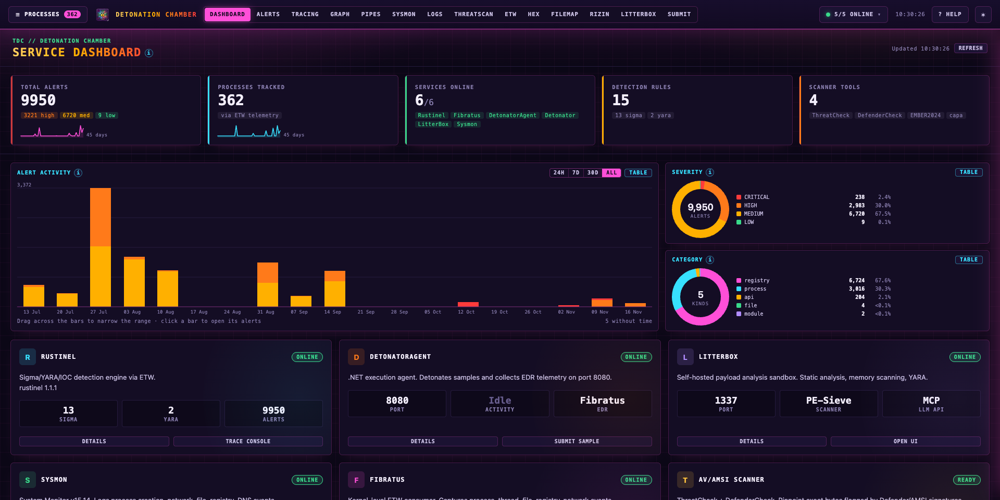
  <br><sub>Service Dashboard &mdash; detection metrics, alert activity by severity and category, and service health (Cyberpunk theme, the default; ✶ switches to Telemetry)</sub>
</p>

<p align="center">
  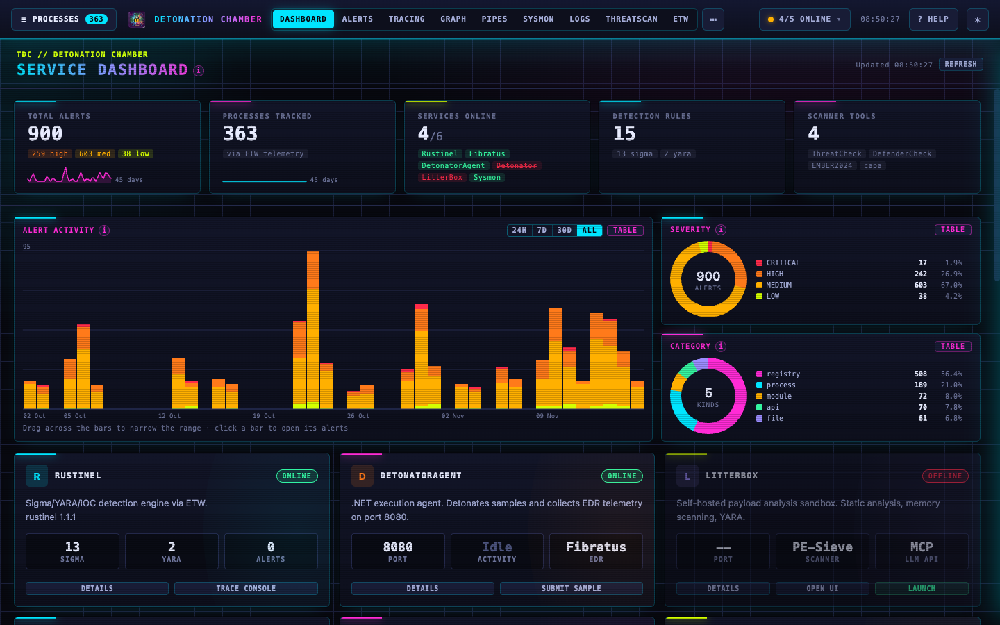
  <br><sub>The same dashboard in the Telemetry theme (cyan, magenta and acid green on near-black blue)</sub>
</p>

<p align="center">
  <a href="static/demo.gif"><strong>▶ Watch the demo</strong></a> &mdash; a walk through the Web UI
  <br><sub>Dashboard, Alerts with charts and drilldown, Tracing, Graph, Pipes, Sysmon, LOGS, ThreatScan, Hex and File map, Rizin, ETW, and a switch between the themes (10 MB GIF; the stills are in <a href="docs/web-ui.md">the Web UI page</a>)</sub>
</p>

---

## What it does

The tab a feature lives in is in [Web UI Tabs](#web-ui-tabs), the long version
in [the guide](docs/README.md).

**Detonation with a verdict** — one submission runs the sample, arms the
exit-time dump and scores every finding into a verdict, here the live-memory
evidence of a sample that exited before the live scan
([Workflow](docs/workflow.md)).

<p align="center">
  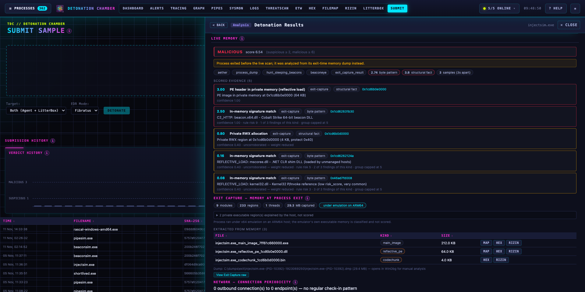
</p>

**Alerts with drilldown** — every detection of every engine in one table under
charts of the current filter, where a click on a slice, a bar or a band of the
engine → rule → process Sankey narrows both, and BACK walks the path back out
([Charts](docs/web-ui.md#charts)).

<p align="center">
  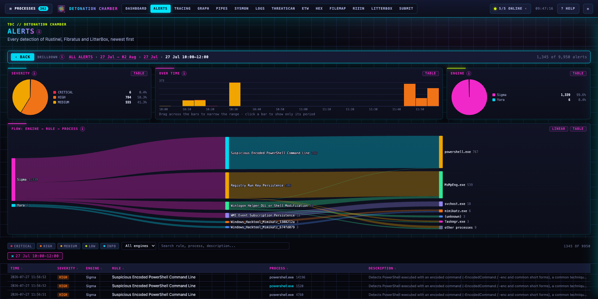
</p>

**Tracing** — a console per process with its verdict, a timeline split by event
type, the process tree with the alert count of every process in it, and the
table of rules that fired, each row with its raw event
([Tracing](docs/web-ui.md#tracing-console--alert-detail)).

<p align="center">
  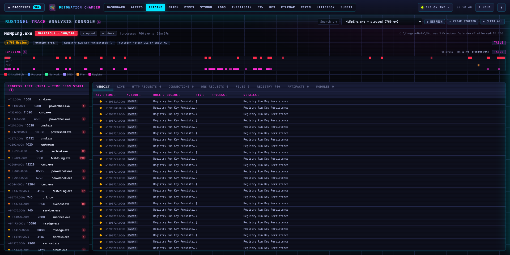
</p>

**Process graph** — the processes around one process as a tree, each node with
its activity counters, the Sysmon events it triggered, the Windows events those
correspond to, its children, and a signature check one click away
([Process graph](docs/web-ui.md#process-graph)).

<p align="center">
  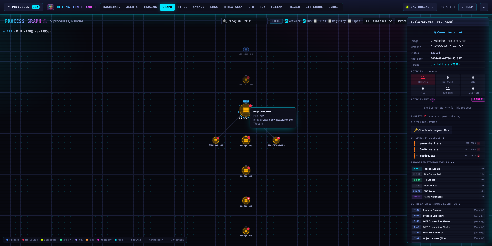
</p>

**Named pipes** — every pipe event Sysmon saw, with a column for the C2 family
a pipe name belongs to, and interception sessions that attach to a pipe or wait
for its name and then relay, hold, edit or drop every message
([Named pipes](docs/pipes.md)).

<p align="center">
  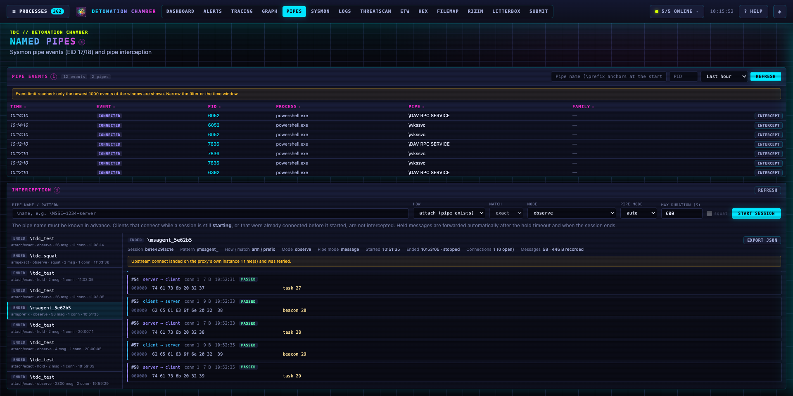
</p>

**Sysmon and ETW** — the Sysmon log with the Windows Event IDs each event
corresponds to, over charts that narrow the table to a time window, an image or
an event type, and twelve event-log channels with live threat highlighting in
the [ETW browser](docs/web-ui.md#etw-browser).

<p align="center">
  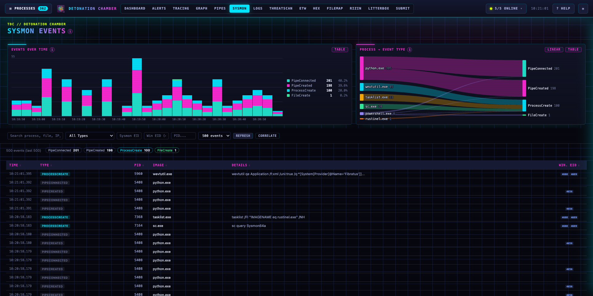
</p>

**Firewall** — every connection a sample makes, by process and on a world map
with the owning network and country, a switch that blocks one endpoint or a
whole program in the Windows Firewall, and one button that cuts the whole
network ([Firewall](docs/firewall.md)).

<p align="center">
  
</p>

**ThreatScan** — ThreatCheck, DefenderCheck, EMBER2024 and capa against a
file, Aether, a memory dump or a sweep of the whole system against a running
process, and a history that keeps every scan with its score
([Live memory](docs/memory.md)).

<p align="center">
  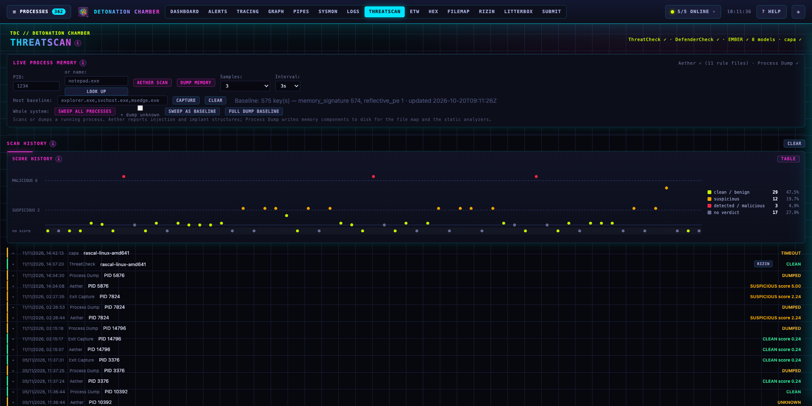
</p>

**Hex and file map** — a hex editor with a data inspector and a structure map
of the bytes, the entropy and the PE structure of the whole file, with PE
analysis, ELF analysis and rizin one button away
([Binary analysis](docs/web-ui.md#binary-analysis-pe--elf)).

<p align="center">
  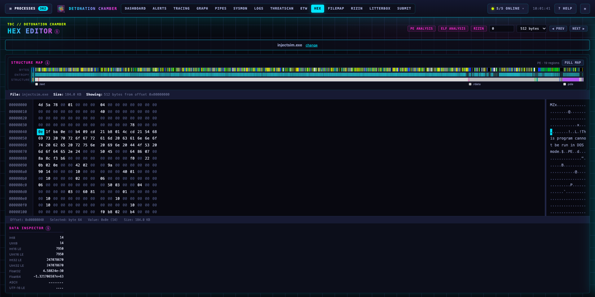
</p>

**Rizin** — rizin and rz-ghidra on the VM, driven from the browser: functions,
disassembly, decompiler and control-flow graph at one current address, a
console whose commands pass an allowlist on the server, and an emulator that
runs no process and never writes the original, with breakpoints, byte patches
and a patched copy for the Submit tab ([Rizin](docs/rizin.md)).

<p align="center">
  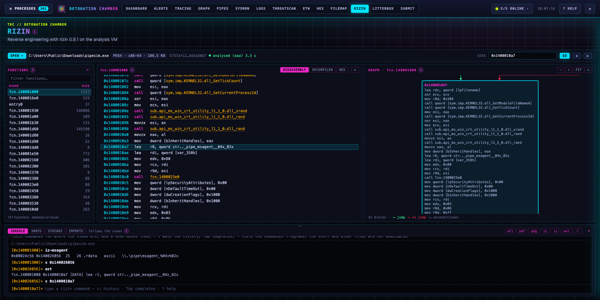
</p>

**Logs** — the PowerShell, access, MCP, NetFlow, DNS and firewall logs of the
VM under one Splunk-like query language, as events, as a table or as a chart
that SAVE keeps on a dashboard of your own ([Logs](docs/logs.md)).

<p align="center">
  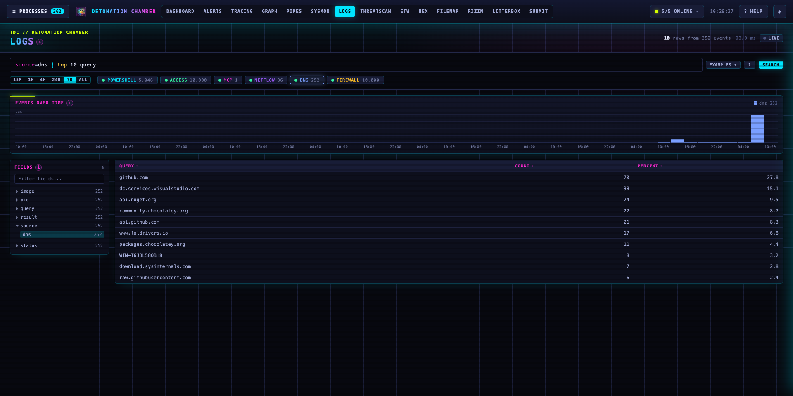
</p>

---

## Architecture

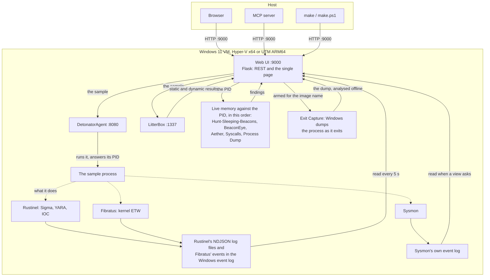

Everything but the browser, the MCP server and `make` runs inside the VM, and
the host reaches all of it through the Web UI on port 9000. The Web UI hands a
sample to DetonatorAgent, which runs it and answers its PID, and to LitterBox,
which analyses it; of the engines watching the process it reloads Rustinel's and
Fibratus' alerts every five seconds, while Sysmon's log is read whenever a view
asks for it. Against the PID it runs the live-memory tools itself, one after
another, and before the sample starts it arms Windows to dump the process as it
exits.

The chain of one detonation, stage by stage, is the diagram in
[Workflow](docs/workflow.md#data-flow); which rules the engines load and what
each of them can see is in [the guide's index](docs/README.md#detection-engines).

### Services

| Service | Port | Purpose | Technology |
|---------|------|---------|------------|
| **Web UI** | 9000 | Unified dashboard & API gateway | Python / Flask |
| **DetonatorAgent** | 8080 | Executes malware samples, returns PID | .NET 8.0 |
| **LitterBox** | 1337 | Static + dynamic analysis sandbox | Python / Flask |
| **Fibratus** | 8180 | Kernel ETW telemetry & behavior rules | Go |
| **Rustinel** | — | Sigma/YARA/IOC real-time detection | Rust |
| **Sysmon** | — | Windows event logging | Sysinternals |
| **Hunt-Sleeping-Beacons** | — | Sleeping C2 beacon callstack scanner | C++ / MSVC |
| **BeaconEye** | — | Cobalt Strike beacon config scanner | .NET |
| **Aether** | — | Live-process memory forensics scanner | Zig |
| **Process Dump** | — | Memory component dumper with clean-hash database | C++ |
| **theZoo-WebUI** | 8888 | Malware sample browser | PHP |
| **Detonator** | 5000/8000 | Orchestration UI + REST API | Python |

### Web UI Tabs

| Tab | Description |
|-----|-------------|
| **Dashboard** | Stats strip (alerts, processes, services, rules, tools; TOTAL ALERTS and PROCESSES TRACKED with 45-day sparklines), ALERT ACTIVITY with the SEVERITY and CATEGORY donuts of its range (see [Charts](docs/web-ui.md#charts)), service health cards, recent activity feed; each tile opens what it counts. Under the head a row of pages: SERVICES is all of that, beside it the dashboards of your own with the tiles saved in the LOGS tab (see [Own dashboards](docs/logs.md#own-dashboards)) |
| **Alerts** | Every alert in one table, newest first, under charts of the current filter (severity and engine pies, bars over time, an engine → rule → process Sankey), with severity (multi-select), engine and text filters, the time range, category, rule and process filters a chart click or a range drawn across the bars sets (each a chip with ×), a drilldown bar with BACK and the path of those steps (see [Charts](docs/web-ui.md#charts)) and an "n of m" count; a row opens the alert detail, the process name its process (only processes in the process list are links); the newest 2000 matches are listed |
| **Tracing** | Per-process console: verdict, timeline by event type, process tree, alerts with full raw events (Sigma match details) |
| **Graph** | Process tree around a process: tree, force-directed and isometric layouts, landing page with samples and candidate processes, detail panel with Sysmon events, ACTIVITY MIX and children |
| **Pipes** | Named pipes: Sysmon pipe events (EID 17/18) with name/PID filters and C2-family hits, and interception sessions (attach to an existing pipe or arm for a name/prefix/regex; observe or hold messages to forward, edit or drop them; JSON export) |
| **Sysmon** | Sysmon event viewer with search, type/PID filters and Sysmon → Windows Event ID correlation; EVENTS OVER TIME and a process → event type Sankey narrow the table by time window, image or event type |
| **FIREWALL** | The chamber's connections (see [Firewall](docs/firewall.md)): a process tree with each process's endpoints, tags and activity (TDC's own processes and local addresses in groups of their own), MAP (arcs from the chamber to every public destination), LIST, ASN and DECISIONS (who decided what about a download, and when, over 24 h); ALLOW / DENY switches that write program-scoped `TDC-FW-*` rules (`?` while the rules are unknown), KILL for a selected process, TURN THE FIREWALL ON in the band that says it is off, `in LOGS ▸` for the selection, the ASK switch, CUT THE NETWORK, the panic button under the summary, and the ISOLATED switch in the head, one state (a press cuts without a confirmation, 8.8 s measured on a quiet VM, leaving asks first; `scripts/tdc-unisolate.ps1` as the way back), the decision toast on every tab (CUT + FETCH, CUT ONLY, ALLOW, with a countdown to the server's default; what TDC decided unattended stays until closed), a summary of connections, blocks, open decisions and secured samples (no byte figures: Sysmon has none), ready LOGS queries for the selection, and the secured samples with RIZIN, HEX and THREATSCAN |
| **LOGS** | Search the PowerShell, access, MCP, NetFlow, DNS and firewall logs with a Splunk-like query (see [Logs](docs/logs.md)): source chips with their counts, EVENTS OVER TIME stacked by source (drag across the bars to zoom), a field bar with the top values, a COMMANDS card with the whole search language, a list of events that unfold to their fields and raw text, or a sortable table after `stats`, `top` and the like, or one chart of it (pie, bars, line, Sankey) that SAVE puts on a dashboard of your own; time range buttons, example and last searches, LIVE |
| **ThreatScan** | ThreatCheck, DefenderCheck, EMBER2024 and capa on a file, plus the **Live Process Memory** panel (Aether scan, memory dump, host baseline, system sweep) and the scan history with its SCORE HISTORY |
| **ETW** | Multi-channel Event Log browser with live threat highlighting (see [ETW Browser](docs/web-ui.md#etw-browser)) |
| **Hex** | Hex editor with data inspector, structure minimap, PE/ELF analysis and section inspection |
| **FileMap** | Byteplot / entropy / PE-ELF structure planes side by side, import/export trees, click-to-offset |
| **Rizin** | Reverse engineering with rizin and rz-ghidra on the VM, one session per browser tab (see [Rizin](docs/rizin.md)): OPEN a submitted sample, a dump, an upload or a VM path; FUNCTIONS, DISASSEMBLY, DECOMPILER and HEX beside the control flow GRAPH (tabs below 1400 px), all at one current address that a click, SEEK + GO, ◀ ▶ or a seek in the console moves; below, a CONSOLE for rizin commands (an allowlist on the server: no programs, no writing to the file, no real debugging), XREFS, STRINGS, IMPORTS and an EMULATION pane; **EMULATE** runs the code in rizin's ESIL emulator (no process, the file untouched) with a run strip, breakpoints in the gutter, an API-call assistant, byte patches from the right-click menu, re-analysis of what a run decrypted, and an export of the patched copy that can be handed to Submit; a right-click also renames a function or comments an address, kept in a project with the patches and breakpoints; `aaa` up to 20 MB, `aa` and a Full analysis button above; Rizin buttons in the Submit history, Process Dump, Exit Capture, ThreatScan (result and history) and the Hex tab open a file here |
| **SYSCALLS** | The map of every syscall of `ntdll.dll` and `win32u.dll` (why it exists and how to read it: [Syscall integrity](docs/memory.md#syscall-integrity); the routes are under [Syscalls](docs/api.md#syscalls)): one cell each in the order of its number, a band per module, from the NTSleuth baseline of this build and view; without a scan the baseline in one quiet tone, after SCAN of a chosen process each cell takes the state its stub was measured in (intact, hooked, patched, diverged, unreadable), counted in the legend, a single deviation standing out by its colour and a ring; a filter by name, number and module that dims what does not match, hover and click on a cell, the catalog under the map, notices for NTSleuth missing, no baseline and an x64 view that cannot be told from arm64; MAP / GRAPH, where GRAPH draws the import graph of `C:\Windows\System32` (3,999 binaries on the build this was measured on; read from the VM's own files and cached, offline) instead of the map: a layered path from an import down to a syscall number, an exploration node by node, and a table of figures over the whole stock. Every edge is derived from a binary except the curated ones, drawn dashed and marked `curated`: the last hop from a Win32 function to its Nt counterpart (from a hand-curated table; at most one per path) and the step from a `Zw` name of `ntdll` to its `Nt` name (a naming convention), in a path and in the syscall callers alike; a path that ends in an `Nt` name `ntdll` or `win32u` exports is derived throughout. More in [The binary graph](docs/memory.md#the-binary-graph) |
| **LitterBox** | Files in the LitterBox sandbox with their static/dynamic/EDR results |
| **Submit** | Detonation with stage-by-stage progress and combined verdict (EDR alerts, live memory, exit capture, network beaconing, LitterBox) with its VERDICT FLOW; the submission history with VERDICT HISTORY |

Every process in the UI is a process *instance*: Windows reuses PIDs, so the
newest process with a PID is addressed by the plain PID and earlier ones as
`<pid>@<start epoch>`. Alerts, events and children belong to the instance
that was running at the time.

---

## Quick Start

### Option A: Local UI Only (no VM)

The Web UI on its own, for development: every tab renders, the backend services
are absent.

```bash
make install        # venv with Flask and the rest
make run            # http://localhost:9000
```

```powershell
.\make.ps1 install  # Windows
.\make.ps1 run
```

### Option B: Full VM (recommended for analysis)

```bash
./scripts/setup-macos-utm.sh   # macOS on Apple Silicon: tools, VM, provisioning
make up                        # or: Vagrant hosts, from a pre-built box
make open                      # http://<vm-ip>:9000
```

```powershell
.\make.ps1 up                  # Windows with Hyper-V, as Administrator
.\make.ps1 open
```

> First boot takes ~20-30 minutes (Windows) or ~30-45 minutes (macOS ARM).

What the host needs first is in [Setup](docs/setup.md); the long way round —
provisioning, the manual install, every `make` target and deploying to a running
VM — is in [Installation](docs/installation.md).

---

## Platform support

Two hosts carry the VM: **Windows 10/11 on x86_64** with Hyper-V
(`Vagrantfile`), and **macOS on Apple Silicon**, where the guest is Windows 11
ARM64 — with UTM and the guided `scripts/setup-macos-utm.sh`, or over the
experimental headless Vagrant/QEMU path ([Setup](docs/setup.md)).

On ARM64 the OS, the execution agent and the runtimes are native; Fibratus,
Rustinel and the memory scanners have no ARM64 build and run under Windows'
x86_64 emulation — which is what the x64 samples do too. What that changes per
component is in [Setup](docs/setup.md#arm64-compatibility), what it costs in a
memory verdict in [Live memory](docs/memory.md#arm64-hosts).

---

## Documentation

The guide lives in [`docs/`](docs/README.md): one page per topic, and two reading
paths through them - set it up, or work with it.

The same pages are on the web: [the documentation website](https://benjitrapp.github.io/transportable-detonation-chamber/)
is built from `main` on every push - one address per page, and a search.

| Page | What it answers |
|---|---|
| [Setup](docs/setup.md) | What do I need before the VM, and what does ARM64 change? |
| [Installation](docs/installation.md) | How do I build, provision and deploy to the VM? |
| [Configuration](docs/configuration.md) | Which settings exist, how do I add my own rules, and how is the box kept safe? |
| [Workflow](docs/workflow.md) | How do I detonate a sample and analyse a binary? |
| [Live memory](docs/memory.md) | What does the chamber see in a running process? |
| [Named pipes](docs/pipes.md) | How do I watch and intercept named pipes? |
| [Rizin](docs/rizin.md) | How do I take a sample apart in the browser? |
| [Logs](docs/logs.md) | How do I search the logs of the VM, and save a search? |
| [Firewall](docs/firewall.md) | Whom does the sample talk to, and how do I cut it off? |
| [Tool updates](docs/updates.md) | How do the tools on the VM stay current? |
| [Web UI](docs/web-ui.md) | What do the themes, the charts and every tab look like? |
| [API](docs/api.md) | Which routes and MCP tools can I call? |
| [Development](docs/development.md) | How do I run the tests and change the code? |
| [Troubleshooting](docs/troubleshooting.md) | Nothing works - where do I look? |

Offline, with navigation and search: `make docs` (or `.\make.ps1 docs`) builds the
whole guide into `webui/static/wiki.html` - one file with every page, the
screenshots embedded and the diagrams drawn, and it opens without a network. The
Web UI's help links it and says when it was built; on the VM, which has no
internet at all, it is the documentation.

<p align="center">
  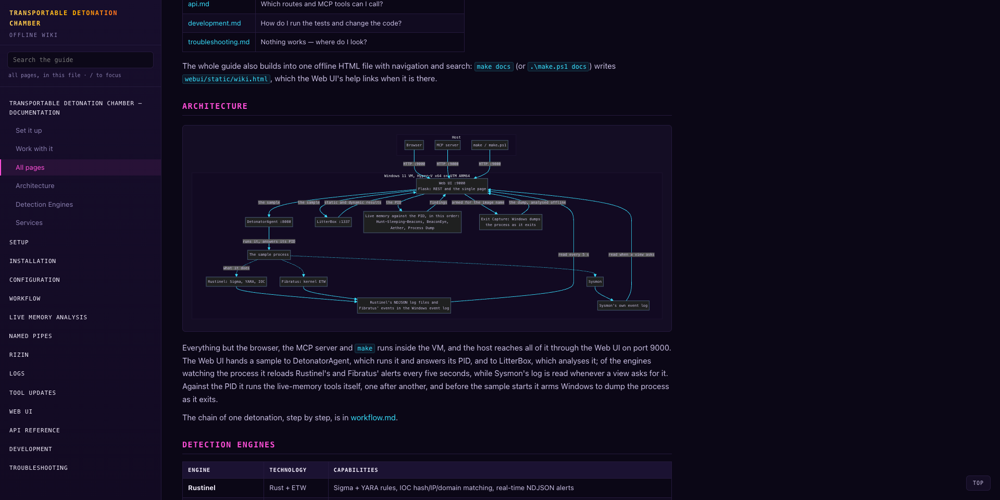
</p>

---

## Security Notes

> **This VM is designed for malware analysis — treat it as compromised.**

Snapshot before each detonation, keep the box on an isolated network, and know
that the Web UI has no login: `/api/submit` executes files by design. The whole
list — the snapshots, the Defender exclusions, Rustinel's active response, and
how the Web UI itself refuses cross-site requests, foreign `Host` headers and
writes outside the detonation paths — is in
[Security Notes](docs/configuration.md#security-notes).

---

## Credits

| Project | Role |
|---------|------|
| [dobin/detonator](https://github.com/dobin/detonator) | Orchestration framework |
| [dobin/DetonatorAgent](https://github.com/dobin/DetonatorAgent) | Execution agent |
| [rabbitstack/fibratus](https://github.com/rabbitstack/fibratus) | ETW detection engine |
| [Karib0u/rustinel](https://github.com/Karib0u/rustinel) | Sigma/YARA EDR agent |
| [BlackSnufkin/LitterBox](https://github.com/BlackSnufkin/LitterBox) | Payload analysis sandbox |
| [FutureComputing4AI/EMBER2024](https://github.com/FutureComputing4AI/EMBER2024) | ML malware classifier (thrember / LightGBM) |
| [mandiant/capa](https://github.com/mandiant/capa) | Static capability detection (ATT&CK / MBC) |
| [thefLink/Hunt-Sleeping-Beacons](https://github.com/thefLink/Hunt-Sleeping-Beacons) | Sleeping beacon callstack scanner |
| [0xsp-SRD/aether](https://github.com/0xsp-SRD/aether) | Live-process memory forensics (GPL-3.0; invoked as a separate binary) |
| [glmcdona/Process-Dump](https://github.com/glmcdona/Process-Dump) | Memory component dumper (MIT) |
| [xaitax/NTSleuth](https://github.com/xaitax/NTSleuth) | Extracts the syscall baseline of the SYSCALLS tab from `ntdll.dll` and `win32u.dll` (BSD-3-Clause; downloaded by `scripts/install-ntsleuth.ps1`, run as a separate binary) |
| [WinGraph](https://wingraph.m0n1x90.dev/) | Dependency graph of the System32 binaries by m0n1x90, linked from the SYSCALLS detail panel; only a link: the chamber never queries it and fetches nothing from it, takes no code or data from it, and the site states no licence |
| [ytisf/theZoo](https://github.com/ytisf/theZoo) | Malware sample repository |
| [kawaiipantsu/theZoo-WebUI](https://github.com/kawaiipantsu/theZoo-WebUI) | theZoo web frontend |
| [horsicq/DIE-engine](https://github.com/horsicq/DIE-engine) | Detect It Easy |
| [NationalSecurityAgency/ghidra](https://github.com/NationalSecurityAgency/ghidra) | Ghidra RE framework |
| [rizinorg/rizin](https://github.com/rizinorg/rizin) | Reverse engineering framework of the RIZIN tab (LGPL-3.0; run as a separate process) |
| [rizinorg/rz-ghidra](https://github.com/rizinorg/rz-ghidra) | Ghidra's decompiler as a rizin plugin (DECOMPILER) |
| [rizinorg/cutter](https://github.com/rizinorg/cutter) | Its Windows package supplies rizin and rz-ghidra |
| [Microsoft WinDbg](https://learn.microsoft.com/en-us/windows-hardware/drivers/debugger/) | Windows debugger |
| [mermaid-js/mermaid](https://github.com/mermaid-js/mermaid) | Draws the diagrams of the offline wiki (MIT; version 10.9.3 vendored as `scripts/wiki/mermaid.min.js` with its licence, so `make docs` needs no network) |

---

## License

This repository is [MIT licensed](LICENSE). Every tool the chamber installs or
calls keeps the licence of its own project; the ones whose terms reach the way
they are used are named in [Credits](#credits) — Aether (GPL-3.0) and rizin
(LGPL-3.0) run as separate processes, Process Dump is MIT, NTSleuth
BSD-3-Clause, and the vendored Mermaid copy is MIT with its licence beside it.

---

<p align="center">
  <sub>Built for security research and EDR testing. Use responsibly.</sub>
</p>
