<p align="center">
  
</p>

<h1 align="center">Transportable Detonation Chamber</h1>

<p align="center">
  <strong>A pre-configured Windows 11 VM for malware detonation testing against multiple EDR solutions.</strong>
</p>

<p align="center">
  <a href="#quick-start"></a>
  <a href="#features"></a>
  <a href="#demo"></a>
  <a href="#api-reference"></a>
</p>

<p align="center">
  
  
  
  
  
  
  
</p>

---

<p align="center">
  <em>Unified dark-themed Web UI &bull; Real-time Sigma/YARA/IOC detection &bull; Kernel ETW telemetry &bull; PE/ELF binary analysis</em>
</p>

<p align="center">
  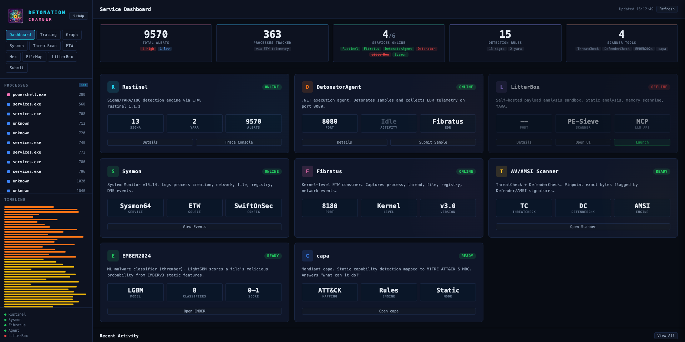
  <br><sub>Service Dashboard &mdash; real-time health monitoring, alert feed, and detection metrics</sub>
</p>

---

## Table of Contents

- [Quick Start](#quick-start)
- [Features](#features)
- [Architecture](#architecture)
- [Platform Support](#platform-support)
- [Prerequisites](#prerequisites)
- [Installation](#installation)
- [Usage](#usage)
- [Live Memory Analysis](#live-memory-analysis)
- [Demo](#demo)
- [API Reference](#api-reference)
- [MCP Server](#mcp-server)
- [Configuration](#configuration)
- [Detection Rules](#detection-rules)
- [File Structure](#file-structure)
- [Troubleshooting](#troubleshooting)
- [Security Notes](#security-notes)
- [Credits](#credits)

---

## Quick Start

### Option A: Local UI Only (no VM)

Run the Web UI locally for development or UI testing. Backend services won't be available, but all tabs and features render normally.

```bash
# macOS / Linux
make install    # Creates venv, installs Flask + deps
make run        # Starts on http://localhost:9000

# Windows (PowerShell)
.\make.ps1 install
.\make.ps1 run
```

### Option B: Full VM (recommended for analysis)

```bash
# macOS Apple Silicon (M1-M4) — UTM-based setup (recommended)
./scripts/setup-macos-utm.sh    # Guided: installs tools, creates VM, provisions

# macOS / Linux — Vagrant-based (requires pre-built box)
make up         # Provisions the full Windows 11 VM
make open       # Opens http://<vm-ip>:9000 in browser

# Windows (PowerShell, run as Administrator)
.\make.ps1 up
.\make.ps1 open
```

> First boot takes ~20-30 minutes (Windows) or ~30-45 minutes (macOS ARM).

---

## Features

### Detection Engines

| Engine | Technology | Capabilities |
|--------|-----------|--------------|
| **Rustinel** | Rust + ETW | Sigma + YARA rules, IOC hash/IP/domain matching, real-time NDJSON alerts |
| **Fibratus** | Go + Kernel ETW | Process/file/registry/network telemetry, behavior rules |
| **Sysmon** | Sysinternals | Event logging (process creation, network, file, registry, image loads) |
| **LitterBox** | Python | Static (YARA, strings) + Dynamic (PE-Sieve, Moneta, HollowsHunter, RedEdr) |
| **Aether** | Zig | Live-process memory forensics: thread start-address validation, heap API tables, disk-vs-memory diff, 380 in-memory signatures |
| **Process Dump** | C++ | Dumps unpacked modules, hidden modules and header-less code from memory, skipping a clean-hash baseline |
| **Exit Capture** | Windows (built-in) | Full-memory dump at the moment a sample exits, analyzed offline — covers samples too short-lived for live scanners |
| **Hunt-Sleeping-Beacons** | C++ | Thread call stacks of sleeping implants (unbacked memory, sleep masks, stack spoofing) |
| **BeaconEye** | .NET | Cobalt Strike beacon configurations in process heaps |

### Web UI Tabs

| Tab | Description |
|-----|-------------|
| **Dashboard** | Stats strip (alerts, processes, services, rules, tools), service health cards, recent activity feed |
| **Tracing** | Per-process console: verdict, timeline by event type, process tree, alerts with full raw events (Sigma match details) |
| **Graph** | Process tree around a process: tree, force-directed and isometric layouts, landing page with samples and candidate processes, detail panel with Sysmon events and children |
| **Sysmon** | Sysmon event viewer with search, type/PID filters and Sysmon → Windows Event ID correlation |
| **ThreatScan** | ThreatCheck, DefenderCheck, EMBER2024 and capa on a file, plus the **Live Process Memory** panel (Aether scan, memory dump, host baseline, system sweep) and the scan history |
| **ETW** | Multi-channel Event Log browser with live threat highlighting (see below) |
| **Hex** | Hex editor with data inspector, structure minimap, PE/ELF analysis and section inspection |
| **FileMap** | Byteplot / entropy / PE-ELF structure planes side by side, import/export trees, click-to-offset |
| **LitterBox** | Files in the LitterBox sandbox with their static/dynamic/EDR results |
| **Submit** | Detonation with stage-by-stage progress and combined verdict (EDR alerts, live memory, exit capture, network beaconing, LitterBox) |

Every process in the UI is a process *instance*: Windows reuses PIDs, so the
newest process with a PID is addressed by the plain PID and earlier ones as
`<pid>@<start epoch>`. Alerts, events and children belong to the instance
that was running at the time.

### ETW Browser

The ETW tab provides a multi-channel Windows Event Log viewer with automatic threat classification:

| Feature | Details |
|---------|---------|
| **12 Channels** | Sysmon, Security, PowerShell, Defender, WMI, Task Scheduler, BITS, DNS, Firewall, AppLocker, WinRM, Application |
| **Availability Probe** | Channels show ● ACTIVE / ○ NO DATA status on load |
| **Auto-Refresh** | Polls every 5s (toggleable), keyword filter across all fields |
| **Threat Highlighting** | Malicious events highlighted red with threat classification badge |
| **Expandable Details** | Click any event to inspect all data fields; suspicious values marked red |

Threat detection rules cover:

- **Encoded/obfuscated PowerShell** (base64, IEX, downloadstring, bypass, hidden)
- **LOLBin abuse** (certutil, mshta, regsvr32, rundll32, bitsadmin, wmic)
- **Credential access** (LSASS access, mimikatz, sekurlsa, procdump)
- **Persistence** (registry Run keys, scheduled tasks, services, WMI subscriptions)
- **Defense evasion** (AMSI bypass, ETW patching, process tampering)
- **Lateral movement** (explicit credential logon, WinRM, net use)
- **C2 indicators** (suspicious ports, .onion/.tk domains, DNS tunneling)
- **Sysmon IOCs** (CreateRemoteThread, DLL sideloading, ADS creation, process tampering)

### Binary Analysis (PE / ELF)

| Capability | Details |
|-----------|---------|
| **PE Header Analysis** | DOS/COFF/Optional headers, ASLR/DEP/SEH/CFG detection |
| **DiE-Style Detection** | Compiler, packer, protector, linker identification with assessment |
| **Entropy Heatmap** | 64-block Shannon entropy visualization (red >= 7.0 = packed) |
| **Section Layout** | Visual section diagram with RWX permission flagging |
| **ELF Security Audit** | PIE, NX stack, RELRO, stack canary, Fortify, stripped detection |
| **Suspicious Imports** | Categorized: injection, evasion, credential access, networking, crypto |
| **IOC Flags (clickable)** | Expandable detail panels showing matched APIs, detection rules, and explanations |
| **Packer Detection** | UPX, Themida, VMProtect, ASPack, MPRESS via section + heuristic matching |
| **TLS Callbacks** | Anti-debug indicator detection |
| **File Map** | Per-byte class plot, local entropy and structure regions (headers, sections, data directories, overlay, entry point) mapped onto file offsets |
| **Import / Export Trees** | DLL → function trees with suspicious APIs tagged; ELF `DT_NEEDED` + dynamic symbols |

### Reverse Engineering Tools

| Tool | Purpose |
|------|---------|
| **Detect It Easy (DiE)** | PE/ELF/Mach-O identification — packers, compilers, protectors |
| **WinDbg (Preview)** | Kernel/user-mode debugger — crash dumps, live debugging, TTD |
| **Ghidra** | NSA RE framework — disassembly, decompilation, scripting |

### Tests

```bash
make unit-test        # or: .\make.ps1 unit-test   (no VM needed)
```

`tests/` covers the failure classes fixed so far, so they cannot come back
unnoticed: process instances and PID reuse, attribution of alerts and
processes to a detonation, timestamp handling, persisted memory results,
scanner output parsing, the evidence model and baseline, CSRF / DNS-rebinding
/ write restrictions, proxied content types, XSS (unescaped event fields and
unsafe inline handlers in `app.js`), MCP tool output, and README/help drift
against the routes and tools. GitHub Actions runs the suite on every push
(`.github/workflows/tests.yml`). `make test` is different: it submits a test
sample to the running VM.

### Developer Experience

- **`make deploy-restart`**: Edit locally, push to VM, restart Flask in one command
- **`make run-debug`**: Flask auto-reload on file changes
- **Toast Notifications**: Throttled error/warning/info toasts with 15s dedup
- **Help Modal**: Built-in documentation ("? Help" next to the logo)
- **Submissions History**: Persisted to JSON with quick hex inspection

---

## Architecture

```
┌──────────────────────────────────────────────────────────────────┐
│ Windows 11 VM (Hyper-V x64 / UTM ARM64)                          │
│                                                                  │
│  ┌─────────────┐ submit ┌────────────────┐  ┌──────────────┐     │
│  │ Web UI      │───────▶│ DetonatorAgent │  │ LitterBox    │     │
│  │ :9000       │───────────────────────────▶│ :1337        │     │
│  │ REST + SPA  │        └───────┬────────┘  └──────────────┘     │
│  └──┬───────▲──┘                │ runs the sample                │
│     │       │                   ▼                                │
│     │       │ alerts   ┌──────────────┐ ┌──────────┐ ┌────────┐  │
│     │       └──────────│ Rustinel     │ │ Fibratus │ │ Sysmon │  │
│     │                  │ Sigma/YARA   │ │ ETW      │ │ EvtLog │  │
│     │                  └──────────────┘ └──────────┘ └────────┘  │
│     │ live memory  ┌───────────┐ ┌──────────────┐ ┌───────────┐  │
│     └─────────────▶│ Aether    │ │ Process Dump │ │ Exit      │  │
│                    │ HSB       │ │ (pd64)       │ │ Capture   │  │
│                    │ BeaconEye │ └──────────────┘ └───────────┘  │
│                    └───────────┘                                 │
└──────────────────────────────▲───────────────────────────────────┘
                               │ HTTP :9000
               Host: browser · MCP server · make / make.ps1
```

### Data Flow

1. A sample is submitted (Web UI, `make submit`, MCP `tdc_submit_file`) and
   forwarded to DetonatorAgent and/or LitterBox. Exit capture is armed for
   its image name first.
2. DetonatorAgent executes the sample and returns its PID.
3. Rustinel (Sigma, YARA, IOC), Fibratus and Sysmon record what it does.
4. The live-memory scanners run against the PID in the background:
   Hunt-Sleeping-Beacons, BeaconEye, Aether (3 samples), then Process Dump.
   If the process exits, Windows writes a full dump that is analyzed offline.
5. Sysmon network events are checked for periodic connections (beaconing).
6. Every memory finding goes through one evidence model (persistence,
   corroboration, host baseline); together with the EDR alerts and LitterBox
   it yields the combined verdict at `/api/detonation/results`.
7. Results are stored in `webui/memory_results/` and survive restarts.

### Services

| Service | Port | Purpose | Technology |
|---------|------|---------|------------|
| **Web UI** | 9000 | Unified dashboard & API gateway | Python / Flask |
| **DetonatorAgent** | 8080 | Executes malware samples, returns PID | .NET 8.0 |
| **LitterBox** | 1337 | Static + dynamic analysis sandbox | Python / Flask |
| **Fibratus** | 8180 | Kernel ETW telemetry & behavior rules | Go |
| **Rustinel** | — | Sigma/YARA/IOC real-time detection | Rust |
| **Sysmon** | — | Windows event logging | Sysinternals |
| **Hunt-Sleeping-Beacons** | — | Sleeping C2 beacon callstack scanner | C++ / MSVC |
| **BeaconEye** | — | Cobalt Strike beacon config scanner | .NET |
| **Aether** | — | Live-process memory forensics scanner | Zig |
| **Process Dump** | — | Memory component dumper with clean-hash database | C++ |
| **theZoo-WebUI** | 8888 | Malware sample browser | PHP |
| **Detonator** | 5000/8000 | Orchestration UI + REST API | Python |

---

## Platform Support

| Host OS | Hypervisor | Guest Arch | Vagrantfile | Performance |
|---------|-----------|------------|-------------|-------------|
| Windows 10/11 (x86_64) | Hyper-V | x86_64 | `Vagrantfile` | Native |
| macOS Apple Silicon (M1-M4) | QEMU via vagrant-qemu | ARM64 | `Vagrantfile.utm` | Near-native via hvf |

### ARM64 Compatibility

| Component | ARM64 Support | Notes |
|-----------|--------------|-------|
| Sysmon | Native | `Sysmon64a.exe` (ARM64 binary) |
| Fibratus | Emulated (x86_64) | No ARM64 build; ~10-20% overhead |
| Rustinel | Emulated (x86_64) | No ARM64 build; ETW works under emulation |
| .NET 8 / Python 3.12 | Native | Full ARM64 SDK and runtime |
| DetonatorAgent | Native | Compiled from source via .NET 8 |
| Detonator / LitterBox | Native | Python-based |
| Aether | Emulated (x86_64) | Deliberately x64: its thread-context probe uses the AMD64 `CONTEXT` layout, so a native ARM64 build would misread it |
| Process Dump | Emulated (x86_64) | `-closemon` is **not used**: it writes x64 hook bytes into every process and cannot tell ARM64 processes apart (Exit Capture replaces it) |
| Exit Capture | Native | OS feature (Silent Process Exit); emulator translation cache is recognized and not scored |
| Hunt-Sleeping-Beacons / BeaconEye | Emulated (x86_64) | x64 builds; reliable for x64 (emulated) targets, results for native ARM64 processes are marked as limited |

---

## Prerequisites

### Windows Host

- Windows 10/11 with **Hyper-V** enabled
- **Vagrant** >= 2.4 ([download](https://www.vagrantup.com/downloads))
- **Administrator** PowerShell (required for Hyper-V)
- ~30 GB disk, ~8 GB RAM

```powershell
# Enable Hyper-V (reboot required)
Enable-WindowsOptionalFeature -Online -FeatureName Microsoft-Hyper-V -All
```

### macOS Host (Apple Silicon)

- macOS on Apple Silicon (M1/M2/M3/M4)
- **UTM** (recommended): `brew install --cask utm` or [mac.getutm.app](https://mac.getutm.app)
- **QEMU tools**: `brew install qemu` (for `qemu-img`)
- **Python 3** with `pywinrm`: `pip3 install pywinrm requests-ntlm`
- **Windows 11 ARM64 ISO** from [Microsoft](https://www.microsoft.com/software-download/windows11arm64)
- ~80 GB disk, ~8 GB RAM

#### Recommended Setup (UTM + automated provisioning)

The fastest path on Apple Silicon uses UTM as the hypervisor with automated
provisioning via WinRM. A single script handles everything after the initial
Windows installation:

```bash
# Full guided setup (installs prerequisites, guides VM creation, provisions)
./scripts/setup-macos-utm.sh

# Or step by step:
./scripts/setup-macos-utm.sh --skip-prerequisites   # if tools already installed
./scripts/setup-macos-utm.sh --provision-only --vm-ip 192.168.64.4  # re-provision existing VM
```

**Manual steps** (the script guides you through these):

1. Install UTM and create a Windows 11 ARM64 VM (8 GB RAM, 4 cores, 80 GB disk)
2. Install Windows normally with a local admin account (`vagrant`/`vagrant` recommended)
3. Run `scripts/prepare-vagrant-winrm.ps1` inside the VM (enables WinRM remote management)
4. Run `./scripts/setup-macos-utm.sh --provision-only --vm-ip <vm-ip>`

The provisioning installs all detection engines, analysis tools, and the unified
Web UI (~20-40 minutes on first run).

#### Alternative: Vagrant/QEMU (headless, experimental)

For a fully headless Vagrant-managed workflow, see [Vagrantfile.utm](Vagrantfile.utm).
This path requires building a custom `win11-arm` Vagrant box from the ISO:

```bash
make prerequisites-fix          # Install QEMU, Vagrant, vagrant-qemu plugin
./scripts/build-box-macos.sh --iso ~/Downloads/Win11_ARM64.iso
make build                      # Provision the VM
```

> **Note:** Headless QEMU boot of Windows 11 ARM64 ISOs can be unreliable on
> some QEMU/firmware combinations. The UTM path above is recommended.

### Local Development Only

- **Python 3.10+** (any platform)
- **Make** (macOS: Xcode CLI tools; Windows: not needed, use `make.ps1`)

---

## Installation

### Using make / make.ps1

The project includes a cross-platform build system:

| Command | Description |
|---------|-------------|
| `install` | Create Python venv + install Flask, requests, watchdog, pefile |
| `run` | Start Web UI locally on port 9000 |
| `run-debug` | Start with Flask auto-reload (watches file changes) |
| `up` | Provision and start the full VM |
| `halt` | Stop the VM gracefully |
| `destroy` | Delete the VM |
| `deploy` | Sync webui files (HTML/CSS/JS) to running VM |
| `deploy-app` | Sync Flask backend (app.py) to VM |
| `restart` | Restart the Web UI service on VM |
| `deploy-restart` | Deploy + restart in one step |
| `open` | Open Web UI in default browser |
| `status` | Show VM + service health |
| `services` | List all service states |
| `alerts` | Show recent detection alerts |
| `test` | Submit test sample to verify pipeline |
| `submit FILE=x` | Submit a file for detonation |
| `logs` | Tail Web UI logs from VM |
| `ssh` / `rdp` | Connect to VM |
| `clean` | Destroy VM + remove .vagrant |
| `clean-all` | Also remove cached Vagrant boxes |
| `uninstall` | Remove local Python venv |

**macOS / Linux:**
```bash
make install        # Local venv setup
make run            # Local server
make up             # Full VM
make deploy-restart # Push changes to VM
```

**Windows (PowerShell):**
```powershell
.\make.ps1 install
.\make.ps1 run
.\make.ps1 up              # Run as Administrator
.\make.ps1 deploy-restart
```

### Manual Installation

```bash
cd webui
python3 -m venv .venv
source .venv/bin/activate   # Windows: .venv\Scripts\activate
pip install -r requirements.txt
python app.py               # http://localhost:9000
```

---

## Usage

### Detonation Workflow

1. Open the Web UI at `http://<vm-ip>:9000` (`make open`)
2. Go to the **Submit** tab and drop (or browse) a sample
3. Select the target: **Agent** (execution), **LitterBox** (analysis) or **Both**
4. Click **Detonate** and watch the stages: agent execution, LitterBox, EDR
   alerts, exit capture, live memory. Live-memory results arrive 1-2 minutes
   after the start; the verdict updates while they come in
5. **Tracing** shows the sample's events and alerts; **Graph** its process tree
   (the landing page links each executed sample to its tree)
6. Earlier detonations: **Submit → Submissions → View results**, or MCP
   `tdc_detonation_results`

### CLI Submission

```bash
# macOS / Linux
make submit FILE=./samples/mimikatz.exe TARGET=both

# Windows
.\make.ps1 submit -File .\samples\mimikatz.exe -Target2 both
```

### Scanner Workflow

1. Go to the **ThreatScan** tab
2. Drop a file or enter a path inside the VM
3. Tick the tools: ThreatCheck (Defender/AMSI engine), DefenderCheck,
   EMBER2024 (model + threshold), capa
4. Click **Scan** — each tool reports in its own card; ThreatCheck shows the
   offset of the flagged bytes with a link into the hex editor
5. Every scan is kept in the **Scan History** below and on the graph landing page

### PE Analysis

1. Go to the **Hex** tab
2. Upload a PE file or enter a VM path (samples are in `C:\Users\Public\Downloads\`)
3. Click **PE Analysis**; **Inspect** on a section shows its hex dump and strings
4. Review: headers, security features (ASLR/DEP/SEH/CFG), section entropy, suspicious imports, packer indicators, DiE-style detection overview

### ELF Analysis

1. Go to the **Hex** tab
2. Upload an ELF binary (Linux/BSD executables, shared objects)
3. Click **ELF Analysis** button
4. Review: ELF header, security audit (PIE/NX/RELRO/canary/Fortify), sections, segments, dynamic libraries, suspicious symbol imports

### Hunt-Sleeping-Beacons

Scan running processes for sleeping C2 beacons (RDP or SSH into VM):

```powershell
# Scan all processes
Hunt-Sleeping-Beacons.exe

# Scan a specific PID (e.g., after detonation)
Hunt-Sleeping-Beacons.exe -p 1234

# Include .NET processes (more false positives)
Hunt-Sleeping-Beacons.exe --dotnet

# Show command lines for suspicious processes
Hunt-Sleeping-Beacons.exe --commandline

# Shortcut alias
hsb --commandline
```

Detections include: unbacked memory in callstacks, non-executable memory pages, module stomping (SharedOriginal check), suspicious APC dispatchers, timer-based sleepmask callbacks, abnormal intermodular calls (module proxying), and return address spoofing (jmp gadget patterns).

Hunt-Sleeping-Beacons and BeaconEye are x64 builds on every VM, ARM64
included: Hunt-Sleeping-Beacons reads thread contexts through the AMD64
`CONTEXT` layout and does not compile for ARM64. Under emulation they see x64
processes - which is what samples and implants on an ARM64 VM are. Results for
a native ARM64 target carry a `limitation` note and count only as
uncorroborated, half-weight evidence. BeaconEye has no PID option; the web UI
scans all processes (under a second) and keeps the requested PID's results.

---

## Live Memory Analysis

Packers decrypt themselves in memory and injected implants never touch disk, so
the chamber also looks at processes while they run - and at the moment they exit.

### What runs after a detonation

When the DetonatorAgent returns a PID, these run automatically (Submit tab →
**Memory** sub-tab, stage cards **Exit Capture** and **Live Memory**):

| Step | Tool | Notes |
|------|------|-------|
| Armed before execution | **Exit Capture** | Windows writes a full-memory dump when the sample exits (`C:\dumps\exit`). Armed per image name for 120 s, then the registry keys are removed again |
| Live, read-only | Hunt-Sleeping-Beacons, BeaconEye, **Aether** | Aether samples the process 3× (3 s apart) |
| Live, writes files | **Process Dump** | Runs last; skips modules in the clean-hash database (`C:\dumps\<time>_pid<PID>`) |
| From the log | **Network beaconing** | Sysmon EID 3 connections scored for check-in periodicity - still available after the process exited |

### How findings become a verdict

All sources go through one tool-independent model (`webui/memory_evidence.py`);
no scanner's own severity label is trusted directly.

| Factor | Effect |
|--------|--------|
| **Evidence class** | structural fact (thread starts in private RX memory, PE in private memory) > behavioural (pointer tables, beaconing) > extracted artifact > byte pattern. String rules are weighted by their own `risk_score` |
| **Persistence** | finding in every sample ×1.0, in ≥ half ×0.55, once ×0.25 |
| **Corroboration** | kinds that also occur in legitimate software (hidden module, private RWX, heap API table, low-risk strings) count 40 % until an independent source agrees on the same process |
| **Host baseline** | findings this box produces on its own are suppressed (shown collapsed, never silently dropped) |
| **Saturation** | one kind repeated N times in one process counts at most 2× its strongest instance |
| **Observation** | a scan that read no memory reports **NOT OBSERVED**, not CLEAN |

Thresholds: score ≥ 2.0 SUSPICIOUS, ≥ 6.0 MALICIOUS. Every finding lists the
factors behind its score.

Measured on the ARM64 UTM VM with three harmless test programs:

| Sample | Behaviour | Verdict |
|--------|-----------|---------|
| exits after 6 s | nothing | CLEAN 0.75 |
| exits after 6 s | private RWX thread, PE copy in private memory, implant string in heap | MALICIOUS 6.54 (from the exit dump; the live scan came too late) |
| connects every 2 s | 8 outbound connections | SUSPICIOUS 2.9 |

A system-wide sweep of the clean VM (139 processes) scores 0 after a baseline
sweep; security tools that keep detection rules in memory (Fibratus, Rustinel,
the web UI itself) are listed as excluded instead of scored.

### Before the first detonation (clean box)

```
ThreatScan → Live Process Memory → "Sweep as baseline"     # memory baseline, ~4 min
ThreatScan → Live Process Memory → "Full dump baseline"    # Process Dump -db gen, ~20+ min
```

Provisioning only runs `pd64.exe -db genquick` (running processes). Anything
captured into either baseline stops counting as evidence later - never run
them after a sample has executed.

### ARM64 hosts

x64 samples run under emulation, and the emulator's ARM64 translation cache is
private executable memory. Exit Capture and Process Dump code chunks are
classified by content (ARM64 instruction density, single-RET stub pages) and
listed as host artifacts rather than injected code.

`pd64.exe -closemon` is intentionally not used: it overwrites `NtTerminateProcess`
with x64 instructions in every process and decides the architecture from
"PE32+" alone, which is also true for native ARM64 processes.

### Limitations

- Exit Capture is armed by image name; child processes with other names are
  only covered by the live scanners and the network log.
- Live-memory findings depend on timing. Use several samples for anything you
  want to compare.
- The memory baseline is per host. Rebuild it after installing software.
- Windows reuses PIDs. Processes are tracked per instance (PID + start time):
  the newest process with a PID is addressed by the plain PID, earlier ones as
  `<pid>@<start epoch>`. Alerts, events and children are attributed to the
  instance that was alive at the time.
- Live-memory results (Aether, Process Dump, exit capture, beacon scanners) are
  stored in `webui/memory_results/` and survive restarts of the web UI.
- Baseline entries are keyed by the process's full image path, so a sample that
  names itself `svchost.exe` does not inherit the real svchost's entries. A
  baseline from an older key scheme is reported as outdated and ignored -
  capture it again ("Sweep as baseline").

## Demo

Screenshots from the ARM64 UTM VM with the test samples used during development
(`shortlived.exe`, `injectsim.exe`, `beaconsim.exe` — harmless programs that
mimic implant behaviour).

### Service Dashboard

<p align="center">
  
</p>

> Stats strip (alerts, tracked processes, services online, loaded Sigma/YARA
> rules, scanner tools) and one card per service: Rustinel, DetonatorAgent,
> LitterBox, Sysmon, Fibratus, AV/AMSI scanner, EMBER2024 and capa. Offline
> services are struck through and can be launched from their card. The left
> sidebar lists tracked processes and a per-engine alert timeline.

---

### Detonation Results

<table>
<tr>
<td width="50%">
<p align="center">
  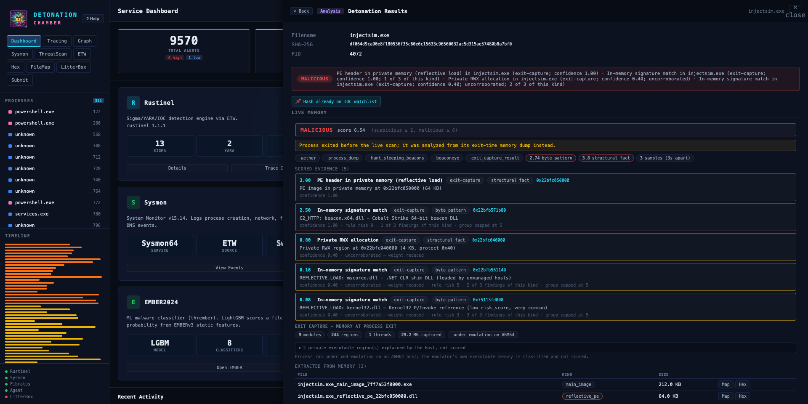
</p>
</td>
<td width="50%">
<p align="center">
  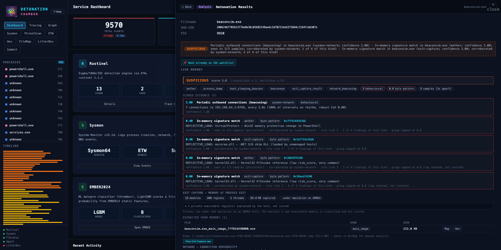
</p>
</td>
</tr>
</table>

> **Left:** `injectsim.exe` is **MALICIOUS (6.54)**. It exited before the
> live scan, so the verdict comes from its exit-time memory dump: a PE image in
> private memory (reflective load), a `beacon.x64.dll` string and a private RWX
> region. Every finding shows its evidence class, confidence and why its weight
> was reduced (uncorroborated, group cap). Below: the exit dump summary
> (modules, regions, emulation on ARM64) and the images extracted from memory,
> each with Map/Hex shortcuts.
>
> **Right:** `beaconsim.exe` is **SUSPICIOUS (3.8)**: Sysmon network events show
> 7 connections to the same endpoint every 2.0 s (robust CoV 0.00), and that
> rhythm corroborates the in-memory signature hits from Aether (3 of 3 samples)
> and the exit dump.

---

### Tracing Console & Alert Detail

<table>
<tr>
<td width="50%">
<p align="center">
  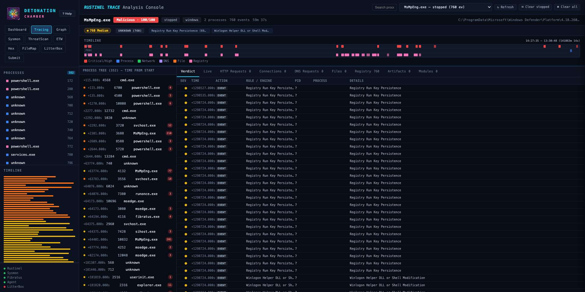
</p>
</td>
<td width="50%">
<p align="center">
  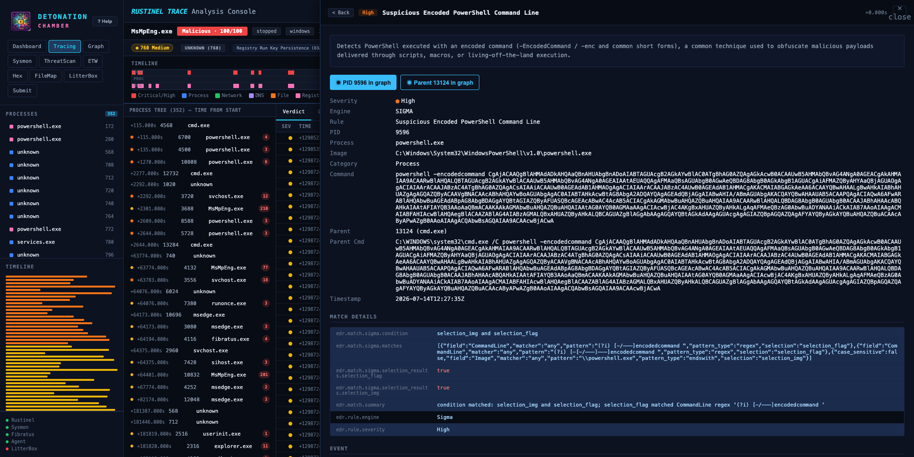
</p>
</td>
</tr>
</table>

> **Left:** The Tracing console for a process with 760 events: verdict badge,
> a timeline split by event type, the process tree with alert counts ("time
> from start"), and the verdict table. Tabs filter HTTP, connections, DNS,
> files, registry, artifacts and modules.
>
> **Right:** A Sigma alert ("Suspicious Encoded PowerShell Command Line") with
> the decoded rule description, pivots to the process and its parent in the
> graph (opened at the alert's time, so a reused PID does not lead to the wrong
> process), the full command lines and the Sigma match details (condition,
> matched fields and patterns), loaded on demand.

---

### Process Graph

<table>
<tr>
<td width="50%">
<p align="center">
  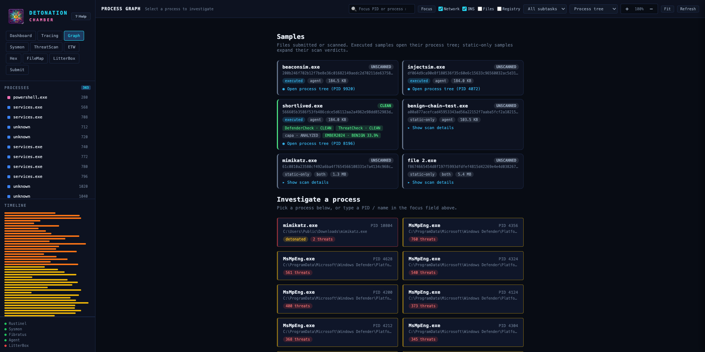
</p>
</td>
<td width="50%">
<p align="center">
  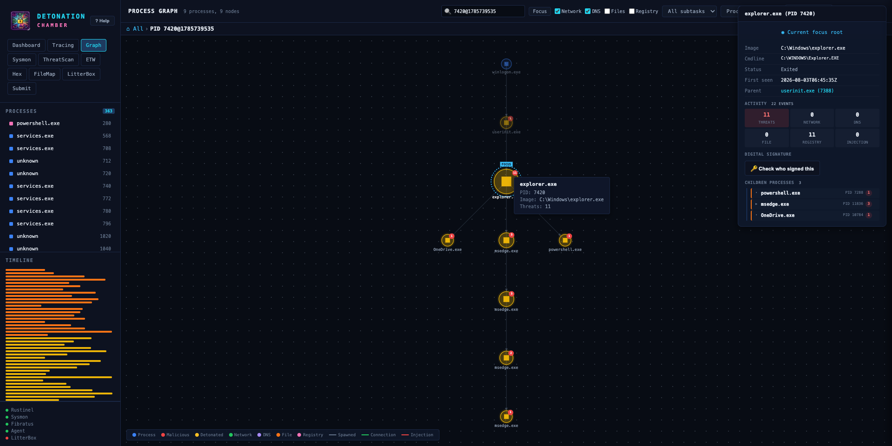
</p>
</td>
</tr>
</table>
<table>
<tr>
<td width="50%">
<p align="center">
  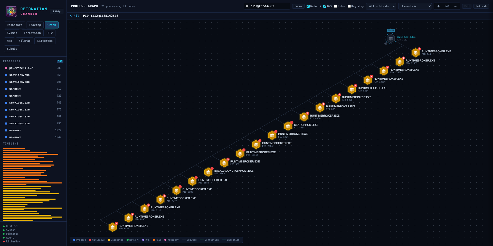
</p>
</td>
<td width="50%">
<p align="center">
  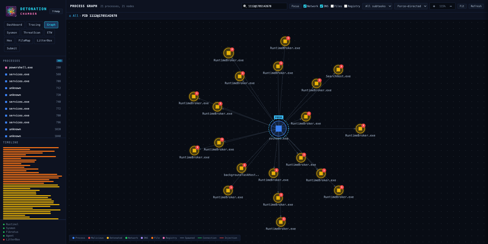
</p>
</td>
</tr>
</table>

> **Top left:** The landing page lists submitted and scanned samples with their
> scan verdicts (executed samples open their process tree) and the processes
> worth investigating — only processes attributed to a submission are marked
> *detonated*.
>
> **Top right:** Process tree around an `explorer.exe` instance
> (`7420@1785739535` — an earlier holder of PID 7420): ancestors above, children
> below. The detail panel shows image, status, activity counters, signature
> check and the children.
>
> **Bottom:** The same kind of tree in the isometric view (sibling spines,
> hexagon nodes coloured by detonation/severity, foldable subtrees, activity
> icons per process; remote threads are drawn as raised bridges) and as a
> force-directed layout.

---

### PE Analysis, Hex Editor & File Map

<table>
<tr>
<td width="50%">
<p align="center">
  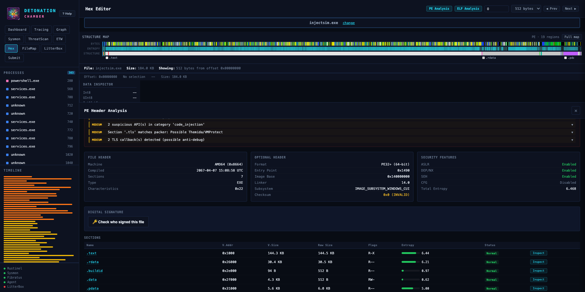
</p>
</td>
<td width="50%">
<p align="center">
  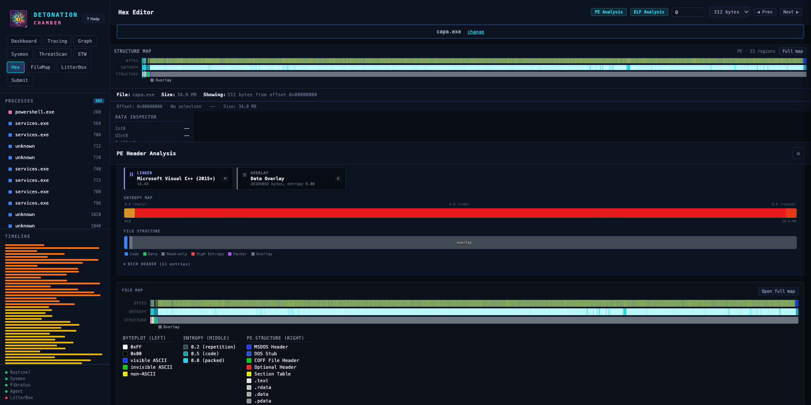
</p>
</td>
</tr>
</table>
<table>
<tr>
<td width="50%">
<p align="center">
  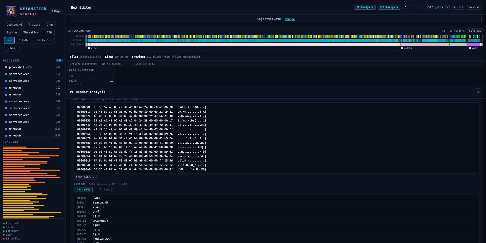
</p>
</td>
<td width="50%">
<p align="center">
  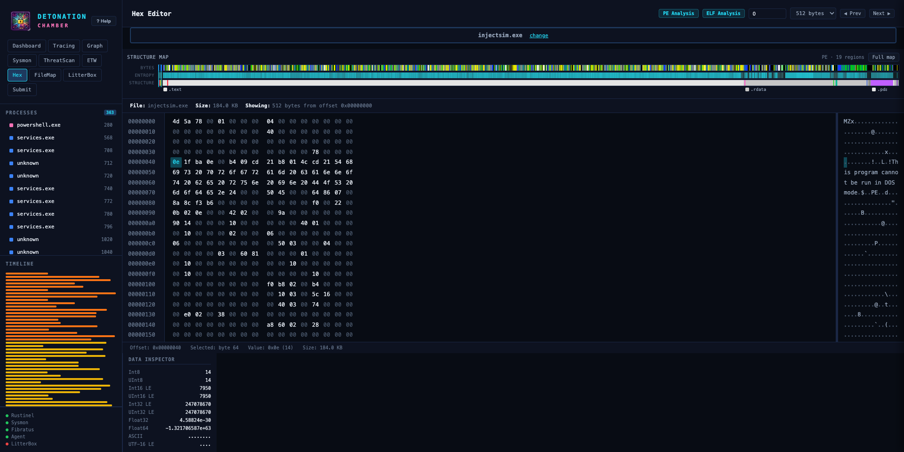
</p>
</td>
</tr>
</table>
<p align="center">
  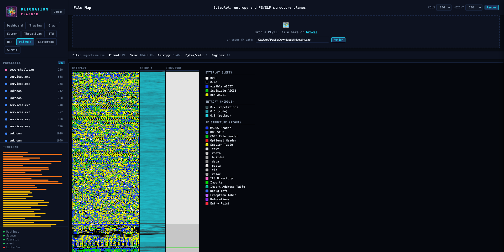
</p>

> **PE header analysis** of `injectsim.exe`: IOC flags (code-injection APIs,
> a `.tls` section matching a packer name, two TLS callbacks), file/optional
> headers with an invalid checksum, security features, and the section table
> with entropy bars.
>
> **Packing analysis** of `capa.exe` (a PyInstaller bundle): Detect-It-Easy
> style cards (linker, 36 MB data overlay at entropy 8.00), entropy map and
> file layout — almost the whole file is overlay.
>
> **Section inspection:** `.text` of `injectsim.exe` with hex dump and
> extracted strings (`beacon.x64.dll`).
>
> **Hex editor:** structure minimap above the dump (sections and data
> directories), selected byte at offset 0x40 decoded by the data inspector.
>
> **File map:** byteplot, local entropy and PE structure planes of
> `injectsim.exe` side by side with the legend; clicking a plane jumps to the
> offset in the hex editor.

---

### Live Process Memory

<p align="center">
  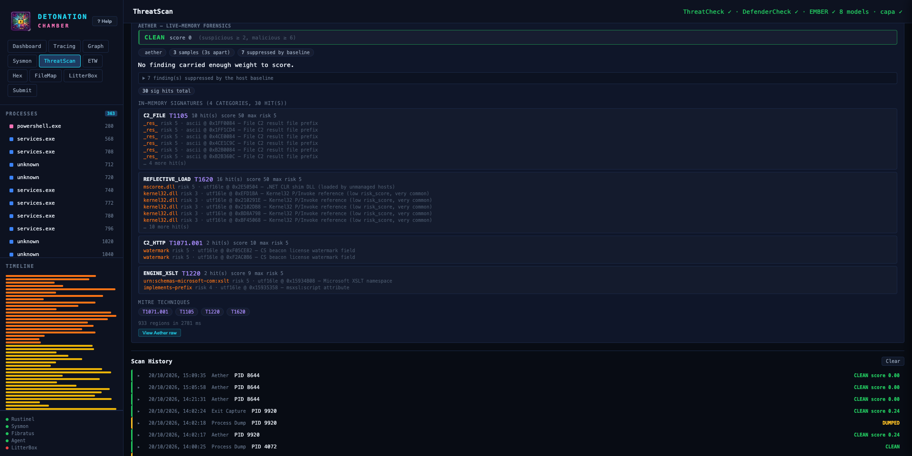
</p>

> An Aether scan of a running `explorer.exe` (3 samples, 3 s apart): 30
> signature hits in four categories, all of them known for this host — the
> baseline suppresses 7 findings and the result is **CLEAN (0)**. Below: the
> scan history with every scanner's verdict and score.

---

### Sysmon & ETW

<table>
<tr>
<td width="50%">
<p align="center">
  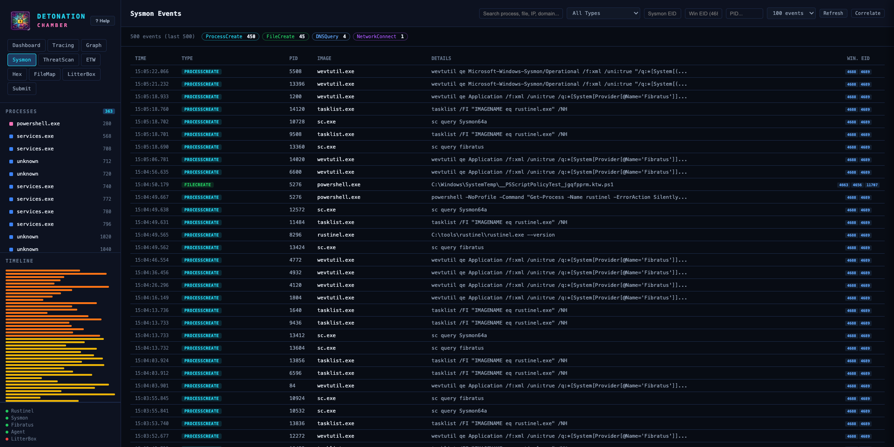
</p>
</td>
<td width="50%">
<p align="center">
  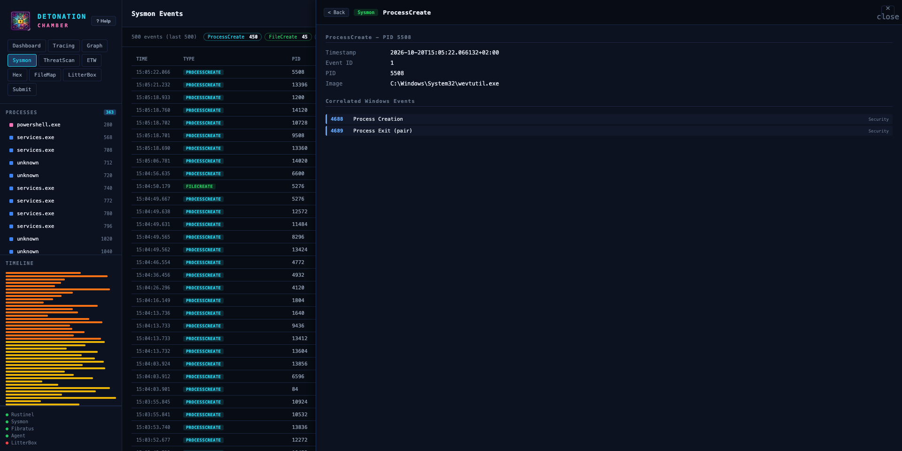
</p>
</td>
</tr>
</table>
<p align="center">
  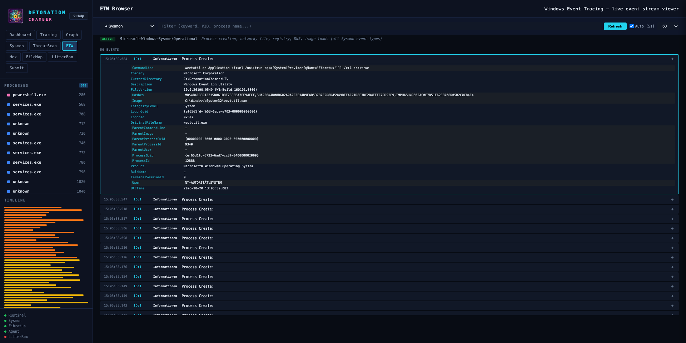
</p>

> **Sysmon:** the last 500 events with type counters (ProcessCreate, FileCreate,
> DNSQuery, NetworkConnect), command lines and the Windows Event IDs each Sysmon
> event corresponds to; the detail view lists the correlated Security events.
>
> **ETW browser:** the Sysmon channel with one event expanded; all fields of the
> event are shown, suspicious values are highlighted.

---

## API Reference

All endpoints served on port `9000`. Responses are JSON.

### Core

| Method | Endpoint | Description |
|--------|----------|-------------|
| GET | `/api/alerts` | All detection alerts (Rustinel + Fibratus + LitterBox). gzip + ETag; `raw` omits fields duplicated at top level (`raw_trimmed: true`). Filters: `severity`, `engine`, `pid`, `since` (ISO-8601), `detonated=true`, `limit` (newest first) |
| GET | `/api/alerts/<id>` | One alert with its complete raw event |
| GET | `/api/processes` | Tracked processes with activity counts. Params: `max` (0 = all), `min_threats` (default 1), `sort` (`threats`/`recent`/`severity`), `detonated`, `include_parents` |
| GET | `/api/processes/<key>` | One process instance with its alerts. `<pid>` = newest process with that PID, `<pid>@<start epoch>` = an earlier one |
| GET | `/api/sessions` | Alerts grouped into activity bursts (summaries + alert ids). Params: `gap` (s, default 600), `limit` |
| GET | `/api/status` | Service health status (all components) |
| GET | `/api/health` | Liveness probe |
| POST | `/api/service/launch` | Start a service/tool. Param: `service` |
| GET | `/api/service/configs` | Detected service launch configurations |
| GET | `/api/rustinel` | Rustinel engine info (rules, version) |
| GET | `/api/submissions` | Submission history (last 200) |

### Submission & Detonation

| Method | Endpoint | Description |
|--------|----------|-------------|
| POST | `/api/submit` | Submit sample (multipart). Params: `file`, `target` (agent/litterbox/both) |
| GET | `/api/detonation/results` | Poll results. Params: `sha256`, `pid`, `litterbox_hash`, `filename` |

### Process Graph

| Method | Endpoint | Description |
|--------|----------|-------------|
| GET | `/api/process-graph` | Ancestors + descendants of a process with network, DNS, file, registry and injection events. Params: `pid` (PID or instance key), `at` (ISO time: the process that had the PID then), `down_depth` (0 = all), `up_depth`, `max_nodes` |
| GET | `/api/process-graph/roots` | Candidate focus processes (detonated / most alerts) |
| GET | `/api/graph/samples` | Submitted and scanned files with their scan verdicts |

### Hex Editor & Binary Analysis

| Method | Endpoint | Description |
|--------|----------|-------------|
| GET | `/api/file/hex` | Hex dump. Params: `path`, `offset`, `bytes` |
| POST | `/api/file/hex/upload` | Upload file for hex viewing |
| POST | `/api/file/hex/write` | Patch bytes (JSON: `path`, `offset`, `bytes`); analysis folders only |
| GET | `/api/file/download` | Download a file as attachment. Param: `path` |
| GET | `/api/file/signature` | Authenticode signer and trust. Param: `path` |
| GET | `/api/file/pe/section` | One PE section: hex dump and strings. Params: `path`, `index`, `max_bytes` |
| GET | `/api/file/pe` | PE header analysis. Param: `path` |
| GET | `/api/file/elf` | ELF binary analysis. Param: `path` |

### Sysmon

| Method | Endpoint | Description |
|--------|----------|-------------|
| GET | `/api/sysmon` | Sysmon events. Params: `max`, `event_id`, `pid`, `parent_pid`, `since`, `until` |
| GET | `/api/sysmon/stats` | Sysmon statistics and diagnostics |

### ETW Browser

| Method | Endpoint | Description |
|--------|----------|-------------|
| GET | `/api/etw/channels` | List available channels. Param: `probe=true` adds availability status |
| GET | `/api/etw/events` | Query events. Params: `channel`, `max`, `since`, `filter` |

### Scanner

| Method | Endpoint | Description |
|--------|----------|-------------|
| POST | `/api/scan/threatcheck` | ThreatCheck scan. Params: `file`/`path`, `engine`, `type` |
| POST | `/api/scan/defendercheck` | DefenderCheck scan. Params: `file`/`path` |
| POST | `/api/scan/ember` | EMBER2024 ML score. Params: `file`/`path`, `model`, `threshold` |
| POST | `/api/scan/capa` | capa capability detection (ATT&CK/MBC). Params: `file`/`path` |
| GET | `/api/scan/status` | Tool availability (ThreatCheck, DefenderCheck, EMBER2024, capa, Aether, Process Dump, Exit Capture) |
| GET | `/api/scan/history` | Static scan timeline, newest first. Param: `limit` |
| POST | `/api/scan/history/clear` | Clear the scan timeline |
| POST | `/api/scan/beacons` | Hunt-Sleeping-Beacons. Param: `pid` (omit for all) |
| POST | `/api/scan/beaconeye` | BeaconEye (Cobalt Strike configs). Param: `pid` (omit for all) |

### Live Memory

| Method | Endpoint | Description |
|--------|----------|-------------|
| POST | `/api/scan/aether` | Aether scan of a PID, scored. Params: `pid`, `samples` (1-10), `interval` (s) |
| POST | `/api/scan/processdump` | Dump a PID's memory components. Params: `pid` or `system`, `ignore_clean_db` |
| POST | `/api/memory/evidence` | Re-score all cached memory results for a PID across sources. Params: `pid` |
| GET / DELETE | `/api/memory/baseline` | Host memory baseline statistics / clear it. `stale: true` means it was built with an older key scheme and is ignored until captured again |
| POST | `/api/memory/baseline/capture` | Record findings of named processes as baseline. Params: `names`, `samples` |
| POST / GET | `/api/memory/sweep` | Background sweep of every process (`aether`, `processdump`, `baseline`) / status + result |
| GET / POST | `/api/processdump/baseline` | Process Dump clean-hash database status / build it (`mode`: `gen`, `genquick`) |
| GET | `/api/process/lookup` | Running PIDs by image name. Params: `name` |
| GET | `/api/file/visualize` | File map planes + structure + import/export trees. Params: `path`, `cols`, `rows` |

### Proxy Endpoints

| Method | Endpoint | Description |
|--------|----------|-------------|
| GET/POST | `/api/litterbox/<path>` | Proxy to LitterBox API (:1337) |
| GET/POST | `/api/agent/<path>` | Proxy to DetonatorAgent (:8080) |
| GET/POST/PUT/DELETE | `/api/detonator/<path>` | Proxy to Detonator |

Proxied responses are only relayed as data (JSON, text, binary); HTML is served as plain text.

---

## MCP Server

`mcp/server.py` exposes the lab to MCP clients (Claude Code, Claude Desktop, ...)
over stdio. It talks to the web UI API, so the VM must be reachable.

```
make mcp-setup        # creates mcp/.venv (Python >= 3.10) from mcp/requirements.txt
```

`.mcp.json` in the repository root registers it for Claude Code; set `TDC_URL`
there if the VM is not at `http://192.168.64.4:9000`.

| Area | Tools |
|------|-------|
| Status | `tdc_status`, `tdc_service_launch`, `tdc_tools_status`, `tdc_rustinel_info` |
| Detonation | `tdc_submit_file`, `tdc_submissions`, `tdc_detonation_results`, `tdc_detonation_memory` |
| Alerts | `tdc_alerts`, `tdc_alert_detail`, `tdc_sessions`, `tdc_search` |
| Processes | `tdc_processes`, `tdc_process_detail`, `tdc_process_graph`, `tdc_process_lookup`, `tdc_powershell_activity` |
| Events | `tdc_sysmon_events`, `tdc_sysmon_stats`, `tdc_etw_events`, `tdc_etw_channels` |
| Static analysis | `tdc_scan_ember`, `tdc_scan_capa`, `tdc_scan_threatcheck`, `tdc_scan_defendercheck`, `tdc_scan_history` |
| Files (paths in the VM) | `tdc_pe_analyze`, `tdc_pe_section`, `tdc_elf_analyze`, `tdc_file_signature`, `tdc_file_hex`, `tdc_file_map` |
| Live memory | `tdc_memory_scan`, `tdc_memory_dump`, `tdc_memory_evidence`, `tdc_memory_baseline`, `tdc_memory_sweep`, `tdc_memory_sweep_status`, `tdc_processdump_baseline`, `tdc_scan_beacons`, `tdc_scan_beaconeye` |

Not exposed on purpose: byte patching (`/api/file/hex/write`), clearing the
scan history and the raw service proxies.

---

## Configuration

### Environment Variables (Web UI)

| Variable | Default | Description |
|----------|---------|-------------|
| `RUSTINEL_ALERTS_DIR` | `C:\tools\rustinel\logs` | Rustinel NDJSON alert directory |
| `RUSTINEL_INSTALL_DIR` | `C:\tools\rustinel` | Rustinel installation root |
| `DETONATOR_API` | `http://127.0.0.1:8000` | Detonator REST API |
| `DETONATOR_AGENT_API` | `http://127.0.0.1:8080` | DetonatorAgent API |
| `LITTERBOX_API` | `http://127.0.0.1:1337` | LitterBox API |
| `WEBUI_PORT` | `9000` | Web UI listen port |
| `WEBUI_HOST` | `0.0.0.0` | Listen address (`127.0.0.1` = VM only) |
| `TDC_ALLOWED_HOSTS` | — | Extra host names accepted in the `Host` header (comma-separated; IPs and `localhost` always work) |
| `VM_WEBUI_URL` | — | Web UI of the VM, used by a host-side instance when it has no local Sysmon/alerts |
| `TDC_VM_USER` / `TDC_VM_PASS` | — | WinRM credentials for starting VM services from a host-side instance |

### Custom Detection Rules

**Sigma** (hot-reload):
```
C:\tools\detection-rules\rustinel-rules\dist\windows-advanced\rules\sigma\
```

**YARA** (hot-reload):
```
C:\tools\detection-rules\yara-combined\
```

**IOC Hashes** (hot-reload, add SHA-256 one per line):
```
C:\tools\detection-rules\rustinel-rules\dist\windows-advanced\rules\ioc\
```

### Defender Exclusions

Provisioning adds exclusions for detonation paths. To fully disable for testing:

```powershell
# Inside VM, run as Administrator
Set-MpPreference -DisableRealtimeMonitoring $true
```

---

## Detection Rules

| Type | Source |
|------|--------|
| **Sigma** | `Karib0u/rustinel-rules` windows-advanced pack |
| **YARA** | rustinel-rules + Elastic protections-artifacts (`C:\tools\detection-rules\yara-combined`) |
| **IOC** | SHA-256 hashes, IPs, domains, path regexes; sample hashes are added on submission |
| **Aether** | 380 in-memory signatures in `C:\tools\Aether\rules\` |

The number of rules Rustinel actually loaded is shown on the Dashboard and by
`GET /api/rustinel` / MCP `tdc_rustinel_info`.

---

## File Structure

```
transportable-detonation-chamber/
├── Makefile                        # Build system (macOS/Linux)
├── make.ps1                        # Build system (Windows PowerShell)
├── Vagrantfile                     # VM definition (Hyper-V)
├── Vagrantfile.utm                 # VM definition (QEMU/UTM, Apple Silicon)
├── README.md
├── tdc-logo.png
│
├── static/                         # Screenshots for this README
│
├── mcp/
│   ├── server.py                  # MCP server (41 tools, talks to the web UI API)
│   └── requirements.txt           # mcp, httpx  (make mcp-setup)
├── .mcp.json                      # Registers the MCP server for Claude Code
│
├── tests/                          # Unit tests (make unit-test), run by GitHub Actions
│
├── webui/                          # Unified Web UI
│   ├── app.py                     # Flask backend (APIs, proxying, PE/ELF analysis)
│   ├── memory_evidence.py         # Tool-independent scoring of memory findings
│   ├── minidump_analysis.py       # Offline analysis of exit-time minidumps
│   ├── memory_results/            # Persisted live-memory results (git-ignored)
│   ├── memory_baseline.json       # Host memory baseline (git-ignored)
│   ├── dev_server.py              # Dev server with live-reload
│   ├── requirements.txt           # Python deps (flask, requests, watchdog, pefile)
│   ├── templates/
│   │   └── index.html             # SPA with all tabs + Help modal
│   └── static/
│       ├── css/style.css          # Dark theme
│       ├── js/app.js              # Frontend logic (single file, no build step)
│       └── icon.png               # Logo
│
├── config/
│   ├── rustinel-config.toml       # Rustinel config (sigma/yara/ioc paths)
│   ├── fibratus.yml               # Fibratus config (JSON eventlog output)
│   └── profiles_init.yaml         # Detonator target profiles
│
├── rules/                          # Detection rules (copied to VM)
│
├── scripts/                        # Provisioning scripts
│   ├── install-prerequisites.ps1  # .NET 8, Python 3.12, Git, 7-Zip
│   ├── install-sysmon.ps1         # Sysmon (ARM64-aware)
│   ├── install-fibratus.ps1       # Fibratus v3.0.0
│   ├── install-rustinel.ps1       # Rustinel v1.1.1
│   ├── install-detection-rules.ps1 # Sigma + YARA rules
│   ├── install-detonator.ps1      # Detonator + DetonatorAgent
│   ├── install-litterbox.ps1      # LitterBox sandbox
│   ├── install-thezoo.ps1        # theZoo malware repository + WebUI
│   ├── install-hunt-sleeping-beacons.ps1 # Hunt-Sleeping-Beacons (VS Build Tools, x64 build)
│   ├── install-beaconeye.ps1     # BeaconEye (x64 release)
│   ├── install-aether.ps1        # Aether (prebuilt/ or Zig 0.16 build in the VM)
│   ├── install-process-dump.ps1  # Process Dump + clean-hash baseline (genquick)
│   ├── build-aether.sh           # Cross-compile Aether on the host into prebuilt/
│   ├── install-re-tools.ps1      # Detect It Easy, WinDbg, Ghidra
│   ├── install-webui.ps1          # Web UI deployment
│   ├── deploy-utm.py             # Push code to a UTM VM over WinRM, restart, run installers
│   └── configure-services.ps1    # Service registration (runs on every boot)
│
└── prebuilt/                       # Host-built binaries uploaded by provisioning (git-ignored)
```

### VM File Layout

```
C:\DetonationChamberUI\                 Web UI (Flask)
C:\tools\rustinel\                      Rustinel ETW engine + rules
C:\tools\fibratus\                      Fibratus kernel tracer
C:\DetonatorAgent\                      .NET 8 execution agent
C:\LitterBox\                           Analysis sandbox
C:\tools\ThreatCheck\                   AV signature scanner
C:\tools\DefenderCheck\                 Defender evasion tester
C:\tools\EMBER2024\                     EMBER2024 ML classifier (thrember venv + models)
C:\tools\capa\                          Mandiant capa (static capability detection)
C:\tools\Hunt-Sleeping-Beacons\         Sleeping beacon scanner (x64)
C:\tools\BeaconEye\                     Cobalt Strike config scanner (x64)
C:\tools\Aether\                        Memory forensics scanner + rules\
C:\tools\ProcessDump\                   pd64.exe + clean-hash database
C:\tools\zig\                           Zig 0.16 (only when Aether was built in the VM)
C:\dumps\                               Process Dump output; exit\ holds exit-time dumps
C:\tools\theZoo-WebUI\                  theZoo malware sample browser (:8888)
C:\tools\detection-rules\               Sigma + YARA + IOC rules
C:\ProgramData\chocolatey\lib\die\      Detect It Easy (DiE 3.21)
C:\ProgramData\chocolatey\lib\ghidra\   Ghidra 12.1.2
WinDbgX.exe                             WinDbg Preview (via winget)
C:\Users\Public\Downloads\              Samples written by DetonatorAgent
```

---

## Troubleshooting

### Check service status

```bash
# macOS / Linux
make services

# Windows
.\make.ps1 services
```

Expected output:
```
  SERVICE               STATE
  -------               -----
  DetonationChamberUI   Running
  Rustinel              Running
  DetonatorAgent        Running
  LitterBox             Running
  Fibratus              Running
  Sysmon                Running
  theZoo-WebUI          Running
```

### Services not starting

```powershell
# SSH/RDP into the VM
vagrant ssh  # or: vagrant rdp

# Check and restart services
Get-ScheduledTask -TaskName DetonationChamberUI | Start-ScheduledTask
Get-ScheduledTask -TaskName Rustinel | Start-ScheduledTask
Get-ScheduledTask -TaskName DetonatorAgent | Start-ScheduledTask
Get-ScheduledTask -TaskName LitterBox | Start-ScheduledTask

# View logs
Get-Content C:\tools\logs\DetonatorAgent.log -Tail 50
Get-Content C:\tools\logs\DetonationChamberUI.log -Tail 50
```

### Port forwarding not working (Hyper-V)

Hyper-V uses a virtual switch. Connect directly via the VM's IP:

```powershell
# Find VM IP
.\make.ps1 status
# Or: vagrant ssh -c "ipconfig"

# Override in make.ps1
.\make.ps1 status -VMIp 172.17.x.x
```

### Web UI not loading

```bash
# Check if Flask is running
make status  # or: .\make.ps1 status

# Restart it
make restart  # or: .\make.ps1 restart

# View logs
make logs  # or: .\make.ps1 logs
```

### Web UI answers 403 "Host not allowed" or "Cross-site request rejected"

The UI only accepts IP addresses and `localhost` in the `Host` header (DNS
rebinding protection). Open it by IP, or add the name you use to
`TDC_ALLOWED_HOSTS`. "Cross-site request rejected" means a POST came from a
page on another origin, e.g. a bookmarklet or a tool running in the browser;
send it without an `Origin` header (curl, scripts) or from the UI itself.

### Rustinel not detecting events

```powershell
# Inside the VM:
Get-Process rustinel
Get-Content C:\tools\rustinel\logs\rustinel.log.* | Select-Object -Last 20
logman query -ets | findstr rustinel

# Restart if stale
logman stop rustinel-etw-trace -ets 2>$null
Start-ScheduledTask -TaskName "Rustinel"
```

### macOS: QEMU won't start

```bash
qemu-system-aarch64 --accel help  # Should show: hvf
ls /opt/homebrew/share/qemu/edk2-aarch64-code.fd
vagrant plugin list | grep qemu
```

### Local install fails

```bash
# Verify Python version (needs 3.10+)
python3 --version

# If venv creation fails, try:
make uninstall  # or: .\make.ps1 uninstall
make install    # or: .\make.ps1 install
```

---

## Security Notes

> **This VM is designed for malware analysis — treat it as compromised.**

- Use **snapshots** before each detonation (`vagrant snapshot save clean_state`)
- **Network isolation** recommended (Hyper-V internal/private switch)
- Defender exclusions configured for detonation paths only
- Rustinel active response is **disabled by default**
- The Web UI has no login — keep it on an isolated network: `/api/submit`
  executes files by design.

### Web UI hardening

- **Cross-site requests:** state-changing requests (POST/PUT/DELETE) whose
  `Origin`/`Referer` names another site are refused, so a web page opened in
  the VM's browser cannot submit samples or change settings. curl, the MCP
  server and scripts send no such header and are unaffected.
- **DNS rebinding:** only IP addresses, `localhost` and names listed in
  `TDC_ALLOWED_HOSTS` (comma-separated) are accepted in the `Host` header.
- **Writes:** `/api/file/hex/write` only writes inside the hex-upload folder,
  `C:\Temp`, `C:\Users\Public\Downloads` and `C:\dumps`, and never to script
  or shortcut files.
- **Headers:** no framing (clickjacking), `nosniff`, same-origin referrers.
- `WEBUI_HOST=127.0.0.1` restricts the listener to the VM itself.

---

## Credits

| Project | Role |
|---------|------|
| [dobin/detonator](https://github.com/dobin/detonator) | Orchestration framework |
| [dobin/DetonatorAgent](https://github.com/dobin/DetonatorAgent) | Execution agent |
| [rabbitstack/fibratus](https://github.com/rabbitstack/fibratus) | ETW detection engine |
| [Karib0u/rustinel](https://github.com/Karib0u/rustinel) | Sigma/YARA EDR agent |
| [BlackSnufkin/LitterBox](https://github.com/BlackSnufkin/LitterBox) | Payload analysis sandbox |
| [FutureComputing4AI/EMBER2024](https://github.com/FutureComputing4AI/EMBER2024) | ML malware classifier (thrember / LightGBM) |
| [mandiant/capa](https://github.com/mandiant/capa) | Static capability detection (ATT&CK / MBC) |
| [thefLink/Hunt-Sleeping-Beacons](https://github.com/thefLink/Hunt-Sleeping-Beacons) | Sleeping beacon callstack scanner |
| [0xsp-SRD/aether](https://github.com/0xsp-SRD/aether) | Live-process memory forensics (GPL-3.0; invoked as a separate binary) |
| [glmcdona/Process-Dump](https://github.com/glmcdona/Process-Dump) | Memory component dumper (MIT) |
| [ytisf/theZoo](https://github.com/ytisf/theZoo) | Malware sample repository |
| [kawaiipantsu/theZoo-WebUI](https://github.com/kawaiipantsu/theZoo-WebUI) | theZoo web frontend |
| [horsicq/DIE-engine](https://github.com/horsicq/DIE-engine) | Detect It Easy |
| [NationalSecurityAgency/ghidra](https://github.com/NationalSecurityAgency/ghidra) | Ghidra RE framework |
| [Microsoft WinDbg](https://learn.microsoft.com/en-us/windows-hardware/drivers/debugger/) | Windows debugger |

---

<p align="center">
  <sub>Built for security research and EDR testing. Use responsibly.</sub>
</p>
