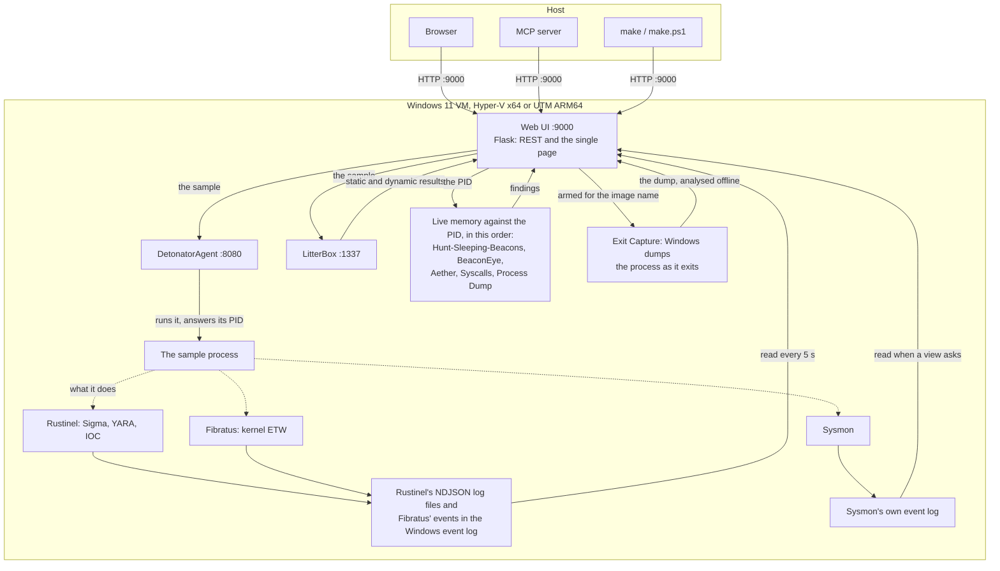

# Transportable Detonation Chamber — Documentation

This is the guide: how to set the chamber up, and how to work with it once it runs.
The same pages are on the web, one address each and searchable:
[the documentation website](https://benjitrapp.github.io/transportable-detonation-chamber/).

The Transportable Detonation Chamber is a pre-configured Windows 11 VM for malware
detonation testing against multiple EDR solutions. A sample goes in; the detection
engines, the live-memory scanners and the sandbox report what it did, and one Web UI
on port 9000 shows all of it. The repository [README](../README.md) is the showcase —
screenshots, the feature tour and the demo video. These pages are the manual.

## Set it up

Start here if there is no VM yet. Three pages, in this order:

1. **[Setup](setup.md)** — what your host needs, what is different on ARM64, and the
   guided UTM path to a VM.
2. **[Installation](installation.md)** — `make` and `make.ps1`, the two Quick Start
   variants, and the manual path.
3. **[Configuration](configuration.md)** — environment variables, your own Sigma and
   YARA rules, Sysmon and Defender, and the security notes for running the box.

## Work with it

Start here if the chamber runs. Workflow is the one to read first; the rest are the
tools, in the order you meet them:

1. **[Workflow](workflow.md)** — detonating a sample, the CLI, the scanners, PE and
   ELF analysis.
2. **[Live memory analysis](memory.md)** — what runs after a detonation, and how
   findings become a verdict.
3. **[Named pipes](pipes.md)** — watching pipe events, and intercepting a pipe.
4. **[Rizin](rizin.md)** — reverse engineering in the browser.
5. **[Logs](logs.md)** — the six log sources, the search language and the
   dashboards of your own.
6. **[Firewall](firewall.md)** — every connection of the sample on a map, blocking
   per process or endpoint, download decisions and the panic cut.
7. **[Tool updates](updates.md)** — checking, installing and pinning the VM's tools.
8. **[Web UI](web-ui.md)** — the two themes, the charts of every tab and the
   screenshots.
9. **[API](api.md)** — every REST route and every MCP tool.

## All pages

| Page | What it answers |
|---|---|
| [setup.md](setup.md) | What do I need before the VM, and what does ARM64 change? |
| [installation.md](installation.md) | How do I build, provision and deploy to the VM? |
| [configuration.md](configuration.md) | Which settings exist, how do I add my own rules, and how is the box kept safe? |
| [workflow.md](workflow.md) | How do I detonate a sample and analyse a binary? |
| [memory.md](memory.md) | What does the chamber see in a running process? |
| [pipes.md](pipes.md) | How do I watch and intercept named pipes? |
| [rizin.md](rizin.md) | How do I take a sample apart in the browser? |
| [logs.md](logs.md) | How do I search the logs of the VM, and save a search? |
| [firewall.md](firewall.md) | Whom does the sample talk to, and how do I cut it off? |
| [updates.md](updates.md) | How do the tools on the VM stay current? |
| [web-ui.md](web-ui.md) | What do the themes, the charts and every tab look like? |
| [api.md](api.md) | Which routes and MCP tools can I call? |
| [development.md](development.md) | How do I run the tests and change the code? |
| [troubleshooting.md](troubleshooting.md) | Nothing works — where do I look? |

The whole guide also builds into one offline HTML file with navigation and search:
`make docs` (or `.\make.ps1 docs`) writes `webui/static/wiki.html`, which the Web UI's
help links when it is there.

## Architecture

Everything but the browser, the MCP server and `make` runs inside the VM, and
the host reaches all of it through the Web UI on port 9000. The Web UI hands a
sample to DetonatorAgent, which runs it and answers its PID, and to LitterBox,
which analyses it; of the engines watching the process it reloads Rustinel's and
Fibratus' alerts every five seconds, while Sysmon's log is read whenever a view
asks for it. Against the PID it runs the live-memory tools itself, one after
another, and before the sample starts it arms Windows to dump the process as it
exits.

The chain of one detonation, step by step, is in [workflow.md](workflow.md#data-flow).

## Detection Engines

| Engine | Technology | Capabilities |
|--------|-----------|--------------|
| **Rustinel** | Rust + ETW | Sigma + YARA rules, IOC hash/IP/domain matching, real-time NDJSON alerts |
| **Fibratus** | Go + Kernel ETW | Process/file/registry/network telemetry, behavior rules |
| **Sysmon** | Sysinternals | Event logging (process creation, network, file, registry, image loads) |
| **LitterBox** | Python | Static (YARA, strings) + Dynamic (PE-Sieve, Moneta, HollowsHunter, RedEdr) |
| **Aether** | Zig | Live-process memory forensics: thread start-address validation, heap API tables, disk-vs-memory diff, 380 in-memory signatures |
| **Process Dump** | C++ | Dumps unpacked modules, hidden modules and header-less code from memory, skipping a clean-hash baseline |
| **Exit Capture** | Windows (built-in) | Full-memory dump at the moment a sample exits, analyzed offline — covers samples too short-lived for live scanners |
| **Hunt-Sleeping-Beacons** | C++ | Thread call stacks of sleeping implants (unbacked memory, sleep masks, stack spoofing) |
| **BeaconEye** | .NET | Cobalt Strike beacon configurations in process heaps |

Which rules the engines load, and where you put your own, is in
[configuration.md](configuration.md).

## Services

Everything in the table runs inside the VM. The host only talks to the Web UI on
port 9000 — with a browser, with `make` or with the MCP server.

| Service | Port | Purpose | Technology |
|---------|------|---------|------------|
| **Web UI** | 9000 | Unified dashboard & API gateway | Python / Flask |
| **DetonatorAgent** | 8080 | Executes malware samples, returns PID | .NET 8.0 |
| **LitterBox** | 1337 | Static + dynamic analysis sandbox | Python / Flask |
| **Fibratus** | 8180 | Kernel ETW telemetry & behavior rules | Go |
| **Rustinel** | — | Sigma/YARA/IOC real-time detection | Rust |
| **Sysmon** | — | Windows event logging | Sysinternals |
| **Hunt-Sleeping-Beacons** | — | Sleeping C2 beacon callstack scanner | C++ / MSVC |
| **BeaconEye** | — | Cobalt Strike beacon config scanner | .NET |
| **Aether** | — | Live-process memory forensics scanner | Zig |
| **Process Dump** | — | Memory component dumper with clean-hash database | C++ |
| **theZoo-WebUI** | 8888 | Malware sample browser | PHP |
| **Detonator** | 5000/8000 | Orchestration UI + REST API | Python |

Whether a service answers is on the dashboard and in `make services`; when one does
not, see [troubleshooting.md](troubleshooting.md).
