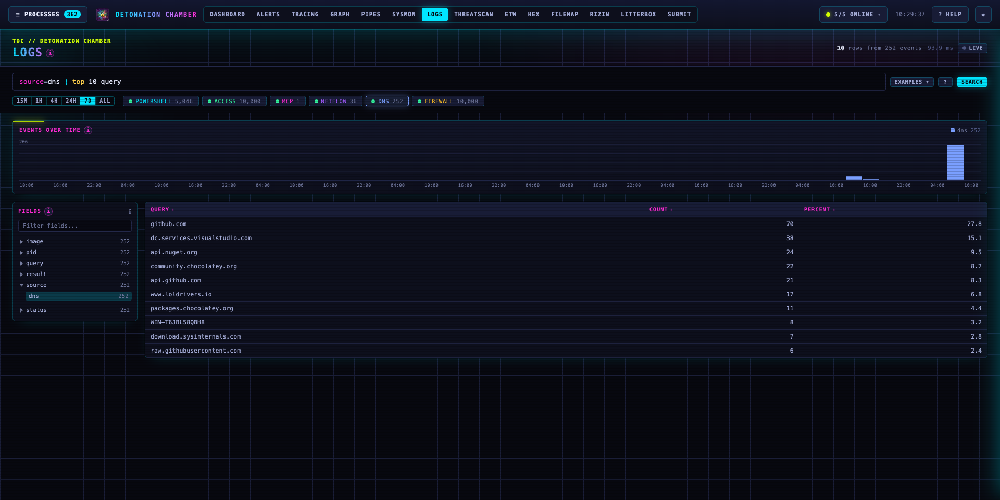

# Logs

How to search the six log sources of the VM, and how to keep a search as a
tile on a dashboard of your own.

The **LOGS** tab searches six log sources in one place with a small subset of
Splunk's search language. Everything in it is text from the sample or the VM
(a PowerShell script block above all), so it is always shown as text, never as
markup.



> The search `source=dns | top 10 query` over the last 7 days: the 252 DNS
> events of the VM, counted by queried name (`github.com` 70, then
> `dc.services.visualstudio.com` 38, `api.nuget.org` 24, ...) as a table with
> its share, over the **EVENTS OVER TIME** histogram of the range. The chips
> under the search box count the six sources (the DNS one is the active
> source), the range buttons sit left of them, and the field list left of the
> table shows the six fields of the result.

| Source | Content |
|--------|---------|
| `powershell` | Script Blocks (4104), module and pipeline logging (4103) and engine errors (4100) of `Microsoft-Windows-PowerShell/Operational`; the parts of a long script block are joined into one event; the script is the `message` (`script=` searches it too) |
| `access` | Every HTTP request to the web UI (not `/static/`): `method`, `path`, `query`, `status`, `duration_ms`, `remote_addr`, `user_agent`, `client` (`browser`, `mcp` or `other`). The regular polls of the UI itself (the exact paths `/api/status`, `/api/updates`, `/api/alerts`, `/api/health`, `/api/rustinel`, `/api/firewall/pending`, `/api/firewall/connections` and a GET of `/api/firewall/isolate`, and everything under `/api/logs/`) carry `poll=true`; `/api/alerts/<id>` does not. A request that ends in an unhandled error is logged with status 500 |
| `mcp` | Every action of the MCP server (it sends `X-TDC-Client: mcp` and `X-TDC-MCP-Tool: <name>`): `tool`, `method`, `path`, `status`, `duration_ms` |
| `netflow` | Network connections (Sysmon 3) bundled into flows per image, PID, protocol and address pair, with `count`, `first_seen` and `last_seen` |
| `dns` | DNS queries (Sysmon 22): `query`, `result`, `image`, `pid` |
| `firewall` | The Windows Firewall log (`pfirewall.log`): `action`, `protocol`, source and destination address and port, `path` |

A chip per source shows its event count and status; a click on it searches that
source. A source without data says why in its tooltip (the Windows sources are
`unavailable` when the web UI does not run on the VM; the firewall log stays
empty while the firewall is off). Every source has its own ring in memory, so a burst in one cannot push out another: `powershell` 15,000 events, `firewall`, `dns` and `access` 10,000 each, `netflow` and `mcp` 5,000 each, and 50 million characters of text in all, split in proportion. A search response cuts every value at 64 KB (the event then has `truncated_fields: true`; the UI loads the whole event when you unfold it);
`access` and `mcp` are also written to `webui/logs/` (10 MB per file, one older
file kept) and loaded again at start. The Windows sources read the last 24 hours
at start (at most 5000 events each) and then every 10 seconds; a Sysmon backlog of more than 5000 events is read oldest first, over several rounds.

**Search syntax.** Words and `"phrases"` match anywhere in the message and the
fields, without regard to case; `*` is a wildcard. `field=value`, `field!=value`,
`field>n` (also `<`, `>=`, `<=`; numbers compare as numbers) test a field;
`AND` (implied), `OR`, `NOT` and parentheses combine them. `source`,
`sourcetype` and `index` all mean the source. Pipes transform the result:
`head N`, `tail N`, `sort -field`, `dedup field`, `table f1, f2`, `fields f1`,
`stats count|dc(f)|sum(f)|avg(f)|min(f)|max(f)|values(f) by f1, f2`, `top field`,
`rare field` and `timechart span=5m count by field`. A search that cannot be
read shows the message and marks the place of the mistake under the search box.
At most 10,000 matches go into the pipes and 1000 rows come back (200 at first;
"Show up to 1000" asks for more).

```text
source=powershell "Invoke-Expression"
source=mcp | stats count by tool
source=access NOT poll=true
source=netflow | sort -count | head 20
source=dns | top query
source=firewall action=DROP
* | timechart span=5m count by source
```

**Time.** The buttons `15M`, `1H`, `4H`, `24H`, `7D` and `ALL` set the range
(default 24 hours); `earliest=-15m` and `latest=now` in the query take
precedence. A range drawn across the bars of EVENTS OVER TIME (or a click on a
bar) zooms to it and shows it as a chip whose × goes back to the button. The
field bar on the left lists the fields of the matches with their ten most
frequent values; a click on a value adds `field="value"` to the search. A
click on an event unfolds its fields and its raw text with the search words
marked. The EXAMPLES menu holds the searches above and your last ten, and
**LIVE** searches again every 10 seconds while the tab is open.

**The COMMANDS card.** The `?` button beside EXAMPLES opens a card in the
left column that lists the whole search language in four groups — **SEARCH**
(the terms above), **PIPES**, **TIME** and **SOURCES** — one group open at a
time, each row with the command and what it does. A click **adds** the
command to the search box instead of replacing what is there and does not
search, so you can finish the field name and press Enter: a pipe goes behind
the whole query, a term where the search part ends (before the first pipe),
and a bare `*` gives way. A source row is the exception: like a source chip
it takes the place of the source the query has, and searches. A click on the
head of the card folds it to its one-line head and back; the `?` does the
same. Whether the card is open and which group it shows are kept in the
browser; in a window narrower than 1100 px the card lies over the results at
full width and starts folded.

**The result: EVENTS · STATISTICS · VISUALIZATION.** Over the result stand
three tabs and, beside them, the forms **TABLE · PIE · BARS · LINE ·
SANKEY**; at the right end **SAVE**. Which of them can be used comes
from the answer: a search without a pipe has only EVENTS (the list of
matches), a `stats`/`top`/`table` answer opens in STATISTICS (the sortable
table) and a `timechart` in VISUALIZATION as a LINE. A tab or form that the
result cannot carry stays in the row, grey, with the reason in its tooltip
("needs a timechart, such as `| timechart span=5m count by source`"). The
chosen tab holds while type and columns stay the same; other columns open the
default of their type again.


> The same search over the last 24 hours: 10 rows from 185 events in 134.3 ms,
> LIVE on. Under the search box (the query highlighted, then EXAMPLES, the `?`
> button and SEARCH) stand the range buttons with `24H` active and the source
> chips with their counts: POWERSHELL 1,658, ACCESS 10,000, MCP 1, NETFLOW 234,
> DNS 197 (the active source) and FIREWALL 10,000. EVENTS OVER TIME draws one
> series, `dns 185`, in bars from 12:00 to 11:00 the next day, the highest of
> 27 events. In the left column the **COMMANDS card** has its SEARCH group
> open with ten rows (`word`, `"a phrase"`, `field=value`, `field!=value`,
> `field>5`, `AND`, `OR`, `NOT`, `( )` and `*`, each with what it does) and
> PIPES (10), TIME (2) and SOURCES (6) folded beneath it; under the card the
> field list shows 6 fields (`image`, `pid`, `query`, `result`, `source`
> unfolded to `dns 185`, and `status`), each in all 185 events. On the right
> STATISTICS is the active tab and TABLE the active form, with PIE, BARS, LINE
> and SANKEY beside it and SAVE at the end of the row. The table counts the
> queried names: `github.com` 100 (54.1%), `example.com` 21 (11.4%),
> `www.loldrivers.io` 21 (11.4%), `WIN-T6JBL58QBH8` 12 (6.5%),
> `www.msftconnecttest.com` 10 (5.4%), then `api.github.com`,
> `community.chocolatey.org`, `download.sysinternals.com` and
> `raw.githubusercontent.com` with 5 each and
> `eip-terr-eu.cdp1.digicert.com.akahost.net` with 1.
>
> Two of those names are not the sample's. `www.loldrivers.io` and
> `download.sysinternals.com` are the downloads of the tool installers on the
> chamber, and `WIN-T6JBL58QBH8` is a NetBIOS name, not a domain, so a host name
> in a DNS top list is not always somewhere the malware went.

**SAVE** puts the result on a dashboard of your own (see
[Own dashboards](#own-dashboards)): it asks for a name (prefilled from the
pipes — the fields after `by`, or the field of `top` / `rare`), the dashboard
or **+ New**, and whether the tile keeps the moving range of the tab or the
window on screen, frozen in UTC. A result without a form cannot be a tile,
which is exactly a search without a pipe: SAVE is grey then.

Which chart a table can be drawn as follows from its columns: **column 0 is
the name, the first column after it whose values are all numbers is the
value** (`| top query` is drawn by its count, not its percent), and further
columns are unused. Without a number column only TABLE is left; PIE and BARS
need a name and a number column, SANKEY two name columns and a number column
(`| stats count by a, b`), and a timechart draws as LINE or BARS, never as a
pie. PIE and BARS show the twelve largest values plus *other*, SANKEY the
twelve largest per side, LINE the series the server sends (at most ten plus
*OTHER*). A chart asks for 1000 rows instead of the 200 of the list and the
table, and only when it needs more than the last search brought.

If the chart stands for less than the whole result, a line under it says so
and offers the pipe that helps: `only 1,000 of 3,773 groups shown — add | sort
-count | head 20` when more groups were counted than came back, otherwise
`only the newest 10,000 matches went into the pipes — add …` when the search
hit the cap on what goes through the pipes at all (the group line wins when
both are true). A click appends exactly that pipe and
searches again. The line is plain text, without the offer, when the query
already ends in that pipe and for a timechart, whose periods must not be cut
to twenty (it then reads `only N of M periods shown` or the line about the
10,000 matches).

PowerShell and firewall logging are off on a Windows install. New VMs get them
turned on during provisioning; on an **existing VM** run
`C:\tdc\scripts\configure-logging.ps1` once as Administrator (`make deploy`
uploads it). It enables Script Block Logging and Module Logging, sets the
PowerShell operational log to 256 MB and turns on Windows Firewall logging of
allowed and blocked packets. It is safe to run again.

## Own dashboards

Under the head of the **Dashboard** tab a row of pages: **SERVICES** is the
service dashboard the tab opens with, beside it one page per dashboard of your
own, and **+ NEW** for another one (it asks for a name; once ten dashboards
exist it is grey and asks nothing). The open page is kept in the
browser, so the tab comes back to it; a page that is gone falls back to
SERVICES. Screenshot: [Own Dashboard Tiles](web-ui.md#own-dashboard-tiles).

A **tile** is a search of the LOGS tab, saved with SAVE (above). The store
keeps its name, the query, the form (`table`,
`pie`, `bars`, `line` or `sankey`) and the time range — either the relative
one of the tab (`last 24 h`, which moves with the clock) or a window frozen
in UTC. Nothing else: a tile holds no numbers. It computes its own, through
the same `/api/logs/search` the tab uses, and asks for 1000 rows for a chart
and 200 for a table.

**When a tile computes.** The tiles of a page run **one after the other**,
never two at a time: before its turn a tile says `Queued`, during it
`Loading…`. Opening a page computes every tile of it once — eight tiles of
the test VM took about 2 s. After that nothing recomputes by itself: the 10 s
poll of the dashboard and the browser tab becoming visible again leave the
tiles alone, and so does a click on the button of the page that is already
open. Leaving the Dashboard tab abandons the run (the answer of an
abandoned tile draws nothing), and coming back to it computes every tile of
the open page again, as opening a page does — so a page of searches is the
price of every trip through the Dashboard tab. Three things compute on
purpose: **Refresh** in the head takes every tile of the open page, the **↻**
of a tile only that one, and **Change form** in a tile's menu recomputes that
tile, because another form may need more rows than the last search asked for.
The clock beside a tile says when its numbers are from (the clock in the page
head is the newest of them). A change to another page abandons what is still
queued, the same way leaving the tab does.

| On a tile | |
|---|---|
| Head | the name, the range, the clock, **↻** and **⋯** |
| Body | the saved form, an error, or `Queued` / `Loading…` (a tile that computes again keeps its numbers under that word) |
| Foot | the query, cut to 140 characters (the whole text in its tooltip) |

The **⋯** of a tile holds **Open in LOGS** (the LOGS tab with that query, that
window and that form, searched once), **Rename**, **Change form** (the five forms as
switches; the ones the columns of the last answer cannot carry are grey, with
the reason in the tooltip, and a tile that has not computed yet offers all
five), **Move up** / **Move down** and **Delete**, which asks first. The
**⋯** beside the name of the page renames or deletes the whole dashboard
("Delete 'Log watch' and its 4 tiles?"). Only one menu is open at a time; Esc
or a click elsewhere closes it. Every change is written to the server at once and
the list read again afterwards, so a second browser tab on the same dashboard
cannot work from an old list: a write against a tile that the other tab
deleted says `Panel not found.` and the page corrects itself.

A tile whose search is refused shows the server's message in its own body,
in red, and leaves the other tiles alone; its head, **↻** and **⋯** keep
working. A tile whose saved form no longer fits the columns that came back
shows the table instead, with a line saying why ("saved as pie, which needs
one name column and one number column"). A table tile shows at most **20**
rows and says so ("the first 20 of 40 rows"); an incomplete result carries
the same warning line as the tab, but as plain text — a tile's query belongs
to the store, so sharpen it in LOGS and save it again.

**Limits:** **10** dashboards, **12** tiles per dashboard, a name of 1 to 60
characters, a query of at most 4000 characters. The dashboards live in
`webui/dashboards.json` beside the web UI (`C:\DetonationChamberUI\` on the
VM), written as a whole file after every change; a damaged file is read as
far as it is readable instead of breaking the tab. The seven routes behind
all of this are in the [API reference](api.md#dashboards).

**Next:** [Firewall](firewall.md)
