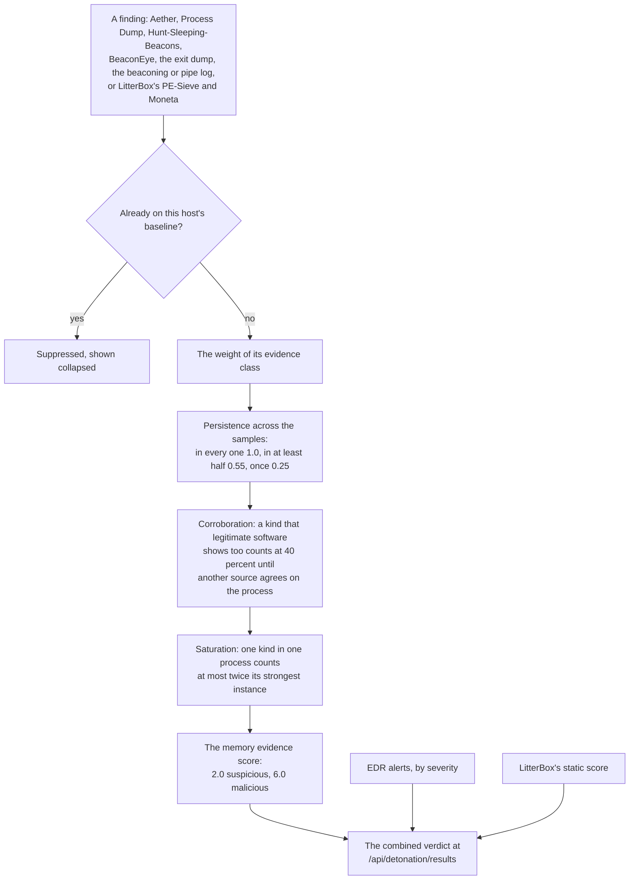

# Live Memory Analysis

Packers decrypt themselves in memory and injected implants never touch disk, so
the chamber also looks at processes while they run - and at the moment they exit.

## What runs after a detonation

When the DetonatorAgent returns a PID, these run automatically (Submit tab →
**Memory** sub-tab, stage cards **Exit Capture** and **Live Memory**):

| Step | Tool | Notes |
|------|------|-------|
| Armed before execution | **Exit Capture** | Windows writes a full-memory dump when the sample exits (`C:\dumps\exit`). Armed per image name for 120 s, then the registry keys are removed again |
| Live, read-only | Hunt-Sleeping-Beacons, BeaconEye, **Aether** | Aether samples the process 3× (3 s apart) |
| Live, read-only | **Syscalls** | Measures the process's `ntdll` syscall stubs against the NTSleuth baseline of this build and view, and searches the process and the sample file for stubs the sample carries itself. Needs the baseline file only, not NTSleuth. Skips itself, with its reason kept, without a baseline of this build (it never extracts one), for a process that is gone, or when `TDC_NO_SYSCALL_STAGE=1`; the detonation goes on |
| Live, writes files | **Process Dump** | Runs last; skips modules in the clean-hash database (`C:\dumps\<time>_pid<PID>`) |
| From the log | **Network beaconing** | Sysmon EID 3 connections scored for check-in periodicity - still available after the process exited |

## How findings become a verdict

All sources go through one tool-independent model (`webui/memory_evidence.py`);
no scanner's own severity label is trusted directly.



A finding the clean-host baseline already knows is set aside before anything is
counted; what is left is weighed by its evidence class and then by how
persistently it appears and whether a second source agrees, and no single kind
of finding may dominate a process. The sum of what is left is the memory
evidence score. That score, the EDR alerts and LitterBox's static score together
make the one verdict the Submit tab shows.

| Factor | Effect |
|--------|--------|
| **Evidence class** | structural fact (thread starts in private RX memory, PE in private memory) > behavioural (pointer tables, beaconing) > extracted artifact > byte pattern. String rules are weighted by their own `risk_score` |
| **Persistence** | finding in every sample ×1.0, in ≥ half ×0.55, once ×0.25 |
| **Corroboration** | kinds that also occur in legitimate software (hidden module, private RWX, heap API table, low-risk strings) count 40 % until an independent source agrees on the same process |
| **Host baseline** | findings this box produces on its own are suppressed (shown collapsed, never silently dropped) |
| **Saturation** | one kind repeated N times in one process counts at most 2× its strongest instance |
| **Observation** | a scan that read no memory reports **NOT OBSERVED**, not CLEAN |

Thresholds: score ≥ 2.0 SUSPICIOUS, ≥ 6.0 MALICIOUS. Every finding lists the
factors behind its score.

Measured on the ARM64 UTM VM with three harmless test programs:

| Sample | Behaviour | Verdict |
|--------|-----------|---------|
| exits after 6 s | nothing | CLEAN 0.75 |
| exits after 6 s | private RWX thread, PE copy in private memory, implant string in heap | MALICIOUS 6.54 (from the exit dump; the live scan came too late) |
| connects every 2 s | 8 outbound connections | SUSPICIOUS 2.9 |

A system-wide sweep of the clean VM (139 processes) scores 0 after a baseline
sweep; security tools that keep detection rules in memory (Fibratus, Rustinel,
the web UI itself) are listed as excluded instead of scored.

## Syscall integrity

Everything above measures a process's own memory. `ntdll.dll` is the blind spot:
Aether treats everything under `C:\Windows\` as system code, so it never looks
for hooks in `ntdll` and never compares it with the file on disk, and its
disk-versus-memory diff answers a bare yes or no, with no name, no address and
no bytes. Yet `ntdll` is where implants work: they unhook it, patch a stub, or
carry a stub of their own and skip it. The SYSCALLS tab fills the gap with a
**baseline** of what every syscall stub of this Windows build should look like,
and with names and numbers for whatever differs.

### The baseline

[NTSleuth](https://github.com/xaitax/NTSleuth) reads `ntdll.dll` and `win32u.dll`
and writes out every syscall (about 2,461) with its number, its RVA, its
parameters and the bytes of its stub. `scripts/install-ntsleuth.ps1` runs it once
during provisioning and keeps the result in
`C:\tools\ntsleuth\baseline\ntsleuth-<build>-<view>.json`. A baseline belongs to
one Windows build and one **view**: on an ARM64 host `System32\ntdll.dll` holds
two, the native `arm64` one and the `x64` one that emulated samples see, each
with its own RVAs and stub bytes, so both are extracted. The view of a target is
read from the PE header of its image.

A Windows update changes the build and with it the baseline. The next request
that needs one extracts it again in the background, which takes a few seconds.
When the symbol server cannot be reached, which is the normal case on the
isolated box, it runs with `--no-symbols`: the parameter table is then
incomplete and the tab says so, but the measurement is unaffected, because
numbers, RVAs and stub bytes come from the disassembly, not from symbols.

### The measurement

SCAN reads the stubs of one process, with read rights only: no write, no attach,
no thread. It compares the prefix of each stub that decides what it does (the
`SVC` and `RET` on ARM64, the real length of the stub on x64), not the whole
window NTSleuth stores, which runs on into the next stub and would light up the
neighbour of every hook. Each stub comes out in one of five states:

| State | Meaning |
|-------|---------|
| **intact** | As the baseline has it |
| **hooked** | A jump into a loaded module that a file backs and that is not `ntdll`: what an EDR does |
| **patched** | A jump into private memory that no file backs |
| **diverged** | The bytes differ, but the jump is neither of the two or cannot be resolved. It is not guessed at, and never reported as intact |
| **unreadable** | No stub could be read. A scan with any of these is marked partial |

The difference between hooked and patched is the spine of the feature, and it is
decided by **who owns the jump target**, not by the instruction pattern. On a
machine with an EDR, hooks in `ntdll` are normal: the product installs them in
every process it watches. Counting them as evidence would make every clean host
look malicious. A hook jumps into a module the loader mapped from a file; a patch
jumps into memory somebody allocated, and nothing legitimate does that. So the
owner of the target is looked up with a region query for each stub that differs,
and a stub that merely jumps back into `ntdll` is `diverged`, because it is
neither.

Hooks the EDR installs everywhere are recorded once, on a host you believe is
clean (RECORD THE HOOKS OF THIS RUN AS KNOWN, or `POST /api/syscalls/hook-baseline`): pairs of a
syscall and the module that owns the jump, kept per build and view in
`webui/syscall_hook_allowlist.json`. A known hook stays on the map and in the
list but is filtered out before scoring. A patch is never recorded. Record the
hooks of a sample's process and the sample's own hooks stop counting.

### What scores

| Finding | Weight | Notes |
|---------|--------|-------|
| Syscall stub redirected into private memory (`patched`) | 4.0 | Structural, needs no second source |
| Syscall stub hooked by an unlisted module (`hooked`) | 0.8 | Behavioural, counts at 40 % until another source agrees on the process |
| Syscall stub outside `ntdll` (`direct_syscall_stub`) | 4.0 | Every hit is a hint for now and counts at 40 % until another source agrees, see below |

`diverged` and `unreadable` stay on the map and out of the score. A scan goes
into the scan history like the others, and into the combined verdict through the
same evidence model as everything else in this page.

### Stubs the sample brings itself

A sample that carries its own syscall stub never calls `ntdll`, so the
measurement above cannot see it. STUBS searches the chosen process's private
executable memory and the sample file for the shape of a stub with a number that
is valid for this build, which is what makes a hit specific: not "an `SVC`
somewhere" but "a stub for `NtWriteVirtualMemory`". Guard pages are never read,
because reading one would change the process. Every hit is for now a hint: telling
a bypass from an ordinary call needs the chain from the Win32 function to its Nt
counterpart, which the chamber does not have yet, so `import_present` stays
`null`. A stub that jumps into `ntdll`'s own `syscall` instruction (an indirect
syscall) has no stub shape of its own and is not found.

### Rules

Draft rule shows a rule and writes nothing. For a stub found by STUBS it is a
YARA rule that names the syscall, the build and the view (a rule without the view
would fall silent on the other one, and nobody would know why).

APPLY TO THIS VM writes it into the folder Rustinel reads,
`C:\tools\detection-rules\yara-combined\tdc`. Rustinel is configured to reload
its rules without a restart, so it should pick the rule up within about two
seconds, **but that is not yet verified on a VM**: look in Rustinel's log for the
reload before you trust the rule. The applied copy is lost with the VM.

DOWNLOAD FOR THE REPO gives the same rule as a file to commit under `rules/yara/`,
so that it is version-controlled and reviewable.
**Whether a committed rule is loaded again after a rebuild is not yet verified.**
As the scripts read, `install-detection-rules.ps1` points Rustinel at
`yara-combined`, which links only the upstream pack and the Elastic rules, while
`install-rustinel.ps1` copies the repository's own rules to another folder. Do not
rely on a committed rule until that is settled.

For a deviation in `ntdll` the draft is an entry for
`webui/syscall_signatures.json`, to be added by hand. There are no Sigma rules
for this: a patched stub raises no event. The YARA rule matches its bytes
anywhere, the `ntdll` of the same build included. As Rustinel's configuration
reads, it does not scan `C:\Windows\`; that is not yet verified on a VM either.
Review a draft before keeping it.

### When the tab says it cannot measure

Two notices look alike and are not.

- **No baseline** for this build and view: nothing has been extracted yet, or
  NTSleuth is not installed (`scripts/install-ntsleuth.ps1` installs it). Asking
  for a baseline starts the extraction in the background; press Refresh after a
  few seconds. A failed one is tried again after ten minutes at the earliest. A
  baseline of an older build is listed as such and is not used.
- **Not distinguishable on this host**: `ntsleuth-x64.exe` ran under emulation and
  produced the same view as the native `arm64` one. Measuring against it would
  report every x64 process wrongly, so that baseline was discarded on purpose
  and nothing is broken. Emulated x64 processes cannot be measured here, and
  the arm64 view still works. Asking again gives the same answer.

The detonation stage (**Syscalls** in the table at the top) needs only the
baseline file, not NTSleuth. It skips itself with its reason when there is no
baseline of this build and view, when the process is gone, or when
`TDC_NO_SYSCALL_STAGE=1` is set, and the detonation goes on.

## Before the first detonation (clean box)

```text
ThreatScan → Live Process Memory → "Sweep as baseline"     # memory baseline, ~4 min
ThreatScan → Live Process Memory → "Full dump baseline"    # Process Dump -db gen, ~20+ min
```

Provisioning only runs `pd64.exe -db genquick` (running processes). Anything
captured into either baseline stops counting as evidence later - never run
them after a sample has executed.

## ARM64 hosts

x64 samples run under emulation, and the emulator's ARM64 translation cache is
private executable memory. Exit Capture and Process Dump code chunks are
classified by content (ARM64 instruction density, single-RET stub pages) and
listed as host artifacts rather than injected code.

`pd64.exe -closemon` is intentionally not used: it overwrites `NtTerminateProcess`
with x64 instructions in every process and decides the architecture from
"PE32+" alone, which is also true for native ARM64 processes.

## Limitations

- Exit Capture is armed by image name; child processes with other names are
  only covered by the live scanners and the network log.
- Live-memory findings depend on timing. Use several samples for anything you
  want to compare.
- The memory baseline is per host. Rebuild it after installing software.
- The syscall measurement covers the stubs of `ntdll.dll`, and of `win32u.dll`
  when asked; a process that maps a module more than once is not measured for
  it, and the scan says so. A scan is given 120 s.
- The hook list is as clean as the host it was recorded on. Record it before
  the first detonation, from a process you trust, not after.
- Windows reuses PIDs. Processes are tracked per instance (PID + start time):
  the newest process with a PID is addressed by the plain PID, earlier ones as
  `<pid>@<start epoch>`. Alerts, events and children are attributed to the
  instance that was alive at the time.
- Live-memory results (Aether, Process Dump, exit capture, beacon scanners) are
  stored in `webui/memory_results/` and survive restarts of the web UI.
- Baseline entries are keyed by the process's full image path, so a sample that
  names itself `svchost.exe` does not inherit the real svchost's entries. A
  baseline from an older key scheme is reported as outdated and ignored -
  capture it again ("Sweep as baseline").

**Next:** [Named pipes](pipes.md)
