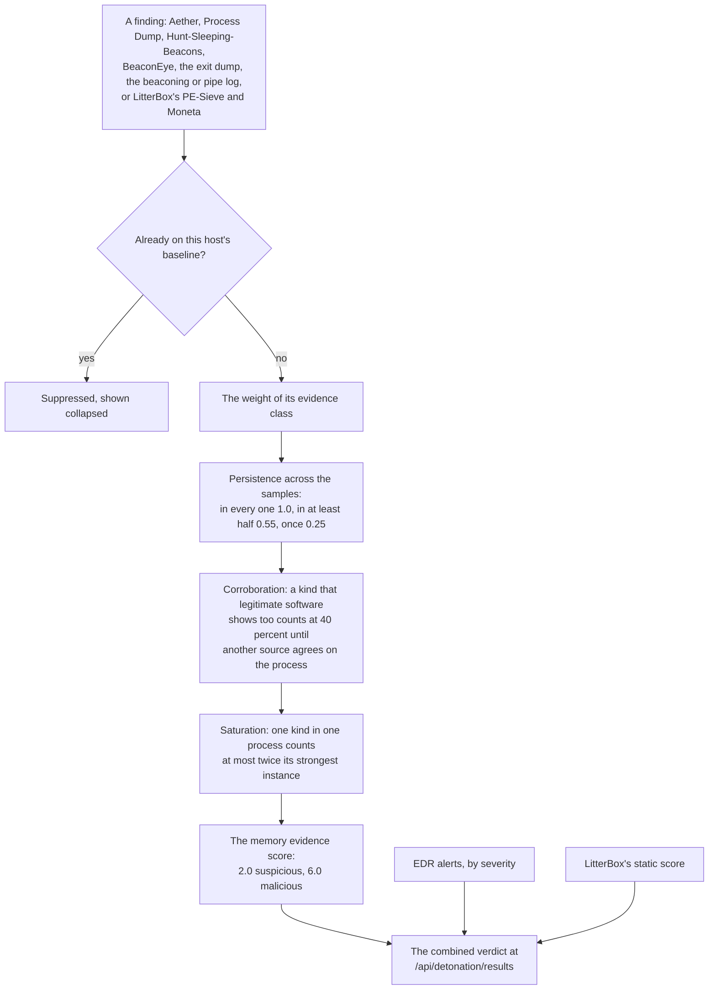

# Live Memory Analysis

Packers decrypt themselves in memory and injected implants never touch disk, so
the chamber also looks at processes while they run - and at the moment they exit.

## What runs after a detonation

When the DetonatorAgent returns a PID, these run automatically (Submit tab →
**Memory** sub-tab, stage cards **Exit Capture** and **Live Memory**):

| Step | Tool | Notes |
|------|------|-------|
| Armed before execution | **Exit Capture** | Windows writes a full-memory dump when the sample exits (`C:\dumps\exit`). Armed per image name for 120 s, then the registry keys are removed again |
| Live, read-only | Hunt-Sleeping-Beacons, BeaconEye, **Aether** | Aether samples the process 3× (3 s apart) |
| Live, read-only | **Syscalls** | Measures the process's `ntdll` syscall stubs against the NTSleuth baseline of this build and view, and searches the process and the sample file for stubs the sample carries itself. Needs the baseline file only, not NTSleuth. Skips itself, with its reason kept, without a baseline of this build (it never extracts one), for a process that is gone, or when `TDC_NO_SYSCALL_STAGE=1`; the detonation goes on |
| Live, writes files | **Process Dump** | Runs last; skips modules in the clean-hash database (`C:\dumps\<time>_pid<PID>`) |
| From the log | **Network beaconing** | Sysmon EID 3 connections scored for check-in periodicity - still available after the process exited |

## How findings become a verdict

All sources go through one tool-independent model (`webui/memory_evidence.py`);
no scanner's own severity label is trusted directly.



A finding the clean-host baseline already knows is set aside before anything is
counted; what is left is weighed by its evidence class and then by how
persistently it appears and whether a second source agrees, and no single kind
of finding may dominate a process. The sum of what is left is the memory
evidence score. That score, the EDR alerts and LitterBox's static score together
make the one verdict the Submit tab shows.

| Factor | Effect |
|--------|--------|
| **Evidence class** | structural fact (thread starts in private RX memory, PE in private memory) > behavioural (pointer tables, beaconing) > extracted artifact > byte pattern. String rules are weighted by their own `risk_score` |
| **Persistence** | finding in every sample ×1.0, in ≥ half ×0.55, once ×0.25 |
| **Corroboration** | kinds that also occur in legitimate software (hidden module, private RWX, heap API table, low-risk strings) count 40 % until an independent source agrees on the same process |
| **Host baseline** | findings this box produces on its own are suppressed (shown collapsed, never silently dropped) |
| **Saturation** | one kind repeated N times in one process counts at most 2× its strongest instance |
| **Observation** | a scan that read no memory reports **NOT OBSERVED**, not CLEAN |

Thresholds: score ≥ 2.0 SUSPICIOUS, ≥ 6.0 MALICIOUS. Every finding lists the
factors behind its score.

Measured on the ARM64 UTM VM with three harmless test programs:

| Sample | Behaviour | Verdict |
|--------|-----------|---------|
| exits after 6 s | nothing | CLEAN 0.75 |
| exits after 6 s | private RWX thread, PE copy in private memory, implant string in heap | MALICIOUS 6.54 (from the exit dump; the live scan came too late) |
| connects every 2 s | 8 outbound connections | SUSPICIOUS 2.9 |

A system-wide sweep of the clean VM (139 processes) scores 0 after a baseline
sweep; security tools that keep detection rules in memory (Fibratus, Rustinel,
the web UI itself) are listed as excluded instead of scored.

## Syscall integrity

Everything above measures a process's own memory. `ntdll.dll` is the blind spot:
Aether treats everything under `C:\Windows\` as system code, so it never looks
for hooks in `ntdll` and never compares it with the file on disk, and its
disk-versus-memory diff answers a bare yes or no, with no name, no address and
no bytes. Yet `ntdll` is where implants work: they unhook it, patch a stub, or
carry a stub of their own and skip it. The SYSCALLS tab fills the gap with a
**baseline** of what every syscall stub of this Windows build should look like,
and with names and numbers for whatever differs.

### The baseline

[NTSleuth](https://github.com/xaitax/NTSleuth) reads `ntdll.dll` and `win32u.dll`
and writes out every syscall (how many depends on the build and the view: on build
26200.9974, ARM64, the arm64 view holds 1,991, the x64 view 490 and no win32u
one) with its number, its RVA, its
parameters and the bytes of its stub. `scripts/install-ntsleuth.ps1` runs it once
during provisioning and keeps the result in
`C:\tools\ntsleuth\baseline\ntsleuth-<build>-<view>.json`. A baseline belongs to
one Windows build and one **view**: on an ARM64 host `System32\ntdll.dll` holds
two, the native `arm64` one and the `x64` one that emulated samples see, each
with its own RVAs and stub bytes, so both are extracted. The view of a target is
read from the PE header of its image.

A Windows update changes the build and with it the baseline. The next request
that needs one extracts it again in the background, which takes a few seconds.
When the symbol server cannot be reached, which is the normal case on the
isolated box, it runs with `--no-symbols`: the parameter table is then
incomplete and the tab says so, but the measurement is unaffected, because
numbers, RVAs and stub bytes come from the disassembly, not from symbols.

### The measurement

SCAN reads the stubs of one process, with read rights only: no write, no attach,
no thread. It compares the prefix of each stub that decides what it does (the
`SVC` and `RET` on ARM64, the real length of the stub on x64), not the whole
window NTSleuth stores, which runs on into the next stub and would light up the
neighbour of every hook. Each stub comes out in one of five states:

| State | Meaning |
|-------|---------|
| **intact** | As the baseline has it |
| **hooked** (file-backed module) | The jump ends in a loaded module that a file backs and that is not `ntdll`. An EDR does that, but so does a DLL the sample dropped and loaded, or a legitimate DLL it overwrote in place (module stomping keeps the image and its path); the scan cannot tell these apart |
| **patched** | The jump ends in memory no hooking product explains: private memory, a section no file backs or a mapped view of a file (after any relay was followed, see below), a core Windows module such as `kernelbase.dll` or `win32u.dll`, which means a code cave, or `ntdll` itself reached through such a relay |
| **diverged** | The bytes differ, but nothing tells a hook from a patch: there is no jump, its target cannot be resolved, or it goes straight into `ntdll` or the stub's own module. It is not guessed at, never reported as intact, and the verdict says how many there are |
| **unreadable** | No stub could be read. A scan with any of these is marked partial |

The difference between hooked and patched is the spine of the feature, and it is
decided by **who owns the jump target**, not by the instruction pattern. On a
machine with an EDR, hooks in `ntdll` are normal: the product installs them in
every process it watches. Counting them as evidence would make every clean host
look malicious. So the owner of the target is looked up with a region query for
each stub that differs, and a stub that merely jumps straight back into `ntdll`
is `diverged`, because it may be ntdll's own jump or a baseline error. Through a
private relay it is `patched`: that rules out both.

**A first hop into private memory is not malice by itself.** MinHook and
Microsoft Detours, the most common x64 hooking libraries, write `E9 rel32` into
the stub and land on a relay they allocated near the target with
`VirtualAlloc`: private memory. Only the relay jumps on (`FF 25`) to the hooking
DLL. ARM64 hookers relay by necessity, because a `B` reaches only 128 MB. EDRs,
overlay and capture software and the browser sandboxes hook this way. So when the
first target is private and its bytes are one of the known jump forms, the scan
follows it, up to two hops, and judges the stub by the **final** owner; the
relays it passed are listed with the stub. The ARM64 forms take any register:
`LDR Xn, literal; BR Xn`, `ADRP; ADD; BR` and `ADRP Xn; LDR Xt, [Xn, #imm];
BR Xt`, which is what Detours writes, with x17, and `MOVZ` with up to three
`MOVK` and a branch; each may end in a pointer-authenticated branch (`BRAA`,
`BRAB`, `BRAAZ`, `BRABZ`), followed to the address below its PAC (the low 47 bits, which hold every Windows user address). On x64 the
14-byte `PUSH imm32; MOV DWORD [RSP+4], imm32; RET` is known as well. The
decoder is not exhaustive: a private relay in a form it does not know is read as
code that is no jump, so `patched`. That is deliberate, since the other way round
any code the decoder does not know would score nothing; what remains is a false
positive on an unknown hooking form, never a false negative on malware. Private code that is no jump is the
code that runs, and stays `patched`; so does a chain that is still in private
memory after two hops. A relay that cannot be read, or whose target cannot be
looked up, is not guessed past: the stub is `diverged` and counts as a failed
owner lookup, which marks the scan partial.

Memory no file backs is a private allocation or a mapped section with no file
behind it (a pagefile-backed section, the classic target of
`NtMapViewOfSection`). A mapped view of a named file is no loaded module either,
whatever file it maps, a data copy of `ntdll.dll` among them: its owner is
`mapped`, and it is weighed and followed as private memory is, so its state does
not depend on whether its name could be had. An image region whose file name cannot be had is a failed
lookup, not an owner nobody has: an image is file-backed by definition, and the
name query fails easily under the limited access right.

**What the region query cannot see.** Module stomping overwrites a legitimate
DLL in place and keeps its image type and path, so a hook into a stomped DLL
reads as `hooked` with that DLL's name. The scan cannot tell that from an EDR,
which is why the state is called hooked (file-backed module) and weighs little.
Nor can it see a gadget: relays are followed only until the first file-backed
module, so a private relay that jumps to a `BR Xn` or `JMP` gadget in any loaded
non-core DLL reads as `hooked` with that DLL's name while control returns to
private code. That holds for every jump form, `B` and `FF 25` included.

Hooks the EDR installs everywhere are recorded once, on a host you believe is
clean (RECORD THE HOOKS OF THIS RUN AS KNOWN, or `POST /api/syscalls/hook-baseline`): pairs of a
syscall and the module that owns the jump, kept per build and view in
`webui/syscall_hook_allowlist.json`. A known hook stays on the map and in the
list but is filtered out before scoring. A patch is never recorded. Record the
hooks of a sample's process and the sample's own hooks stop counting.

### What scores

| Finding | Weight | Notes |
|---------|--------|-------|
| Syscall stub redirected into private memory (`patched`) | 4.0 | Structural, needs no second source |
| Syscall stub hooked by an unlisted module (`hooked`) | 0.8 | Behavioural, counts at 40 % until another source agrees on the process |
| Syscall stub carries the number of another syscall (`syscall_stub_renumbered`) | 4.0 | Structural, needs no second source. A stub of intact shape whose number is not the baseline's: the call enters the kernel as another syscall. It needs no jump target and no allowlist covers it; its state is `diverged` |
| Syscall stub outside `ntdll` (`direct_syscall_stub`) | 4.0 | Structural. A proven bypass carries the full weight; a hint counts at 40 % until another source agrees and corroborates nothing itself, see below |

`diverged` and `unreadable` stay on the map and out of the score, except a
renumbered stub, which scores as above. A scan goes
into the scan history like the others, and into the combined verdict through the
same evidence model as everything else in this page.

### Stubs the sample brings itself

A sample that carries its own syscall stub never calls `ntdll`, so the
measurement above cannot see it. STUBS searches the chosen process's private
executable memory and the sample file for the shape of a stub with a number that
is valid for this build, which is what makes a hit specific: not "an `SVC`
somewhere" but "a stub for `NtWriteVirtualMemory`". Guard pages are never read,
because reading one would change the process. Telling a bypass from an ordinary
call needs the chain from the Win32 function to its Nt counterpart: a sample that
calls `VirtualAllocEx` never imports `NtAllocateVirtualMemory`. The chamber holds
that chain in `webui/win32_to_nt.json`, each row with the source it was read from.
The APIs it already calls suspicious decide which syscalls the table covers; for a
covered syscall it lists every door, suspicious or not. A door is an API whose
contract performs that syscall's operation on operands the caller supplies: the heap
commits memory and the loader reprotects an import table, but their callers name no
address, protection or process, so neither is a door. A stub whose function the sample does
not import, by its import table widened through that table, is a proven bypass
(`import_present` `false`); one it imports as well is a hint (`true`). Outside the
table `import_present` stays `null`, and so does every hit when the import table
cannot be read or a table of the file was cut short when it was read: a hint. The
file is read by the same reader as the binary graph, so a declared import,
delay-load or export directory the parser refuses leaves the table unread rather
than empty. That is a boundary, not a gap: for a syscall no curated row
leads to, a missing import proves nothing. A proof assumes the table names the
documented entry points to that syscall. An uncommon wrapper to a covered syscall
reads as a bypass: a false positive on an unusual but clean program that carries a
raw stub, never a false negative on malware. Each newly found entry point widens
the table; it does not change the rule. A file's export table counts only where a
stub is the body of an export under its own Nt or Zw name, as in a copy of `ntdll`:
the stub starts at the export's address or less than one stub's read length after it
(20 bytes on ARM64, 32 on x64), since ARM64 `ntdll` carries a second `SVC` sixteen
bytes into `NtUnmapViewOfSection`. The bound is what keeps the rule tight: without
it any stub after an export of that name would match. A sample that publishes its own
stub that way escapes the proof, but a non-`ntdll`
PE exporting syscall stubs is a loud indicator in its own right, so a silent free
escape becomes a noisy one.

**A file searched in a view its machine does not match claims no absence.** The
search compares the view against the file's own `FileHeader.Machine`. The export
table the parser reads describes the file's native view, so a stub found in another
view cannot be matched against it: an unmodified ARM64X `ntdll` (machine ARM64)
searched in the x64 view has its x64 stubs near file offset `0x2fb000`, while every
named export points at an ARM64 stub below `0x2400`. Without this rule every covered
syscall of Microsoft's own `ntdll` read as a proven bypass. There every hit is `null`
unless the import table names the function (`true`), `doors_complete` is `false`, and
`doors_note` names both machines. Reading the hybrid (ARM64X) export table that
describes the other view is not done: the parser does not expose it, and guessing it
would be worse than declining. A sample built for x64 searched in the x64 view is
unaffected.

Copies of one syscall are one finding, and it says the weakest claim among them:
`true` if any copy is `true`, else `null` if any is `null`, else `false`, whatever
their order, so a copy the file exports as its own code is never outvoted by one found
before it. The ordering runs over the copies of one source: where the sample file has
copies, those decide, since a process copy answers for every loaded module and never
for the sample.

A hit whose door is the file's own export of that stub carries `own_export`, and its
row says so. The finding speaks only for the copies it describes: when every copy is
an export body, it calls the stub the module's own code rather than a stub carried
past the documented path; when only some of the copies in the file are, it says how
many, that the others are not, and that the finding is therefore a hint rather than a
proof and the file deserves a look. That is the loud indicator above: a decoy export
under the Nt name buys a hint, never the words "own code". Counts in that sentence
are of the copies in the file; the finding's `copies` also counts those in process
memory. All of it is a fact of each hit and needs no judgment over the file. A
cheaply declared decoy export over one copy turns the finding of its syscall into a
hint whatever the other copies are, now whatever their order: that escape existed
under the old first-copy rule as well, it fails toward a hint, the sentence names it,
and it is accepted as such. Searching `ntdll.dll` itself in its own view
is a category error rather than a bypass: nearly every stub reads that way, and the
verdict is still SUSPICIOUS on several hundred hints alone, as its reasons name the
kind and not the detail.

Two limits follow from the rule. Private executable memory is not the sample's
alone (a hook engine, a browser sandbox's interception thunks or a runtime put
stubs there too), so a stub found there is judged against the union of the doors
every loaded module imports, never against the image's import table alone. The
binary graph of the system holds the import table of every System32 binary, which
makes that union cheap; a module is counted by its path, and only one loaded
directly from System32 that the graph holds contributes. The image's own imports
are read from its file. A module the graph does not hold (the sample's own DLL, a
runtime or hook engine outside System32, a DLL of a System32 name side-loaded from
elsewhere, one whose table was cut short), a process in another view than the
graph's, or a module list that cannot be read again after the search leaves the union
incomplete, and the stub stays a hint (`doors_complete` `false`, with the module
named in `doors_note`): a missing module is a missing door. Without a graph,
process mode says only whether the image imports the function as well, and the
proof can come only from the sample file. The image's imports are the very question
asked: a sample that imports a door is no proven bypass. Any other module the graph
does not hold contributes neither imports nor exports, or a sample would ship a DLL
with a made-up table and switch the proof off for the whole process; malware that
loads a DLL of its own therefore mostly gets `null` in process mode, and its proof
comes from its file. The module list is read before and after the search, and the
union is over both lists: a module loaded only for a while had its doors in the
address space all the same. An import by ordinal (`kernel32.dll!#157`) is named
through the exporting module's record in the graph, in process and in file mode; one
the graph cannot name (its module or number unknown, no graph, a graph of another
view) is an unknown door, and no absence is claimed.

**Process mode practically never yields a proof.** `kernelbase.dll`, loaded in
every Win32 process, implements the Win32 doors and so imports their Nt functions
straight from `ntdll` (`NtAllocateVirtualMemory`, `NtProtectVirtualMemory`,
`NtWriteVirtualMemory`, `NtCreateThreadEx`, `NtSetContextThread`,
`NtOpenProcessToken`, `NtAdjustPrivilegesToken`), so the documented path is present
in the address space even when the sample does not use it, and a stub in private
memory reads as `true`. That answer is correct, not a flaw of the denominator: for a
stub that cannot be attributed, whether the address space holds the documented path
is the only question that can be answered, and on a real Windows process the answer
is yes. Leaving the Nt names imported straight from `ntdll` out of the union would
read a process whose documented path genuinely sits in `kernelbase` as a bypass, a
false accusation. A process-mode proof can fire only for a covered syscall that no
loaded module imports, and on a real system there may be no such syscall. **The
proof comes from the sample file, which is the attributable source.**

**An emulated x64 process on ARM64 never gets a proof from process memory.** On this
chamber that is the normal case, not an edge: a 64-bit sample runs emulated on the
ARM64 VM, which is why two syscall baselines exist. The graph reads the native side
of System32's ARM64X binaries, whose x64 side may import otherwise, so a union built
from it would be wrong. The file-mode proof still works there, and it is the
attributable source.

Many ordinary GUI samples get no process-mode proof either, and that is expected:
`comctl32` v6 and the common-controls side-by-side assemblies load from `WinSxS`, and
an app-local Visual C++ runtime (`vcruntime140.dll`, `msvcp140.dll` beside the
exe) loads from the sample's folder. Neither is directly in System32, so the graph
does not hold them and the union is incomplete. The module list itself must be
whole: a module whose information or file name the reader cannot read makes the
list incomplete, and so does an empty list.

Further residuals of the process-mode proof. A module that unlinks itself from the
loader's list is missing from the union, which pushes the answer toward `false`,
toward a proof: that is against an attacker's interest (malware wants to be a hint,
not a proof, and has no reason to hide a module that imports a door), so it threatens
only a clean program that hides a module from its own loader, which clean software
does not do; no cross-check against the file-backed regions is built, by that
reasoning. An image file changed on disk after the process started makes the union
describe the file, not the mapped image. A module unloaded before the search is in
neither list, though it may have left the stub. A System32 file overwritten without
a build change is not noticed: the graph describes the old file (that takes admin
rights). And a module may write a stub its imports do not explain: a hook engine
copies `ntdll`'s stub bytes into a private trampoline instead of calling
`VirtualAllocEx`, and a broker or injector writes a stub into the process from
outside. If such a module sits directly in System32 and is in the graph, the union
is complete, no door is found, and a clean host reads as a proven bypass: "every
EDR hook is a finding", one layer up. The host memory baseline does **not** mitigate
this today. A `direct_syscall_stub` finding is keyed by the process it was found in
(its image path), so an entry recorded for one program never matches another, and
no sweep records one at all: the sweep's syscall stage measures hooks and does not
search for carried stubs, and "Sweep as baseline" does not run it. A one-off writer
and a host without a baseline are not covered for the same reason. Engines that
live outside System32 (most EDRs install under `Program Files`) leave the union
incomplete and are not affected.

In file mode too, some covered syscalls almost never yield a
proof: nearly every binary imports `FreeLibrary` (a door to
`NtUnmapViewOfSection`) and `CreateThread` or `_beginthreadex` (doors to
`NtCreateThreadEx`), so a carried stub for hollowing or remote thread creation is
usually a hint. A missing proof is not reassurance. Where the target of a door is
uncertain, the door is listed: for a door to a syscall the table already covers, a
wrong `nt` costs a hint and a missing row a false accusation. That asymmetry holds
for doors only; a wrong `nt` on a row that brings a syscall into coverage adds a
syscall whose doors were never audited.

A stub that jumps into `ntdll`'s own `syscall` instruction (an indirect
syscall) has no stub shape of its own and is not found.

### Rules

Draft rule shows a rule and writes nothing. For a stub found by STUBS it is a
YARA rule that names the syscall, the build and the view (a rule without the view
would fall silent on the other one, and nobody would know why).

APPLY TO THIS VM writes it into the folder Rustinel reads,
`C:\tools\detection-rules\yara-combined\tdc`. Rustinel is configured to reload
its rules without a restart, so it should pick the rule up within about two
seconds, **but that is not yet verified on a VM**: look in Rustinel's log for the
reload before you trust the rule. The applied copy is lost with the VM.

A rule is drafted, applied or downloaded only for bytes that are exactly one
syscall stub of its view (`mov r10, rcx; mov eax, …; syscall` on x64, `SVC; RET`
on ARM64) that loads the number the rule names, with the name the syscall, view
and bytes make. The web UI has no login, so a process inside the VM can call
these routes: eight zero bytes or an MZ header are refused. The folder takes at
most 200 rule files (HTTP 507 after that), and no rule is written if `tdc` itself
is a link or junction.

DOWNLOAD FOR THE REPO gives the same rule as a file to commit under `rules/yara/`,
so that it is version-controlled and reviewable.
**Whether a committed rule is loaded again after a rebuild is not yet verified.**
As the scripts read, `install-detection-rules.ps1` points Rustinel at
`yara-combined`, which links only the upstream pack and the Elastic rules, while
`install-rustinel.ps1` copies the repository's own rules to another folder. Do not
rely on a committed rule until that is settled.

For a deviation in `ntdll` the draft is an entry for
`webui/syscall_signatures.json`, to be added by hand. There are no Sigma rules
for this: a patched stub raises no event. The YARA rule matches its bytes
anywhere, the `ntdll` of the same build included. As Rustinel's configuration
reads, it does not scan `C:\Windows\`; that is not yet verified on a VM either.
Review a draft before keeping it.

### When the tab says it cannot measure

Two notices look alike and are not.

- **No baseline** for this build and view: nothing has been extracted yet, or
  NTSleuth is not installed (`scripts/install-ntsleuth.ps1` installs it). Asking
  for a baseline starts the extraction in the background; press Refresh after a
  few seconds. A failed one is tried again after ten minutes at the earliest. A
  baseline of an older build is listed as such and is not used.
- **Not distinguishable on this host**: `ntsleuth-x64.exe` ran under emulation and
  produced the same view as the native `arm64` one. Measuring against it would
  report every x64 process wrongly, so that baseline was discarded on purpose
  and nothing is broken. Emulated x64 processes cannot be measured here, and
  the arm64 view still works. Asking again gives the same answer.
- **Unusable: the stubs do not have the shape of the view.** A baseline is used
  only when most of its stubs look like its view's (`4C 8B D1 B8` on x64, `SVC`
  on ARM64). An x64 file that holds ARM64 stubs, left by an older installer or
  one that could not be deleted, is refused rather than measured by; delete it.

The detonation stage (**Syscalls** in the table at the top) needs only the
baseline file, not NTSleuth. It skips itself with its reason when there is no
baseline of this build and view, when the process is gone, or when
`TDC_NO_SYSCALL_STAGE=1` is set, and the detonation goes on. Its result, and the
reason it skipped, are in the **Memory** tab of the detonation; a partial
measurement and stubs that diverged are named in the verdict's reasons, so that
neither reads as a clean process.

The system-wide sweep (`POST /api/memory/sweep`) runs the syscall scan only when
asked for with `"syscalls": true`. The SWEEP button and "Sweep as baseline" do
not ask for it: a syscall finding does not go into the host baseline until a
clean VM has been shown to sweep clean with it.

### The binary graph

GRAPH beside MAP draws the **import graph of `C:\Windows\System32`** in the map's
place: for every PE in that folder (3,999 of them on build `26200.9974`), which modules and which
functions it imports, delay-loads included, what it exports, which exports are
forwarders and where a forwarder ends, with api-set names resolved to the module
that hosts them. It answers the question the baseline cannot: *by which door does
a sample reach this syscall*, and who else uses the same door.

The graph is made **here and offline**: `scripts/build-binary-graph.ps1` reads the
files of this VM with `pefile` at provisioning, and the web UI builds it in the
background when it is missing ([Configuration](configuration.md#the-binary-graph-cache),
[Troubleshooting](troubleshooting.md#syscalls-graph-says-there-is-no-binary-graph)).
It is the graph of this build and this architecture, and of no other, so on an
ARM64 VM it is an ARM64 one. [WinGraph](https://wingraph.m0n1x90.dev/) shows a
dependency graph of System32 too, but it has no public API, this VM has no
internet, and a foreign dataset would not be the one of this system; the tab only
links to it, and nothing is queried or fetched from it.

![The SYSCALLS tab in GRAPH view on build 26200.9974 arm64: the query path to syscall for kernel32.dll and WriteProcessMemory, the sentence that the last step is not read from any binary but comes from the curated Win32 to Nt table, the path drawn as WriteProcessMemory of kernel32.dll joined by a dashed edge labelled curated to NtWriteVirtualMemory of ntdll.dll at 0x3a, the legend naming derived, curated and origin-unknown edges, and the figures of the whole stock with 3,999 binaries, 107,715 import edges and 1,110 resolved api sets above the caveat that 7 binaries had a table cut short](../static/syscalls_graph.png)

It has three parts. **PATH** asks one question and draws the answer from left to
right, one layer per hop: *path to syscall* (an import such as `kernel32.dll` and
`WriteProcessMemory`, followed over forwarders and api sets to the export that
defines it and from there to a syscall number of this build's baseline),
*importers*, *imports*, *syscall callers*, *forwarders* and *shared dependencies*.
**EXPLORE** starts at one binary and opens its neighbours node by node (EXPAND,
FUNCTIONS, 1 to 3 hops at a time, 400 nodes at most on the canvas). **FIGURES**
is the table of numbers of the whole stock (binaries, edges, resolved api sets,
forwarders, isolated binaries, circular pairs, curated transitions, the most
imported modules, skipped files, binaries with a cut table); a number opens the
list behind it in the DETAIL panel and a row of that list starts an exploration.

**The graph gets the room.** Measured on the chamber at 1920×1080, the canvas got
240 px — its floor — while the panels of the last scan took 320 px of the same
column and the figures table 260, so GRAPH folds those panels away and **⇱** folds
the figures' rows as well: 240 px becomes 647. EXPLORE, which works on the canvas,
starts with those rows folded — at 1280×900 that is 254 px of canvas against 438 —
and PATH, whose answer is a short path, keeps the figures beside it.

What a fold may not do is swallow something the reader should learn. The scan
panels keep a bar that names them, carries each one's count as it is written, and
says when a stub search was not complete or the hook list could not be read at
all — a stub run in the graph view writes the proof of this whole feature into
that row. ⇱ leaves the figures' own line standing, the one that says how many
binaries had a table cut short and how many files could not be read at all; only
the rows go. A scan's own result line sits outside both views and is never
folded. What a fold does hide is the detail behind a count, and the bar is a
pointer to it, not a replacement. A fold or unfold by
hand is kept from then on. The canvas zooms with the wheel, `+` and `−`, FIT
brings every node into view, LAYOUT lays them out again, and a drag moves a node
or the view; the line under the canvas says what the controls around the chosen
node do.

**What is read and what is written by hand.** Every edge is read from a binary
except the curated kind. The last hop from a Win32 function to its Nt counterpart
(`WriteProcessMemory` to `NtWriteVirtualMemory`) is not in any file: it comes from
the table `webui/win32_to_nt.json`, kept by hand. That edge is drawn **dashed and
marked `curated`**, it is at most one per path and always the last, and the
legend says that it is the word of the table, not read from any binary. A path that ends in an Nt stub
which `ntdll.dll` or `win32u.dll` exports has no such edge and is derived from end
to end. The `Zw` name of an `ntdll` function reaches the syscall of its `Nt`
name by a curated edge as well, a naming convention that no binary states, and
the syscall callers draw that `Zw` step curated in the same way. The interface
never presents a curated edge as a derived one; besides a path and the syscall
callers, the list of the table's own rows (the figure *curated transitions*) is
the only place where they appear.

**Where the graph is incomplete it says so.** A binary whose import, delay-load or
export table was cut short when it was read is counted as such (the figure
*partial*), and an answer that read it is marked `partial`: a negative or a count
over it is not certain, and a count is a lower bound. A name that no binary of
System32 imports is *not imported by System32*, which is not the same as not
imported by anything.

The same graph is the denominator of the STUBS search for a stub in process
memory (see above). A scan never starts building it.

## Before the first detonation (clean box)

```text
ThreatScan → Live Process Memory → "Sweep as baseline"     # memory baseline, ~4 min
ThreatScan → Live Process Memory → "Full dump baseline"    # Process Dump -db gen, ~20+ min
```

Provisioning only runs `pd64.exe -db genquick` (running processes). Anything
captured into either baseline stops counting as evidence later - never run
them after a sample has executed.

## ARM64 hosts

x64 samples run under emulation, and the emulator's ARM64 translation cache is
private executable memory. Exit Capture and Process Dump code chunks are
classified by content (ARM64 instruction density, single-RET stub pages) and
listed as host artifacts rather than injected code.

`pd64.exe -closemon` is intentionally not used: it overwrites `NtTerminateProcess`
with x64 instructions in every process and decides the architecture from
"PE32+" alone, which is also true for native ARM64 processes.

## Limitations

- Exit Capture is armed by image name; child processes with other names are
  only covered by the live scanners and the network log.
- Live-memory findings depend on timing. Use several samples for anything you
  want to compare.
- The memory baseline is per host. Rebuild it after installing software.
- The syscall measurement covers the stubs of `ntdll.dll`, and of `win32u.dll`
  when asked and when the baseline has any (the x64 view of build 26200.9974 on
  ARM64 has none; the tab then switches the box off and says why); a process that maps a module more than once is not measured for
  it, and the scan says so. A scan is given 120 s.
- The hook list is as clean as the host it was recorded on. Record it before
  the first detonation, from a process you trust, not after.
- Windows reuses PIDs. Processes are tracked per instance (PID + start time):
  the newest process with a PID is addressed by the plain PID, earlier ones as
  `<pid>@<start epoch>`. Alerts, events and children are attributed to the
  instance that was alive at the time.
- Live-memory results (Aether, Process Dump, exit capture, beacon scanners) are
  stored in `webui/memory_results/` and survive restarts of the web UI.
- Baseline entries are keyed by the process's full image path, so a sample that
  names itself `svchost.exe` does not inherit the real svchost's entries. A
  baseline from an older key scheme is reported as outdated and ignored -
  capture it again ("Sweep as baseline").

**Next:** [Named pipes](pipes.md)
