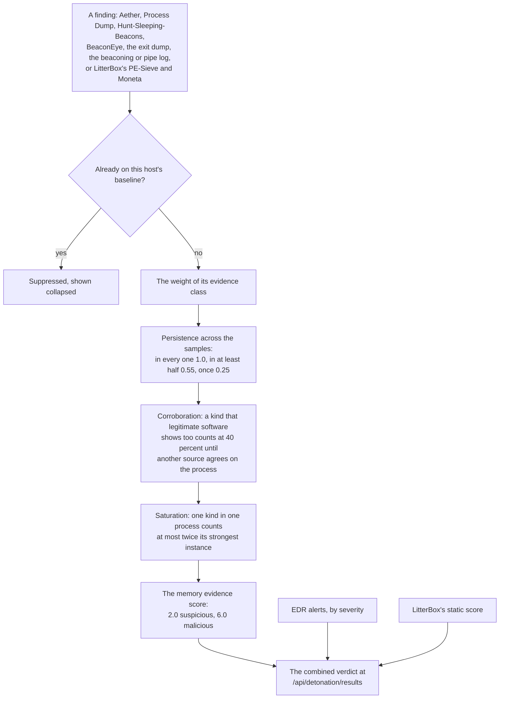

# Live Memory Analysis

Packers decrypt themselves in memory and injected implants never touch disk, so
the chamber also looks at processes while they run - and at the moment they exit.

## What runs after a detonation

When the DetonatorAgent returns a PID, these run automatically (Submit tab →
**Memory** sub-tab, stage cards **Exit Capture** and **Live Memory**):

| Step | Tool | Notes |
|------|------|-------|
| Armed before execution | **Exit Capture** | Windows writes a full-memory dump when the sample exits (`C:\dumps\exit`). Armed per image name for 120 s, then the registry keys are removed again |
| Live, read-only | Hunt-Sleeping-Beacons, BeaconEye, **Aether** | Aether samples the process 3× (3 s apart) |
| Live, read-only | **Syscalls** | Measures the process's `ntdll` syscall stubs against the NTSleuth baseline of this build and view, and searches the process and the sample file for stubs the sample carries itself. Needs the baseline file only, not NTSleuth. Skips itself, with its reason kept, without a baseline of this build (it never extracts one), for a process that is gone, or when `TDC_NO_SYSCALL_STAGE=1`; the detonation goes on |
| Live, writes files | **Process Dump** | Runs last; skips modules in the clean-hash database (`C:\dumps\<time>_pid<PID>`) |
| From the log | **Network beaconing** | Sysmon EID 3 connections scored for check-in periodicity - still available after the process exited |

## How findings become a verdict

All sources go through one tool-independent model (`webui/memory_evidence.py`);
no scanner's own severity label is trusted directly.



A finding the clean-host baseline already knows is set aside before anything is
counted; what is left is weighed by its evidence class and then by how
persistently it appears and whether a second source agrees, and no single kind
of finding may dominate a process. The sum of what is left is the memory
evidence score. That score, the EDR alerts and LitterBox's static score together
make the one verdict the Submit tab shows.

| Factor | Effect |
|--------|--------|
| **Evidence class** | structural fact (thread starts in private RX memory, PE in private memory) > behavioural (pointer tables, beaconing) > extracted artifact > byte pattern. String rules are weighted by their own `risk_score` |
| **Persistence** | finding in every sample ×1.0, in ≥ half ×0.55, once ×0.25 |
| **Corroboration** | kinds that also occur in legitimate software (hidden module, private RWX, heap API table, low-risk strings) count 40 % until an independent source agrees on the same process |
| **Host baseline** | findings this box produces on its own are suppressed (shown collapsed, never silently dropped) |
| **Saturation** | one kind repeated N times in one process counts at most 2× its strongest instance |
| **Observation** | a scan that read no memory reports **NOT OBSERVED**, not CLEAN |

Thresholds: score ≥ 2.0 SUSPICIOUS, ≥ 6.0 MALICIOUS. Every finding lists the
factors behind its score.

Measured on the ARM64 UTM VM with three harmless test programs:

| Sample | Behaviour | Verdict |
|--------|-----------|---------|
| exits after 6 s | nothing | CLEAN 0.75 |
| exits after 6 s | private RWX thread, PE copy in private memory, implant string in heap | MALICIOUS 6.54 (from the exit dump; the live scan came too late) |
| connects every 2 s | 8 outbound connections | SUSPICIOUS 2.9 |

A system-wide sweep of the clean VM (139 processes) scores 0 after a baseline
sweep; security tools that keep detection rules in memory (Fibratus, Rustinel,
the web UI itself) are listed as excluded instead of scored.

## Before the first detonation (clean box)

```text
ThreatScan → Live Process Memory → "Sweep as baseline"     # memory baseline, ~4 min
ThreatScan → Live Process Memory → "Full dump baseline"    # Process Dump -db gen, ~20+ min
```

Provisioning only runs `pd64.exe -db genquick` (running processes). Anything
captured into either baseline stops counting as evidence later - never run
them after a sample has executed.

## ARM64 hosts

x64 samples run under emulation, and the emulator's ARM64 translation cache is
private executable memory. Exit Capture and Process Dump code chunks are
classified by content (ARM64 instruction density, single-RET stub pages) and
listed as host artifacts rather than injected code.

`pd64.exe -closemon` is intentionally not used: it overwrites `NtTerminateProcess`
with x64 instructions in every process and decides the architecture from
"PE32+" alone, which is also true for native ARM64 processes.

## Limitations

- Exit Capture is armed by image name; child processes with other names are
  only covered by the live scanners and the network log.
- Live-memory findings depend on timing. Use several samples for anything you
  want to compare.
- The memory baseline is per host. Rebuild it after installing software.
- Windows reuses PIDs. Processes are tracked per instance (PID + start time):
  the newest process with a PID is addressed by the plain PID, earlier ones as
  `<pid>@<start epoch>`. Alerts, events and children are attributed to the
  instance that was alive at the time.
- Live-memory results (Aether, Process Dump, exit capture, beacon scanners) are
  stored in `webui/memory_results/` and survive restarts of the web UI.
- Baseline entries are keyed by the process's full image path, so a sample that
  names itself `svchost.exe` does not inherit the real svchost's entries. A
  baseline from an older key scheme is reported as outdated and ignored -
  capture it again ("Sweep as baseline").

**Next:** [Named pipes](pipes.md)
