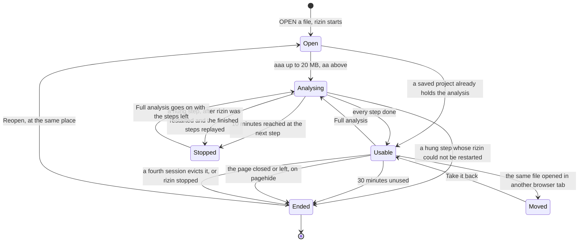

# Rizin

How to take a file on the VM apart in the browser: open it, read it, run its
code in an emulator, patch it, and keep the names, comments and patches you
give it.

The **Rizin** tab reverse engineers a file on the VM in the browser. rizin
0.9.1 with the rz-ghidra decompiler runs on the VM, one process per opened
file; the tab draws its views itself, in both themes. The original file is
never written, and nothing of it runs: **EMULATE** interprets its code in
rizin's ESIL virtual machine, in memory, without starting a process. A copy
with your patches in it exists only after an explicit export. Screenshot:
[Rizin (Reverse Engineering)](web-ui.md#rizin-reverse-engineering).

## Opening a file

- **OPEN ▾** lists SUBMISSIONS (the submitted samples in
  `C:\Users\Public\Downloads`), DUMPS (Process Dump and Exit Capture files in
  `C:\dumps`, newest first) and UPLOADS, and takes a path or an upload
  (**Upload…**, or a file dropped on the tab). Paths have to lie in the folders
  `/api/file/download` serves (`C:\Users`, `C:\Windows\Temp`, `C:\Temp`,
  `C:\dumps`, the Rustinel logs); UNC paths are refused. Uploads are kept in
  `%TEMP%\rizin_uploads` (a Defender exclusion), the newest 40; the patched
  copies an export writes go there too.
- **Rizin** buttons open a file from the Submit history, the files Process
  Dump and Exit Capture dumped (each beside its Hex button), ThreatScan (the
  result, beside Open in Hex Editor, and history entries whose file is still
  there) and the Hex tab's toolbar.
- The analysis starts at once and the toolbar shows it: `aaa` up to 20 MB,
  `aa` above. For those **Full analysis** runs `aaa`'s steps one by one (for
  an x86 PE `aa`, `aac`, `aar`, `aaft`, `Fa`, `aanr`, `aaC`, `avrr`). Between
  two steps rizin answers for about 2 s (up to 10 s while requests come), so
  the views fill in and stay usable; while a step runs they say busy. Once the
  analysis is done the tab jumps to `main` or `sym.main` if the file has one,
  else to the entry point.

Measured on the ARM64 UTM VM (rizin runs as x64 under emulation), from the
click to the first view of the place the tab lands on:

| File | Analysis | First view |
|------|----------|------------|
| `pipesim.exe` built with mingw (symbols), 151.7 KB, 84 functions, uploaded | `aaa` 1.6–2.5 s | 2.7–3.8 s, at `sym.main` |
| `pipesim.exe` from SUBMISSIONS (no symbols), 186.5 KB, 127 functions | `aaa` 2.1–2.2 s | 3.6 s, at the entry point |
| its image from its exit dump (DUMPS), 212.0 KB, 127 functions | `aaa` 2.0 s | 2.6–3.6 s, at the entry point |
| its exit dump from DUMPS, a 31.0 MB minidump, 10 295 functions | `aa` 3.3–3.9 s, then Full analysis 23–24 s | 6.1–6.9 s, at the entry point |

The same project opened again shows its first view after about 1 s.

## One place in every view

- **FUNCTIONS** lists the functions with name and size (the address on hover),
  filters by name or address, marks the current one, and « folds it away.
- **DISASSEMBLY** shows the current function with the current address marked;
  a long function loads on as you scroll, outside functions the linear
  disassembly stops after 2000 instructions. **DECOMPILER** shows rz-ghidra's
  C with the line of the current address marked, **HEX** 512 bytes from it
  with **Open in Hex tab** at that byte of the file.
- **GRAPH** beside them shows the control flow graph with the block of the
  current address marked: green edges are taken jumps, red ones the
  fall-through, dim ones unconditional. Drag, the wheel and − + FIT move and
  zoom it; from 200 blocks it starts as an overview. ⇱ gives one half the
  whole width, the line between the halves can be dragged, and below 1400 px
  window width DISASSEMBLY, DECOMPILER, HEX and GRAPH are tabs.
- Below them **CONSOLE**, **XREFS** (references to the current address and
  from it; at a function's start from the whole function), **STRINGS** and
  **IMPORTS** (paged and filtered on the VM; a click on an import shows its
  references). ═ sets the height, ▾ folds them away.
- A click on a function, an instruction, a jump or call target, a block, a
  line of C, a reference, a string or an import moves every view there, and
  so do **SEEK** (an address, a function or a flag name) + **GO**, **◀ ▶**
  (the jumps made) and a seek in the console (`s`, `pdf @ …`).

## Emulation and patching

**EMULATE** in the toolbar runs the file's code from the current address in
rizin's ESIL virtual machine. ESIL interprets the instructions: it starts no
process, so nothing of the sample executes on the VM. What the code writes
goes into rizin's write cache (`io.cache`), in memory, so the original file is
never written (its SHA-256 is the same before and after a run). That is the
way to run a decryption or unpacking routine to its result, to switch off an
anti-VM check, or to stop at a place of your choice. A sample that has to
really run to unpack is still a job for detonation: run it, take the Process
Dump, open the dump here.

Before every run the server sets rizin's guards again: `esil.timeout` (5 s,
so an endless loop ends the run and not the session), and the traps
`esil.breakoninvalid`, `esil.exectrap`, `esil.iotrap` and `esil.nonull`, which
stop the emulation at an instruction rizin cannot decode, at a jump into
memory that cannot execute, at an invalid read or write and at a null pointer,
instead of letting it run on through zeros and show the result as if it were
real. `esil.romem` is off, so a run can decrypt in place. The stack is 960 KB
at `0x100000`.

### The run strip

While the emulation runs, a strip sits between the toolbar and the views:

- **CONT** runs until a breakpoint, a trap or `esil.timeout`; **STEP** runs one
  instruction; **OVER** one instruction, a call as a whole; **SKIP** does not
  run the instruction (at a call it applies the assistant's answer, see
  [API calls](#api-calls)); **TO CALL** runs to the next call and stops before
  it; **GO TO PC** shows the PC in every view; **STOP** leaves the emulation.
  *Run to here* in the right-click menu of a DISASSEMBLY line runs to that
  line.
- The PC and the registers the last step changed, each marked Δ (six at most,
  then "+n more"). DISASSEMBLY marks the PC with a ▶ and a dashed edge, GRAPH
  marks its block, and the views follow it. Looking elsewhere is free: the PC
  stays where it is until **GO TO PC** brings you back.
- Why the run stopped, every time and never just "done": "Stopped at a
  breakpoint", "Stopped by esil.timeout: the run took too long", "Stopped:
  rizin cannot decode the instruction here" or "Stopped: an invalid memory
  access, or the PC is in memory that cannot be executed". A step that did
  what was asked says what it did.
- At a call, what SKIP will do and the value it will put in the return
  register, as a field you can edit.

### The EMULATION pane

**EMULATION** in the dock holds the whole state: REGISTERS (every one an
editable field; the ones the last step or edit changed are marked Δ), STACK
(16 words from the stack pointer, each with the function or flag its value
points to; a click goes there), BREAKPOINTS and PATCHES, the last in two
groups described below. When the stack pointer has left the stack the
emulation mapped, STACK says why it is empty: "No stack words to show: the
stack pointer is outside the stack the emulation mapped, or that map is gone.
Restarting the emulation (STOP, then EMULATE) maps it again."

### Breakpoints

A click in the gutter left of an address in DISASSEMBLY sets a breakpoint (●)
or removes it; the console does the same with `db @ <addr>` and
`db- @ <addr>`. BREAKPOINTS lists them with the function they are in and a ✕.
A breakpoint is set or it is not: there is no "off", because `dbd` does not
keep rizin from stopping there (measured), and a breakpoint that rizin lists
as disabled says "off, still stops a run". Breakpoints are kept in the
project.

### API calls

ESIL does not emulate the Windows API. A step into `call VirtualAlloc` would
run on into memory that is not mapped, and the emulation would go on with
zeros. So when the PC is on a call, the run strip names the API behind it and
says what SKIP will do: it skips the call, puts an answer in the return
register (`rax`, at 32 bits `eax`) and, where the API makes memory, maps it.
The value is a field you can change before SKIP applies it, and every
register can be set in the pane at any time. The answers are those of a clean machine that
nobody is analysing, which is what gets past an anti-VM check without a
patch:

| Group | APIs | SKIP answers |
|-------|------|--------------|
| Memory | `VirtualAlloc`, `VirtualAllocEx`, `HeapAlloc`, `LocalAlloc`, `GlobalAlloc`, `malloc` | A new buffer of the size the call asks for, mapped for the run; its address in the return register |
| Memory protection | `VirtualProtect` | Success; the memory stays writable |
| Loader | `LoadLibraryA/W`, `GetModuleHandleA/W`, `GetProcAddress` | A pseudo handle; for `GetProcAddress` the address of the import if the file has it, else a recognisable pseudo address |
| Anti-debug | `IsDebuggerPresent`, `CheckRemoteDebuggerPresent`, `NtQueryInformationProcess` | "Not being watched" |
| Time | `GetTickCount`, `GetTickCount64`, `timeGetTime`, `QueryPerformanceCounter`, `QueryPerformanceFrequency`, `GetSystemTimeAsFileTime` | A clock that rises with every skip, so that a timing check sees time pass |
| Environment | `GetComputerNameA/W`, `GetUserNameA/W`, `GetVolumeInformation` | Success, with an unremarkable name written to the out-parameters |
| Copying | `memcpy`, `memmove`, `RtlMoveMemory` | The destination; the bytes really are copied |

A call the table does not know is named all the same; SKIP then leaves the
return register as it is and the field waits for a value. At 32-bit stdcall,
the convention of the Win32 API, the callee would have popped its arguments,
so SKIP raises the stack pointer itself by four bytes per argument (the table
knows each API's argument count; `POST …/call` in the [API](api.md#rizin) takes
another correction); `cdecl` imports
such as `memcpy` are not corrected, because there the caller pops them. What a
SKIP writes (a copy, an out-parameter) is the run's, and ends with the session
like every other byte a run writes.

### Patching

A right-click on a DISASSEMBLY line patches its instruction, and each entry is
there only where it applies:

- **NOP out** fills the instruction with `nop`s of its length;
- **Flip the jump** turns a conditional jump into its opposite (`jz` into
  `jnz`);
- **Always jump** turns a conditional jump into an unconditional one;
- **Kill the call** fills a `call` with `nop`s, the length kept;
- **Bytes…** writes hex bytes you type: an even number of digits, spaces
  allowed, no `0x`, and over several instructions if you want.

The first four write x86 bytes, so on another architecture they are offered
disabled with the reason, and **Bytes…** stays. Nothing assembles: `wa` stays
out, because rizin can hand assembling to nasm or as. A patch needs no running
emulation. DISASSEMBLY marks a line with patched bytes with ≠ (hover: "Patched
by hand: these bytes were written here"), and HEX and DISASSEMBLY show the new
bytes.

PATCHES lists what rizin's write cache holds, one row per write, in two groups
that rizin itself does not tell apart (it has one cache):

- **SET BY HAND** is what the menu wrote, kept with the project and the only
  thing an export takes; each row has a ✕ that takes that write back.
- **WRITTEN BY THE RUN** is everything else in the cache: what the emulation
  wrote, and what you typed as `wx` in the console. These bytes end with the
  session, and the group says so ("These bytes end with the session: they are
  not saved with the project and not in an export.").

**Clear rizin's whole cache**, in the head of PATCHES, clears both groups
(`wc-*`). It asks first: "rizin has one cache, and what a run wrote is back
only by running it again."

### What stays and what does not

| | In the project | In an export | After the session |
|-|----------------|--------------|-------------------|
| Patches set by hand | Yes | Yes | Written back when the file is opened again, before the views load |
| Breakpoints | Yes (rizin's own project holds them) | No | Set again |
| What a run wrote | No | No | Gone |
| What Re-analyse found | No | No | Gone |
| The emulation itself (PC, registers, stack) | No | No | Gone: a reopened file has its patches and breakpoints, but no running emulation |

In short: what a run wrote ends with the session, and so does the emulation. A project
is now also made by a patch or a breakpoint, not only by a rename or a comment.
At most 32 KB of patches fit into a project; what does not is left out of the
save and the session's note says how many. A saved patch whose address is in
none of the reopened file's maps is left out, and the note says which.

### Re-analysing a decrypted range

HEX and DISASSEMBLY show what a run decrypted, because rizin reads through
its cache. FUNCTIONS and STRINGS do not: rizin builds them when it loads the
file, from its sections. **Re-analyse** in WRITTEN BY THE RUN analyses the
range the run wrote again: `af` for the functions that begin there, and a
search for ASCII strings of at least 4 characters (UTF-16 is not searched).
The range is the cluster of the run's writes with the most bytes, leaving out
the emulation's own stack and buffers; it takes at most 4 MB and rebuilds at
most 256 functions, and nothing else is analysed (`aa*` stays behind the Full
analysis button). What it finds belongs to the run and goes with it.

`af` is given about 4 KB of slack past the range, because a function that
begins inside the range and reaches past its end would otherwise be reported
with a truncated size. Two consequences: a flag the **file** already had at the
range's start keeps the widened size the re-analysis gave it, and a project
saved afterwards keeps that flag; and a function whose entry byte a run (or a
console `wx`) overwrote is dropped from the saved project, along with any
rename of it.

### Export and the Submit tab

**Export** in SET BY HAND writes a copy of the file with its patches into
`%TEMP%\rizin_uploads`, as `<16 hex digits of the SHA-256>_<name>.patched.<ext>`
(the name says what it is), with a note `….patch.txt` beside it: the original's
path, the SHA-256 of the original and of the copy, the time in UTC and one line
per patch (address, offset in the file, bytes before → after). The copy is
built in Python, not by rizin: the original is copied and each patch is written
at its **offset in the file**, which is not its address, because sections are
page-aligned in memory and not on disk. Only patches set by hand are exported.

A patch is placed only where exactly one map of the file covers all of its
bytes. One that has no place in the file (a zero-filled room past a section's
data, `.bss`, a buffer the emulation made, a patch across two maps) is named
and skipped, never written wrong; the others are still written, and the pane
lists the addresses that are not in the copy.

**To the Submit tab** is a second, explicit click. It puts the copy into the
Submit tab's file field and opens the tab; the target and **Detonate** are
there, and nothing is submitted on its own. Where patches were skipped, their
addresses are in the Submit tab's result box too, where you are about to press
Detonate. If the patches changed since the export, the button is off and says
to export again.

## Console without a shell

The console runs rizin commands at the current address, which its prompt
shows (`[0x1400014b7]>`): ↑ ↓ walk the history, Tab completes commands,
functions and flags, and quick buttons run `afl`, `pdf`, `pdg`, `iz`, `ii`,
`axt` and `?`. The output keeps rizin's colours, drawn in the theme's
palette, and is cut at about 1 MB.

rizin has no restricted mode of its own (0.9.1 has neither `cfg.sandbox` nor a
web server), and the web UI runs as SYSTEM without a login. So the server
checks every command against an allowlist before rizin gets it; a refused
command answers with one line, e.g. `refused: '!' is not allowed: no shell
commands`, and nothing moves. The console writes nothing to the file and
debugs nothing for real: writes may only go into rizin's cache, `d` is only
the breakpoint list, and the emulation's own commands (`aei`, `aes…`, `aec`,
`ar`) and its `esil.*` and `io.cache` settings are open, so you can go on in
the console where the tab stops.

| Refused | Why |
|---------|-----|
| `!`, `\|`, `>`, `<`, backticks, `$(…)`, `#!` | They run programs, or write output to files and read input from them |
| Command families other than `a p i f C s / ? x t b e w d` (analysis, print, info, flags, comments, seek, search, help, hexdump, types, block size, settings, writes that stay in rizin's cache, breakpoints): among them `o` (open files, and with it `ood`, which would start a debugged process), `.` (scripts), `(` (macros) | Other files and stored scripts are not part of the analysis |
| In `w`: everything but `w`, `wx`, `wz`, `wo…` (writes into the cache) and `wc`, `wcj`, `wc-`, `wc-*` (the cache's list and its removal). `wci` and `wc+` commit the cache to the file, `wa` assembles, `wu` and `wf…` read files | The original file is never written; assembling can reach nasm or as |
| In `d`: everything but the breakpoint list (`db`, `db-`, `db-*`, `dbl`, `dblj`, `dbd`, `dbe` …). `dbc`, `dbC` and `dbx` make a breakpoint run a rizin command, `dbw` sets a watchpoint, which hangs rizin; the executing commands (`dp`, `dc`, `ds`, `dm`, `dk`, `dd`, `dbt`) answer `'d' commands are not allowed: emulation runs from the EMULATION tab` | No real debugging; emulation has its own tab. `dbd` is let through but does not keep a breakpoint from stopping a run: remove it with `db-` |
| Inside the other families: the sub-commands and `@` forms that read or write files, assemble (rizin can hand that to an external assembler), wait for input or open an interactive view, run stored or nested commands, or change the settings, arch or file for one command (`@e:`, `@a:`, `@f:` …) | The same reasons, one level down; the list comes from rizin 0.9.1's own help, and the tests check every entry |
| Setting anything but `asm.*` (not `asm.assembler` and `asm.debuginfo.file`), `analysis.*` (also under its older name `anal.*`), `esil.*` (not `esil.mdev.range`, which a command hook handles), `bin.demangle` and `io.cache`; arch values other than rizin's built-in disassemblers | Some settings and arch plugins start programs or read files; reading a setting is fine |
| `aa`, `aaa` and the other whole-program analyses | They outlast a console command's 60 s; **Full analysis** runs them in steps |
| Backslashes, control characters, several lines, more than 2000 characters | rizin would read such input differently from the check |

## Sessions



A session opens with rizin and, if the file has one, its saved project - a
project that already holds the whole analysis runs none and is usable at once,
otherwise the analysis runs (`aaa` up to 20 MB, `aa` above it). An analysis that
stopped early, at the 10-minute mark or on a step that hung and cost rizin a
restart, leaves what it found usable, and **Full analysis** goes on with the
rest; a rizin that could not be restarted ends the session. Opening the same
file in another browser tab moves the session there, which the first tab shows
as "Open in another tab" with **Take it back**, and a session ends after 30
minutes without use, when its page is closed or left (the tab tells the server
on `pagehide`), when a fourth session needs its place, or when rizin stops; the
toolbar then says "Session ended" and **Reopen** opens the file at the same
place.

- A session is one rizin process for one file and one browser tab; opening
  another file in the tab replaces it, and two sessions never write the same
  project. A session can move to another tab or end while its analysis still
  runs.
- A session ending ends its emulation and the bytes a run wrote; what comes
  back with the file is its project (names, comments, breakpoints, patches set
  by hand).
- At most three sessions run at once; a fourth ends the one unused longest.
  rizin ends with the web UI, also when that is killed (on Windows each rizin
  runs in a job object).
- Every command has a time limit: views 30 s, lists and console commands
  60 s, a decompile 120 s. A rizin that does not answer in time is ended and
  the tab says so; nothing else in the web UI waits for it. A decompile that
  ended its session is not asked for again on its own: **Decompile again**
  asks once more.
- An analysis stops at the next step after 10 minutes and says why; what it
  found stays usable, and **Full analysis** goes on with the steps left. A
  step still running after 12 minutes counts as hung: rizin is ended, and the
  session starts again with the steps it had finished (after an `aaa`, with
  `aa` and the Full analysis button). A file opened again after a Full
  analysis that did not finish runs nothing by itself.

## Projects

- A right-click on a function, an instruction or a graph block offers
  **Rename function…** (`afn`) and **Comment…** (`CC`; an empty comment
  removes it); in the console `CC` works anywhere and `afn` at a function's
  start. Both are refused (busy) until the analysis is done, because a later
  step could change them again.
- They are saved as a rizin project in `webui/rizin_projects/<sha256>.rzdb`
  (`C:\DetonationChamberUI\rizin_projects\` on the VM, git-ignored like
  `webui/memory_results/`): 3 s after the last change and when the session
  ends. A file gets a project only once something is renamed, commented,
  patched by hand or given a breakpoint.
- The same file opened again, under any path, loads its project: names,
  comments, breakpoints and patches set by hand are back (while its session
  still closes, it waits for that session's last save). A project that cannot
  be loaded is kept as `<sha256>.rzdb.broken`, and the file opens without it.
- A loaded project is disarmed on open. A breakpoint can carry a rizin
  command, and a condition, that rizin runs when it hits, and the project
  stores them as they were, so both fields are cleared; a project whose
  breakpoints cannot be shown to be free of them is not used at all. Settings,
  hooks and hints that could start a program are set back the same way.

## Installation

`scripts/install-rizin.ps1` runs during provisioning, after
`install-re-tools.ps1`. It downloads Cutter v2.5.0's Windows package (only
for rizin 0.9.1, the rz tools and rz-ghidra; Cutter itself is never run),
checks its SHA-256 against the pinned digest GitHub publishes for the
release, installs the bundled VC++ runtime if it is missing or older, unpacks
the package to `C:\tools\cutter`, sets `SLEIGHHOME` so that rz-ghidra finds
its processor specifications (the web UI also hands it to rizin) and adds the
Defender exclusion for the uploads. It ends with a self-test (`rizin -v`, the
plugin list and a decompile). A failed download or checksum only warns and
provisioning goes on; the tab then says "rizin not installed". It is safe to
run again. On a running VM:

```bash
python3 scripts/deploy-utm.py --vm-ip <vm> --vm-user tdc --vm-pass tdc --install install-rizin.ps1
```

`TDC_RIZIN` points the web UI at another `rizin` (for example a local one for
development; without rz-ghidra DECOMPILER says "Decompiler not available
(rz-ghidra missing)").

## Limitations

- The emulation is ESIL, not a debugger, and the console allowlist leaves out a
  few rizin features (assembling, scripts, other files, writing to the file).
- **No step back.** rizin 0.9.1's `aesb` restores the registers but not the
  memory, and the step after it runs the instruction again without moving the
  PC: on a decryption loop that applies the `xor` twice and reports a clean
  state (both measured). So the strip has CONT, STEP, OVER, SKIP, TO CALL and
  STOP, and nothing that goes backwards.
- **STOP leaves the emulation mode; it does not abort a running command.**
  rizin under Windows cannot interrupt one. A run in flight says so ("a run
  ends by itself (esil.timeout) and cannot be interrupted"), and `esil.timeout`
  ends it after a few seconds. `aecc` in the console ignores that timeout
  (measured), so it can run until the console command's 60 s, where a rizin
  that does not answer is ended with its session; TO CALL does the same job
  inside the timeout.
- **No breakpoint on/off** (see Breakpoints) and **no watchpoints**: `dbw` plus
  `aec` hung rizin until it was killed (measured). **No assembling**: `wa`
  stays out.
- **The API assistant covers x86-64 and x86-32 only.** On another architecture
  it switches itself off and says so rather than guessing; emulation,
  breakpoints and patching keep working there. A call the table does not know
  is named and skipped with the return register left as it is.
- A patch typed into **Bytes…** is at most 2000 bytes. rizin reads its stdin a
  line at a time and cuts any command line that reaches 4094 characters
  without a word; the truncated line is still run, and writes at whatever
  address survives the cut (measured three times). 2000 bytes are a `wx` line
  of about 4000 characters.
- The four patch buttons are x86 only: `0x90` is a `nop` there and nowhere
  else.
- One stop reason covers two causes: an invalid memory access and a jump into
  memory that cannot execute both reach the tab as `trap`, so it names both
  possibilities instead of guessing.
- A run's bytes do not leave the tab: only patches set by hand are exported,
  and a patch with no place in the file is named and skipped.
- After the emulation is restarted, the stack view can show words the previous
  run wrote into the old ESIL map. `GET /patches` ([API](api.md#rizin)) lists
  them as `mine: false`, and **Clear rizin's whole cache** removes them.
- In a kernel or a complete memory dump (a user-mode process dump's addresses
  all fit), a breakpoint or patch row whose address is above 2^53 shows `?` and
  cannot be clicked. Remove it in the console with `db- @ <addr>` or
  `wc- <addr> <addr+1>`, which the allowlist permits.
- The gutter and the DISASSEMBLY lines cannot be reached with the keyboard.
  Breakpoints are set by a click, or in the console with `db @ <addr>`.
- Full analysis analyses variables less than `aaa` does (the toolbar's note
  says so).
- Under x64 emulation big files are slow: `aaa` on a 5 MB sample takes about
  17 s, and a long function may hit the decompile limit.
- A click on a string or an import jumps to its address, which holds data:
  DISASSEMBLY decodes it as instructions (HEX shows the bytes). For an import
  XREFS opens with its callers.
- STRINGS, IMPORTS and the console's Tab are filtered on the VM from a copy of
  rizin's own list, at most 200 000 rows of it (the pager says so); of a list
  larger than 32 MB they keep nothing and say to filter in the console instead
  (`iz~text`, `ii~name`), and Tab then lists the names of FUNCTIONS without
  completing one. FUNCTIONS has no 32 MB limit: it reads rizin's `afl`, whose
  rows are small enough for the thousands of functions of a big dump. Its rows
  are capped at 200 000 too, and past that the functions left out are missing
  from the list and from the names XREFS shows for references inside them (no
  dump measured comes near it: a 16 MB binary has about 17 000 functions).
- DISASSEMBLY, GRAPH and DECOMPILER read one whole function from rizin at a
  time: a function whose `pdfj` or `pdgj` is larger than 64 MB (about 220 000
  instructions) is not shown, and the view says so.
- "Duplicate tab" in the browser copies the tab's ID, so both pages drive one
  session without "Open in another tab"; open the file in a new tab instead.
- Addresses above 2^53 (kernel space) lose precision in the browser.

**Next:** [Logs](logs.md)
