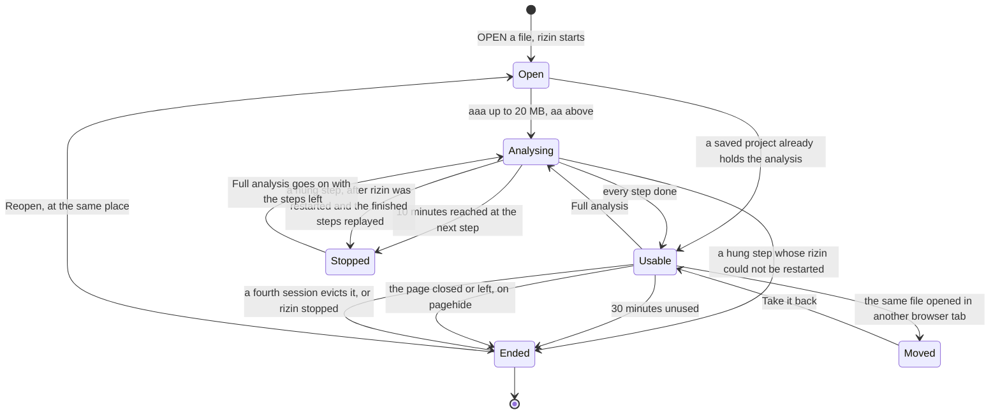

# Rizin

How to take a file on the VM apart in the browser: open it, read it, and keep
the names and comments you give it.

The **Rizin** tab reverse engineers a file on the VM in the browser. rizin
0.9.1 with the rz-ghidra decompiler runs on the VM, one process per opened
file; the tab draws its views itself, in both themes. The file is only read:
nothing is written into it or next to it, and there is no debugging. Screenshot:
[Rizin (Reverse Engineering)](web-ui.md#rizin-reverse-engineering).

## Opening a file

- **OPEN ▾** lists SUBMISSIONS (the submitted samples in
  `C:\Users\Public\Downloads`), DUMPS (Process Dump and Exit Capture files in
  `C:\dumps`, newest first) and UPLOADS, and takes a path or an upload
  (**Upload…**, or a file dropped on the tab). Paths have to lie in the folders
  `/api/file/download` serves (`C:\Users`, `C:\Windows\Temp`, `C:\Temp`,
  `C:\dumps`, the Rustinel logs); UNC paths are refused. Uploads are kept in
  `%TEMP%\rizin_uploads` (a Defender exclusion), the newest 40.
- **Rizin** buttons open a file from the Submit history, the files Process
  Dump and Exit Capture dumped (each beside its Hex button), ThreatScan (the
  result, beside Open in Hex Editor, and history entries whose file is still
  there) and the Hex tab's toolbar.
- The analysis starts at once and the toolbar shows it: `aaa` up to 20 MB,
  `aa` above. For those **Full analysis** runs `aaa`'s steps one by one (for
  an x86 PE `aa`, `aac`, `aar`, `aaft`, `Fa`, `aanr`, `aaC`, `avrr`). Between
  two steps rizin answers for about 2 s (up to 10 s while requests come), so
  the views fill in and stay usable; while a step runs they say busy. Once the
  analysis is done the tab jumps to `main` or `sym.main` if the file has one,
  else to the entry point.

Measured on the ARM64 UTM VM (rizin runs as x64 under emulation), from the
click to the first view of the place the tab lands on:

| File | Analysis | First view |
|------|----------|------------|
| `pipesim.exe` built with mingw (symbols), 151.7 KB, 84 functions, uploaded | `aaa` 1.6–2.5 s | 2.7–3.8 s, at `sym.main` |
| `pipesim.exe` from SUBMISSIONS (no symbols), 186.5 KB, 127 functions | `aaa` 2.1–2.2 s | 3.6 s, at the entry point |
| its image from its exit dump (DUMPS), 212.0 KB, 127 functions | `aaa` 2.0 s | 2.6–3.6 s, at the entry point |
| its exit dump from DUMPS, a 31.0 MB minidump, 10 295 functions | `aa` 3.3–3.9 s, then Full analysis 23–24 s | 6.1–6.9 s, at the entry point |

The same project opened again shows its first view after about 1 s.

## One place in every view

- **FUNCTIONS** lists the functions with name and size (the address on hover),
  filters by name or address, marks the current one, and « folds it away.
- **DISASSEMBLY** shows the current function with the current address marked;
  a long function loads on as you scroll, outside functions the linear
  disassembly stops after 2000 instructions. **DECOMPILER** shows rz-ghidra's
  C with the line of the current address marked, **HEX** 512 bytes from it
  with **Open in Hex tab** at that byte of the file.
- **GRAPH** beside them shows the control flow graph with the block of the
  current address marked: green edges are taken jumps, red ones the
  fall-through, dim ones unconditional. Drag, the wheel and − + FIT move and
  zoom it; from 200 blocks it starts as an overview. ⇱ gives one half the
  whole width, the line between the halves can be dragged, and below 1400 px
  window width DISASSEMBLY, DECOMPILER, HEX and GRAPH are tabs.
- Below them **CONSOLE**, **XREFS** (references to the current address and
  from it; at a function's start from the whole function), **STRINGS** and
  **IMPORTS** (paged and filtered on the VM; a click on an import shows its
  references). ═ sets the height, ▾ folds them away.
- A click on a function, an instruction, a jump or call target, a block, a
  line of C, a reference, a string or an import moves every view there, and
  so do **SEEK** (an address, a function or a flag name) + **GO**, **◀ ▶**
  (the jumps made) and a seek in the console (`s`, `pdf @ …`).

## Console without a shell

The console runs rizin commands at the current address, which its prompt
shows (`[0x1400014b7]>`): ↑ ↓ walk the history, Tab completes commands,
functions and flags, and quick buttons run `afl`, `pdf`, `pdg`, `iz`, `ii`,
`axt` and `?`. The output keeps rizin's colours, drawn in the theme's
palette, and is cut at about 1 MB.

rizin has no restricted mode of its own (0.9.1 has neither `cfg.sandbox` nor a
web server), and the web UI runs as SYSTEM without a login. So the server
checks every command against an allowlist before rizin gets it; a refused
command answers with one line, e.g. `refused: '!' is not allowed: no shell
commands`, and nothing moves.

| Refused | Why |
|---------|-----|
| `!`, `\|`, `>`, `<`, backticks, `$(…)`, `#!` | They run programs, or write output to files and read input from them |
| Command families other than `a p i f C s / ? x t b e` (analysis, print, info, flags, comments, seek, search, help, hexdump, types, block size, settings): among them `o` (open files), `w` (write), `d` (debug), `.` (scripts), `(` (macros) | Other files, writing, debugging and stored scripts are not part of static analysis |
| Inside the families: the sub-commands and `@` forms that read or write files, assemble (rizin can hand that to an external assembler), wait for input or open an interactive view, run stored or nested commands, or change the settings, arch or file for one command (`@e:`, `@a:`, `@f:` …) | The same reasons, one level down; the list comes from rizin 0.9.1's own help, and the tests check every entry |
| Setting anything but `asm.*` (not `asm.assembler` and `asm.debuginfo.file`), `analysis.*` (also under its older name `anal.*`) and `bin.demangle`; arch values other than rizin's built-in disassemblers | Some settings and arch plugins start programs or read files; reading a setting is fine |
| `aa`, `aaa` and the other whole-program analyses | They outlast a console command's 60 s; **Full analysis** runs them in steps |
| Backslashes, control characters, several lines, more than 2000 characters | rizin would read such input differently from the check |

## Sessions



A session opens with rizin and, if the file has one, its saved project - a
project that already holds the whole analysis runs none and is usable at once,
otherwise the analysis runs (`aaa` up to 20 MB, `aa` above it). An analysis that
stopped early, at the 10-minute mark or on a step that hung and cost rizin a
restart, leaves what it found usable, and **Full analysis** goes on with the
rest; a rizin that could not be restarted ends the session. Opening the same
file in another browser tab moves the session there, which the first tab shows
as "Open in another tab" with **Take it back**, and a session ends after 30
minutes without use, when its page is closed or left (the tab tells the server
on `pagehide`), when a fourth session needs its place, or when rizin stops; the
toolbar then says "Session ended" and **Reopen** opens the file at the same
place.

- A session is one rizin process for one file and one browser tab; opening
  another file in the tab replaces it, and two sessions never write the same
  project. A session can move to another tab or end while its analysis still
  runs.
- At most three sessions run at once; a fourth ends the one unused longest.
  rizin ends with the web UI, also when that is killed (on Windows each rizin
  runs in a job object).
- Every command has a time limit: views 30 s, lists and console commands
  60 s, a decompile 120 s. A rizin that does not answer in time is ended and
  the tab says so; nothing else in the web UI waits for it. A decompile that
  ended its session is not asked for again on its own: **Decompile again**
  asks once more.
- An analysis stops at the next step after 10 minutes and says why; what it
  found stays usable, and **Full analysis** goes on with the steps left. A
  step still running after 12 minutes counts as hung: rizin is ended, and the
  session starts again with the steps it had finished (after an `aaa`, with
  `aa` and the Full analysis button). A file opened again after a Full
  analysis that did not finish runs nothing by itself.

## Projects

- A right-click on a function, an instruction or a graph block offers
  **Rename function…** (`afn`) and **Comment…** (`CC`; an empty comment
  removes it); in the console `CC` works anywhere and `afn` at a function's
  start. Both are refused (busy) until the analysis is done, because a later
  step could change them again.
- They are saved as a rizin project in `webui/rizin_projects/<sha256>.rzdb`
  (`C:\DetonationChamberUI\rizin_projects\` on the VM, git-ignored like
  `webui/memory_results/`): 3 s after the last change and when the session
  ends. A file gets a project only once something is renamed or commented.
- The same file opened again, under any path, loads its project: names and
  comments are back (while its session still closes, it waits for that
  session's last save). A project that cannot be loaded is kept as
  `<sha256>.rzdb.broken`, and the file opens without it.

## Installation

`scripts/install-rizin.ps1` runs during provisioning, after
`install-re-tools.ps1`. It downloads Cutter v2.5.0's Windows package (only
for rizin 0.9.1, the rz tools and rz-ghidra; Cutter itself is never run),
checks its SHA-256 against the pinned digest GitHub publishes for the
release, installs the bundled VC++ runtime if it is missing or older, unpacks
the package to `C:\tools\cutter`, sets `SLEIGHHOME` so that rz-ghidra finds
its processor specifications (the web UI also hands it to rizin) and adds the
Defender exclusion for the uploads. It ends with a self-test (`rizin -v`, the
plugin list and a decompile). A failed download or checksum only warns and
provisioning goes on; the tab then says "rizin not installed". It is safe to
run again. On a running VM:

```bash
python3 scripts/deploy-utm.py --vm-ip <vm> --vm-user tdc --vm-pass tdc --install install-rizin.ps1
```

`TDC_RIZIN` points the web UI at another `rizin` (for example a local one for
development; without rz-ghidra DECOMPILER says "Decompiler not available
(rz-ghidra missing)").

## Limitations

- Static analysis only: no debugging, no patching, and the console allowlist
  leaves out a few rizin features (assembling, scripts, other files).
- Full analysis analyses variables less than `aaa` does (the toolbar's note
  says so).
- Under x64 emulation big files are slow: `aaa` on a 5 MB sample takes about
  17 s, and a long function may hit the decompile limit.
- A click on a string or an import jumps to its address, which holds data:
  DISASSEMBLY decodes it as instructions (HEX shows the bytes). For an import
  XREFS opens with its callers.
- STRINGS, IMPORTS and the console's Tab are filtered on the VM from a copy of
  rizin's own list, at most 200 000 rows of it (the pager says so); of a list
  larger than 32 MB they keep nothing and say to filter in the console instead
  (`iz~text`, `ii~name`), and Tab then lists the names of FUNCTIONS without
  completing one. FUNCTIONS has no 32 MB limit: it reads rizin's `afl`, whose
  rows are small enough for the thousands of functions of a big dump. Its rows
  are capped at 200 000 too, and past that the functions left out are missing
  from the list and from the names XREFS shows for references inside them (no
  dump measured comes near it: a 16 MB binary has about 17 000 functions).
- DISASSEMBLY, GRAPH and DECOMPILER read one whole function from rizin at a
  time: a function whose `pdfj` or `pdgj` is larger than 64 MB (about 220 000
  instructions) is not shown, and the view says so.
- "Duplicate tab" in the browser copies the tab's ID, so both pages drive one
  session without "Open in another tab"; open the file in a new tab instead.
- Addresses above 2^53 (kernel space) lose precision in the browser.

**Next:** [Logs](logs.md)
