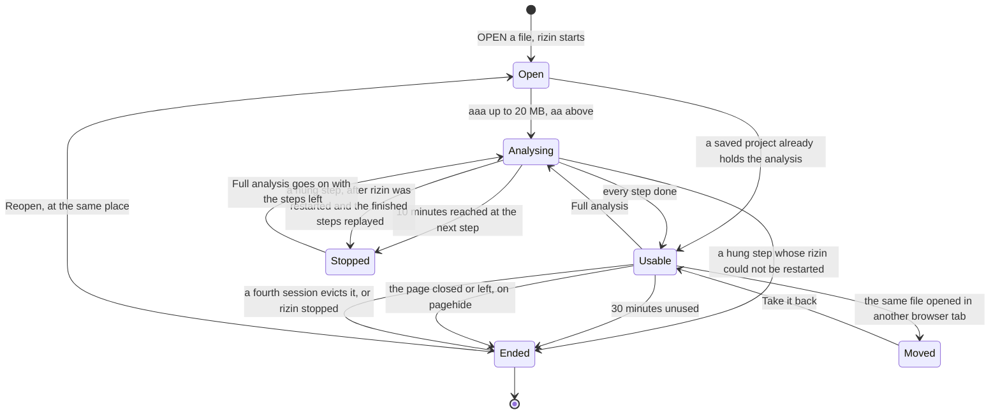

# Rizin

How to take a file on the VM apart in the browser: open it, read it, run its
code in an emulator, patch it, and keep the names, comments and patches you
give it.

The **Rizin** tab reverse engineers a file on the VM in the browser. rizin
0.9.1 with the rz-ghidra decompiler runs on the VM, one process per opened
file; the tab draws its views itself, in both themes. The original file is
never written, and nothing of it runs: **EMULATE** interprets its code in
rizin's ESIL virtual machine, in memory, without starting a process. A copy
with your patches in it exists only after an explicit export (why that is safe:
[Security Notes](configuration.md#security-notes)). Screenshot:
[Rizin (Reverse Engineering)](web-ui.md#rizin-reverse-engineering).

## Opening a file

- **OPEN ▾** lists SUBMISSIONS (the submitted samples in
  `C:\Users\Public\Downloads`), DUMPS (Process Dump and Exit Capture files in
  `C:\dumps`, newest first) and UPLOADS, and takes a path or an upload
  (**Upload…**, or a file dropped on the tab). Paths have to lie in the folders
  `/api/file/download` serves (`C:\Users`, `C:\Windows\Temp`, `C:\Temp`,
  `C:\dumps`, the Rustinel logs); UNC paths are refused. Uploads are kept in
  `%TEMP%\rizin_uploads` (a Defender exclusion), the newest 40; the patched
  copies an export writes go there too.
- **Rizin** buttons open a file from the Submit history, the files Process
  Dump and Exit Capture dumped (each beside its Hex button), ThreatScan (the
  result, beside Open in Hex Editor, and history entries whose file is still
  there) and the Hex tab's toolbar.
- The analysis starts at once and the toolbar shows it: `aaa` up to 20 MB,
  `aa` above. For those **Full analysis** runs `aaa`'s steps one by one (for
  an x86 PE `aa`, `aac`, `aar`, `aaft`, `Fa`, `aanr`, `aaC`, `avrr`). Between
  two steps rizin answers for about 2 s (up to 10 s while requests come), so
  the views fill in and stay usable; while a step runs they say busy. Once the
  analysis is done the tab jumps to `main` or `sym.main` if the file has one,
  else to the entry point.

Measured on the ARM64 UTM VM (rizin runs as x64 under emulation), from the
click to the first view of the place the tab lands on:

| File | Analysis | First view |
|------|----------|------------|
| `pipesim.exe` built with mingw (symbols), 151.7 KB, 84 functions, uploaded | `aaa` 1.6–2.5 s | 2.7–3.8 s, at `sym.main` |
| `pipesim.exe` from SUBMISSIONS (no symbols), 186.5 KB, 127 functions | `aaa` 2.1–2.2 s | 3.6 s, at the entry point |
| its image from its exit dump (DUMPS), 212.0 KB, 127 functions | `aaa` 2.0 s | 2.6–3.6 s, at the entry point |
| its exit dump from DUMPS, a 31.0 MB minidump, 10 295 functions | `aa` 3.3–3.9 s, then Full analysis 23–24 s | 6.1–6.9 s, at the entry point |

The same project opened again shows its first view after about 1 s.

## One place in every view

- **FUNCTIONS** lists the functions with name and size (the address on hover),
  filters by name or address, marks the current one, and « folds it away.
- **DISASSEMBLY** shows the current function with the current address marked;
  a long function loads on as you scroll, outside functions the linear
  disassembly stops after 2000 instructions. **DECOMPILER** shows rz-ghidra's
  C with the line of the current address marked, **HEX** 512 bytes from it
  with **Open in Hex tab** at that byte of the file.
- **GRAPH** beside them shows the control flow graph with the block of the
  current address marked: green edges are taken jumps, red ones the
  fall-through, dim ones unconditional. Drag, the wheel and − + FIT move and
  zoom it; from 200 blocks it starts as an overview. ⇱ gives one half the
  whole width, the line between the halves can be dragged, and below 1400 px
  window width DISASSEMBLY, DECOMPILER, HEX and GRAPH are tabs.
- Below them **CONSOLE**, **XREFS** (references to the current address and
  from it; at a function's start from the whole function), **STRINGS** and
  **IMPORTS** (paged and filtered on the VM; a click on an import shows its
  references). ═ sets the height, ▾ folds them away.
- A click on a function, an instruction, a jump or call target, a block, a
  line of C, a reference, a string or an import moves every view there, and
  so do **SEEK** (an address, a function or a flag name) + **GO**, **◀ ▶**
  (the jumps made) and a seek in the console (`s`, `pdf @ …`).

## Emulation and patching

**EMULATE** in the toolbar runs the file's code from the current address in
rizin's ESIL virtual machine. ESIL interprets the instructions: it starts no
process, so nothing of the sample executes on the VM. What the code writes
goes into rizin's write cache (`io.cache`), in memory, so the original file is
never written (its SHA-256 is the same before and after a run). That is the
way to run a decryption or unpacking routine to its result, to switch off an
anti-VM check, or to stop at a place of your choice. A sample that has to
really run to unpack is still a job for detonation: run it, take the Process
Dump, open the dump here.

Before every run the server sets rizin's guards again: `esil.timeout` (5 s,
so an endless loop ends the run and not the session), and the traps
`esil.breakoninvalid`, `esil.exectrap` and `esil.iotrap`, which stop the
emulation at an instruction rizin cannot decode, at a jump into memory that
cannot execute and at an invalid read or write, instead of letting it run on
through zeros and show the result as if it were real. `esil.nonull` is set as
well but stops nothing in rizin 0.9.1 (measured: a read or a write at address
0 is carried out silently and the run goes on to the timeout); in a PE, where
address 0 is in no map, `esil.iotrap` is the guard that fires there.
`esil.romem` is off, so a run can decrypt in place. The stack is 960 KB
at `0x100000`.

### The run strip

While the emulation runs, a strip sits between the toolbar and the views:

- **CONT** runs until a breakpoint, a trap or `esil.timeout`; **STEP** runs one
  instruction; **OVER** one instruction, a call as a whole; **SKIP** does not
  run the instruction (at a call it applies the assistant's answer, see
  [API calls](#api-calls)); **TO CALL** runs to the next call and stops before
  it; **GO TO PC** shows the PC in every view; **STOP** leaves the emulation.
  *Run to here* in the right-click menu of a DISASSEMBLY line runs to that
  line.
- The PC and the registers the last step changed, each marked Δ (six at most,
  then "+n more"). DISASSEMBLY marks the PC with a ▶ and a dashed edge, GRAPH
  marks its block, and the views follow it. Looking elsewhere is free: the PC
  stays where it is until **GO TO PC** brings you back.
- Why the run stopped, every time and never just "done": "Stopped at a
  breakpoint", "Stopped by esil.timeout: the run took too long", "Stopped:
  rizin cannot decode the instruction here" or "Stopped: an invalid memory
  access, or the PC is in memory that cannot be executed". A step that did
  what was asked says what it did.
- At a call, what SKIP will do and the value it will put in the return
  register, as a field you can edit.

### The EMULATION pane

**EMULATION** in the dock holds the whole state: REGISTERS (every one an
editable field; the ones the last step or edit changed are marked Δ), STACK
(16 words from the stack pointer, each with the function or flag its value
points to; a click goes there), BREAKPOINTS and PATCHES, the last in three
groups described below, with the **Restore the run** button at the head of that column
([Waiting patches and the way back](#waiting-patches-and-the-way-back)). When the stack pointer has left the stack the
emulation mapped, STACK says why it is empty: "No stack words to show: the
stack pointer is outside the stack the emulation mapped, or that map is gone.
Restarting the emulation (STOP, then EMULATE) maps it again."

### Breakpoints

A click in the gutter left of an address in DISASSEMBLY sets a breakpoint (●)
or removes it. The gutter is the narrow column at the left edge of every line,
a faint ○ where there is no breakpoint (stronger under the pointer); the cell
between it and the address is for the ≠ of a line patched by hand, and is not
a button. DECOMPILER has the same gutter before the C of each line that has an
address (the signature and a brace have none): a click sets the breakpoint on
the lowest address of the line, so a run stops before this line, and the hover
text names that address; if another address of the line has one already, a
click removes that one. An instruction that belongs to several lines of C marks
all of them, and a click on any of them removes it. To stop at a call in the
middle of a line, set the breakpoint in DISASSEMBLY. The console does the same
with `db @ <addr>` and `db- @ <addr>`. BREAKPOINTS lists them with the function
they are in and a ✕. A breakpoint is set or it is not: there is no "off",
because `dbd` does not keep rizin from stopping there (measured), and a
breakpoint that rizin lists as disabled says "off, still stops a run".
Breakpoints are kept in the project.

### API calls

ESIL does not emulate the Windows API. A step into `call VirtualAlloc` would
run on into memory that is not mapped, and the emulation would go on with
zeros. So when the PC is on a call, the run strip names the API behind it and
says what SKIP will do: it skips the call, puts an answer in the return
register (`rax`, at 32 bits `eax`) and, where the API makes memory, maps it.
The value is a field you can change before SKIP applies it, and every
register can be set in the pane at any time. The answers are those of a clean
machine that nobody is analysing, which is what gets past an anti-VM check
without a patch. The groups below are the ones that matter when unpacking and against
anti-VM checks, with the APIs the table names for them; it holds more (among
others `HeapCreate`, `VirtualFree`, `HeapFree`, `free`, `VirtualProtectEx`,
`FlushInstructionCache`, `LoadLibraryEx`, `GetModuleHandleEx`, `Sleep`,
`GetSystemInfo`, `GetEnvironmentVariable` and `RtlCopyMemory`), and it is data
(`API_TABLE` in `webui/rizin_emulation.py`), so it can grow without a code
change:

| Group | APIs | SKIP answers |
|-------|------|--------------|
| Memory | `VirtualAlloc`, `VirtualAllocEx`, `HeapAlloc`, `LocalAlloc`, `GlobalAlloc`, `malloc` | A new buffer of the size the call asks for (rounded up to a page, at most 16 MB), mapped for the run as readable, writable **and executable**; its address in the return register |
| Memory protection | `VirtualProtect` | Success; the memory stays writable, and a buffer the assistant made is executable from the start |
| Loader | `LoadLibraryA/W`, `GetModuleHandleA/W`, `GetProcAddress` | A pseudo handle; for `GetProcAddress` the address of the import if the file has it, else a recognisable pseudo address |
| Anti-debug | `IsDebuggerPresent`, `CheckRemoteDebuggerPresent`, `NtQueryInformationProcess` | "Not being watched" |
| Time | `GetTickCount`, `GetTickCount64`, `timeGetTime`, `QueryPerformanceCounter`, `QueryPerformanceFrequency`, `GetSystemTimeAsFileTime` | A clock that rises with every skip, so that a timing check sees time pass |
| Environment | `GetComputerNameA/W`, `GetUserNameA/W`, `GetVolumeInformation` | Success, with an unremarkable name written to the out-parameters |
| Copying | `memcpy`, `memmove`, `RtlMoveMemory` | The destination; the bytes really are copied |

A call the table does not know is named all the same; SKIP then leaves the
return register as it is and the field waits for a value. At 32-bit stdcall,
the convention of the Win32 API, the callee would have popped its arguments,
so SKIP raises the stack pointer itself by four bytes per argument (the table
knows each API's argument count; `POST …/call` in the [API](api.md#rizin) takes
another correction); `cdecl` imports
such as `memcpy` are not corrected, because there the caller pops them. What a
SKIP writes (a copy, an out-parameter) is the run's, and ends with the session
like every other byte a run writes.

### Patching

A right-click on a DISASSEMBLY line patches its instruction, and each entry is
there only where it applies:

- **NOP out** fills the instruction with `nop`s of its length;
- **Flip the jump** turns a conditional jump into its opposite (`jz` into
  `jnz`);
- **Always jump** turns a conditional jump into an unconditional one;
- **Kill the call** fills a `call` with `nop`s, the length kept;
- **Bytes…** writes hex bytes you type: an even number of digits, spaces
  allowed, no `0x`, and over several instructions if you want.

The first four write x86 bytes, so on another architecture they are offered
disabled with the reason, and **Bytes…** stays. Nothing assembles: `wa` stays
out, because rizin can hand assembling to nasm or as. A patch needs no running
emulation. DISASSEMBLY marks a line with patched bytes with ≠ (hover: "Patched
by hand: these bytes were written here"), and HEX and DISASSEMBLY show the new
bytes.

PATCHES lists what rizin's write cache holds, one row per write, in two groups
that rizin itself does not tell apart (it has one cache):

- **SET BY HAND** is what the menu wrote, kept with the project and the only
  thing an export takes; each row has a ✕ that takes that write back. A row
  set over bytes a run changed carries a ⚠: rizin's "before" for it is the
  run's byte and not the file's, the group says so, and the export's note
  names the row with what the file really holds there. Taking such a row back
  drops the run's whole write with it -- rizin removes a write whole -- and
  the pane names the writes that went, with their byte total.
- **WRITTEN BY THE RUN** is everything else in the cache: what the emulation
  wrote, and what you typed as `wx` in the console. These bytes end with the
  session, and the group says so ("These bytes end with the session: they are
  not saved with the project and not in an export.").

A third group, **WAITING**, appears only where a patch waits. It is not in the
cache at all: see [Waiting patches and the way back](#waiting-patches-and-the-way-back).

**Clear rizin's whole cache**, in the head of PATCHES, clears both groups
(`wc-*`) and leaves WAITING alone. It asks first: "rizin has one cache, and what a run wrote is back
only by running it again."

### What stays and what does not

| | In the project | In an export | After the session |
|-|----------------|--------------|-------------------|
| Patches set by hand | Yes | Yes | Written back when the file is opened again, before the views load; one set over bytes a run wrote waits instead |
| Breakpoints | Yes (rizin's own project holds them) | No | Set again |
| What a run wrote | No (only a SHA-256 of it) | No | Gone: **Restore the run** replays the timeline below and proves the same bytes came back |
| The timeline of the emulation (what the session did) | Yes, while it can be replayed | No | **Restore the run**, one press |
| What Re-analyse found | No | No | Gone |
| The emulation itself (PC, registers, stack) | No | No | Gone: a reopened file has its patches and breakpoints, but no running emulation until **Restore the run** starts one again |

In short: what a run wrote ends with the session, and so does the emulation; the
project keeps the way to it, which is a different thing from the bytes. A project
is made by a patch, a breakpoint or a run of the emulation, not only by a rename or a comment.
At most 32 KB of patches fit into a project; what does not is left out of the
save and the session's note says how many. A saved patch whose address is in
none of the reopened file's maps is left out, and the note says which.

### Waiting patches and the way back

The point of the emulator is a patch inside freshly decrypted code: run the
decryption, read the code, switch off the anti-VM check in it. The project
saves such a patch with a mark (`:r`, the ⚠ of SET BY HAND), and this section
is what the project does with it when the file is opened again, and how the run
comes back.

**What a waiting patch is, and why it waits.** A patch set over bytes a run wrote is not written when the file is opened: opening happens before any run, so it would land in the file's own, still encrypted bytes, and the next decryption would XOR over it instead of over the file's bytes. The patch would be gone, and the decrypted output would be wrong at exactly the place you wanted to read. So it waits. It stays in the project through every save, and the session's note names it once when the file is opened ("Held back, not applied: 1 saved patch over bytes an emulation run wrote (0x…). The file's own bytes there are still encrypted, and a patch written into them would be decrypted over by the next run."). PATCHES shows it in a group of its own, WAITING, between SET BY HAND and WRITTEN BY THE RUN: the address, the function, the bytes and the reason on a line below, under the heading "not applied · kept with the project". The group says "These are not in rizin's cache: written into the file's own bytes, which are still encrypted, the next decryption would run over them. Apply now is there once a run's bytes lie under a patch; ✕ removes one from the project." A waiting patch is no write of rizin's cache, so it is not among the patches, not touched by "Clear rizin's whole cache" and not exported (`GET /patches` lists it under `waiting`). A patch saved by an older version has no mark and is written back as it always was.

**Two ways out, and no third.** A waiting patch has two ways out, and no third:

- ✕ takes it out of the project, as for any other patch, and it does not come back when the file is opened again. Taking back a patch that the timeline makes drops the timeline too, because a replay would write the patch again and the SHA-256 would not notice (below).
- Apply now writes the patch into the cache now. Apply now appears only where a run's bytes cover the address again, and the server decides that, not the pane: the server says it with each waiting entry (`apply_now`), and the server checks it again when it is pressed, and refuses with its reason where no run's bytes lie under the address by then. That is the case when you have decrypted again yourself and the patch makes sense again. It is a patch like any other afterwards.

There is no other exit, on purpose: an Apply now that is always there would be the harm above with a button in front of it. A waiting patch at an address the browser cannot hold exactly (above 2^53) has a ✕ that is off, titled "This address cannot be sent exactly, so this patch cannot be removed from here"; the way out is `DELETE /patch` with `waiting` in the [API](api.md#rizin).

**The button.** Restore the run, at the head of the right column of the EMULATION pane, replays the timeline the project keeps and proves the result. It is one button press, and never on its own when a file is opened, because it runs the file's code in the emulator again and a run can take as long as `esil.timeout` (5 s). Nothing starts on the VM, but it is the sample's code. Done by opening a file, it would execute sample code because a file was looked at, and a timeout would block the tab while it opens.

The timeline is what the session did while you worked, in the order it was done in: the start, the runs, each skipped call with the value that was applied and the stack correction, and your patches. Your patches stand in the timeline with the rest, in the order they were made in, so a patch of the decrypted code is there when the replay runs on through the patched check, and not the original code. The button is on when the project holds a timeline that can prove something, no emulation runs, the cache holds nothing but the patches the file was opened with, and the breakpoints are the ones the timeline ran under (a run stops at a breakpoint). Otherwise it is off, with an emulation that runs, a cache that holds more or other than the open left, or other breakpoints, and its title is the server's sentence; for example "the project holds no timeline of the emulation to restore". A press that is refused changes nothing.

The replay begins with `wc-*` and the registers reset, writes the patches the file was opened with that the timeline does not make (those made before the first start), sets the assistant's counters back to where the timeline began, and then does every action through the code that did it the first time. It has 60 s from its first command to its last action, which is why a record of 500 runs of `esil.timeout` does not hold the tab for 40 minutes. It cannot be stopped once it started; it is one request.

**The SHA-256 is the proof.** A restore that quietly gave other bytes would be the worst result: you would read code that was never decrypted so. So the project holds one SHA-256 for each range the run decrypted, made over the bytes as the run left them, and the replay is checked against them in the order the writes were made. Because they are the bytes of the run, the SHA-256 does not cover your patches: a patch is replayed at its place in the timeline, not proven, which is also why taking one back drops the timeline.

If the bytes are the ones saved, the emulation is left running at the replay's PC, every view moves there, and the patches that waited and that a run's bytes cover again are written; the others keep waiting. If a range differs, or an action is refused, or a run ends at the time limit, or the 60 s are used up, nothing is applied, and the cache is as it was when the file was opened (`wc-*`, then the file's patches again); the emulation is stopped, the counters are where they were, and the patches that wait still wait. The notice says which of four things happened:

| What happened | What the pane says |
|---------------|--------------------|
| Restored | "Session restored: the saved timeline was replayed (3 actions) and the bytes it left match the SHA-256 the project holds for 2 ranges." and, where they apply, how many patches that waited were written, at which addresses, and how many still wait |
| Other bytes | "Not restored: replaying the timeline left other bytes than the ones saved with it (1 of 2 saved ranges differ): nothing was applied, and the cache is as it was when the file was opened." |
| Failed on the way | "Not restored: the replay stopped at action 3 of 5 (…): …; nothing was applied, and the cache is as it was when the file was opened." (the reason is the run's own: a refusal, a run that ended at the time limit, the 60 s) |
| Nothing recorded | The button is off, and its title says what a press would be refused with (no timeline in the project, an emulation that runs, a cache that is not the one from opening, other breakpoints). Where the timeline was spoiled the status band says it as soon as it is true -- "The way to this state is not kept in the project: …" with the reason, whether or not the EMULATION is open -- and the pane of the EMULATION does not say it a second time. Where the project still holds an earlier timeline, the note adds "The project still holds an earlier timeline, which the restore button replays."; where the timeline is not spoiled and there is none in the project, only the button's title speaks |

Where patches wait, a failure adds "The patches that wait still wait." A refused press is shown as the server worded it, after "Not restored:".

**What spoils the timeline.** Only what the emulation routes of the server did is recorded; everything else that touched the emulation or the cache spoils it. The causes are a run that ended at the time limit, a register set by hand, a console command that writes or sets, a breakpoint that stands other than the timeline began with, a rizin that restarted, something taken out of the cache, and a run with nothing to prove. A timeline that is spoiled is not offered and not saved, and the pane's notice says which cause it was, with these reasons:

| Cause | The reason in the notice |
|-------|----------------------------------------------------------------------|
| A register set by hand (in the pane or with `/emulation/register`) | a register was set by hand, which the timeline does not record |
| A console command that writes into the cache (`w…`) | a console command wrote to the cache, which the timeline does not record |
| A console command that sets a register or steps the emulation (`ar x=…`, `aes…`) | a console command set a register or stepped the emulation, which the timeline does not record |
| A console command that arms the emulation, maps its memory or sets its PC (`aei`, `aeim`, `aepc`) in the middle of a timeline | a console command armed the emulation, mapped its memory or set its PC, which the timeline does not record |
| A setting (`e <key>=<value>`) or a hint (`ah…`) changed while the timeline ran | a setting or a hint was changed while the timeline ran, and the timeline does not record it |
| A breakpoint changed, from the pane, the gutter or the console, with an action after it (put the breakpoints back before that and nothing is lost) | a breakpoint was changed, and a run stops at the breakpoints there are |
| A run that ended at `esil.timeout`: the result hangs on the clock and cannot be repeated | a run ended at the time limit, a result that hangs on the clock and cannot be repeated |
| An action that failed half-way | an action failed half-way, after it had already changed the emulation or the cache |
| A timeline longer than the project keeps | an action was dropped: a project keeps 500 actions at most |
| rizin could not be asked what the cache or the breakpoints held when the timeline began | rizin did not say what the cache or the breakpoints held when the timeline began |
| The cache already held writes of its own when the timeline began (a console `wx` before the first start) | the cache already held writes of its own when the timeline began, which no replay makes |
| Something taken out of the cache: ✕ on a patch, **Clear rizin's whole cache**, a console `wc-` | something was taken out of the cache, so the way to the state it held is no longer kept |
| A rizin that restarted (a hung step) | rizin was restarted, which emptied the cache the run had written to: the way to its bytes can no longer be proven |
| A run with nothing to prove | the run left nothing in the cache that a restore could bring back |

A timeline that is spoiled is not written to the project, and a timeline of the project that was clean before stays: it still proves its own run. The patches stay waiting either way, and the two exits are the way out: decrypt again and Apply now, or ✕.

**The decrypted bytes are not stored in the project.** The arithmetic forbids it. `_read_project_meta` reads only the last 64 KB of the project file, and the patches and the timeline share 32 KB of characters, the patches first. A decrypted section is a few hundred KB as hex. So the project holds the way to the bytes (the actions, at most 500 actions) and a 32-byte SHA-256 for each range, and not the bytes. The timeline is saved after the patches, with what they left of the 32 KB; a timeline that does not fit is dropped whole, never saved in part, because one that ends where the budget did would replay to somewhere nobody named. The project then holds `restore=dropped` in its place, the session's note says so when the save happens, and the file's next open says "The project's timeline of the emulation could not be kept when the file was last saved (it was too long for the room the project has): the way to the decrypted bytes is gone, and decrypting again is the only way back." A timeline that is longer than the room on its own is dropped the same way.

### Re-analysing a decrypted range

HEX and DISASSEMBLY show what a run decrypted, because rizin reads through
its cache. FUNCTIONS and STRINGS do not: rizin builds them when it loads the
file, from its sections. **Re-analyse** in WRITTEN BY THE RUN analyses the
range the run wrote again: `af` for the functions that begin there, and a
search for ASCII strings of at least 4 characters (UTF-16 is not searched).
The range is the cluster of the run's writes with the most bytes, leaving out
the emulation's own stack and buffers. A range wider than 4 MB, or holding
more than 256 functions, is refused with "analyse it in parts" and not cut to
size; nothing else is analysed (`aa*` stays behind the Full analysis button).
What it finds belongs to the run and goes with it.

`af` is given about 4 KB of slack past the range, because a function that
begins inside the range and reaches past its end would otherwise be reported
with a truncated size. Two consequences: a flag the **file** already had at the
range's start keeps the widened size the re-analysis gave it, and a project
saved afterwards keeps that flag; and a function whose entry byte a run (or a
console `wx`) overwrote is dropped from the saved project, along with any
rename of it.

### Export and the Submit tab

**Export** in SET BY HAND writes a copy of the file with its patches into
`%TEMP%\rizin_uploads`, as `<16 hex digits of the original's SHA-256>_<name>.patched.<ext>`
(the name says what it is), with a note `….patch.txt` beside it: the original's
path, the SHA-256 of the original and of the copy, the time in UTC and one line
per patch (address, offset in the file, the file's own bytes there → the copy's).
Those bytes are read from the original, not from rizin's cache: where a patch
was set over bytes a run had changed, rizin reports as "before" what the run
wrote, and the note would otherwise say the file held it. Every such patch is
named in a block of its own, with both bytes, because the copy carries the
file's own bytes everywhere else -- so the patch sits in bytes that are still
encrypted on disk. The copy is
built in Python, not by rizin: the original is copied and each patch is written
at its **offset in the file**, which is not its address, because sections are
page-aligned in memory and not on disk. Only patches set by hand are exported.

A patch is placed only where exactly one map of the file covers all of its
bytes. One that has no place in the file (a zero-filled room past a section's
data, `.bss`, a buffer the emulation made, a patch across two maps) is named
and skipped, never written wrong; the others are still written, and the pane
lists the addresses that are not in the copy.

**To the Submit tab** is a second, explicit click. It puts the copy into the
Submit tab's file field and opens the tab; the target and **Detonate** are
there, and nothing is submitted on its own. Where patches were skipped, their
addresses are in the Submit tab's result box too, where you are about to press
Detonate. If the patches changed since the export, the button is off and says
to export again.

## Console without a shell

The console runs rizin commands at the current address, which its prompt
shows (`[0x1400014b7]>`): ↑ ↓ walk the history, Tab completes commands,
functions and flags, and quick buttons run `afl`, `pdf`, `pdg`, `iz`, `ii`,
`axt` and `?`. The output keeps rizin's colours, drawn in the theme's
palette, and is cut at about 1 MB.

rizin has no restricted mode of its own (0.9.1 has neither `cfg.sandbox` nor a
web server), and the web UI runs as SYSTEM without a login. So the server
checks every command against an allowlist before rizin gets it; a refused
command answers with one line, e.g. `refused: '!' is not allowed: no shell
commands`, and nothing moves. The console writes nothing to the file and
debugs nothing for real: writes may only go into rizin's cache, `d` is only
the breakpoint list, and the emulation's own commands (`aei`, `aes…`, `aec`,
`ar`) and its `esil.*` and `io.cache` settings are open, so you can go on in
the console where the tab stops -- all but the three that ignore
`esil.timeout` (see the table below).

| Refused | Why |
|---------|-----|
| `!`, `\|`, `>`, `<`, backticks, `$(…)`, `#!` | They run programs, or write output to files and read input from them |
| Command families other than `a p i f C s / ? x t b e w d` (analysis, print, info, flags, comments, seek, search, help, hexdump, types, block size, settings, writes that stay in rizin's cache, breakpoints): among them `o` (open files, and with it `ood`, which would start a debugged process), `.` (scripts), `(` (macros) | Other files and stored scripts are not part of the analysis |
| In `w`: everything but `w`, `wx`, `wz`, `wo…` (writes into the cache) and `wc`, `wcj`, `wc-`, `wc-*` (the cache's list and its removal). `wci` and `wc+` answer `'wc+', 'wci' and 'wcp...' commit the cache: they write into the file`; `wa` answers `assembling is not available: rizin can hand it to an external assembler`; `wu` and `wxf` answer `'wu' and 'wxf' read a file`, `wff` and `wfs` answer `'wff' and 'wfs' read a file or a socket`; any other name answers `'<name>' is not allowed: only writes that stay in the cache are available` | The original file is never written; assembling can reach nasm or as; reading files is not part of the analysis |
| In `d`: everything but the breakpoint list (`db`, `db-`, `db-*`, `dbl`, `dblj`, `dbd`, `dbe` …). `dbc`, `dbC` and `dbx` answer `'dbc', 'dbC', 'dbx', 'dbic' and 'dbix' run rizin commands when a breakpoint hits`; `dbw` answers `'dbw' and 'dbW' set watchpoints, which hang rizin`; the executing commands (`dp`, `dc`, `ds`, `dm`, `dk`, `dd`, `dbt`) answer `'d' commands are not allowed: emulation runs from the EMULATION tab` | No real debugging; emulation has its own tab. `dbd` is let through but does not keep a breakpoint from stopping a run: remove it with `db-` |
| Inside the other families: the sub-commands and `@` forms that read or write files, assemble (rizin can hand that to an external assembler), wait for input or open an interactive view, run stored or nested commands, or change the settings, arch or file for one command (`@e:`, `@a:`, `@f:` …) | The same reasons, one level down; the list comes from rizin 0.9.1's own help, and the tests check every entry |
| Setting anything but `asm.*` (not `asm.assembler` and `asm.debuginfo.file`), `analysis.*` (also under its older name `anal.*`), `esil.*` (not `esil.mdev.range`, which a command hook handles), `bin.demangle` and `io.cache`; arch values other than rizin's built-in disassemblers | Some settings and arch plugins start programs or read files; reading a setting is fine |
| `aecc`, `aecs` and `aesuo`, which answer `'aecc', 'aecs' and 'aesuo' ignore esil.timeout and run until rizin is killed: TO CALL does this` | They ignore `esil.timeout` (measured: all three past 15 s on a `jmp $` with `esil.timeout=2`), so the console's own 60 s would end the session and the run's bytes with it. `aec`, `aecu`, `aecue`, `aes`, `aesu`, `aesue`, `aess`, `aeso`, `aesou` and `aecb` all stop at the timeout and stay open |
| `aa`, `aaa` and the other whole-program analyses | They outlast a console command's 60 s; **Full analysis** runs them in steps |
| Backslashes, control characters, several lines, more than 2000 characters | rizin would read such input differently from the check |

## Sessions



A session opens with rizin and, if the file has one, its saved project - a
project that already holds the whole analysis runs none and is usable at once,
otherwise the analysis runs (`aaa` up to 20 MB, `aa` above it). An analysis that
stopped early, at the 10-minute mark or on a step that hung and cost rizin a
restart, leaves what it found usable, and **Full analysis** goes on with the
rest; a rizin that could not be restarted ends the session. Opening the same
file in another browser tab moves the session there, which the first tab shows
as "Open in another tab" with **Take it back**, and a session ends after 30
minutes without use, when its page is closed or left (the tab tells the server
on `pagehide`), when a fourth session needs its place, or when rizin stops; the
toolbar then says "Session ended" and **Reopen** opens the file at the same
place.

- A session is one rizin process for one file and one browser tab; opening
  another file in the tab replaces it, and two sessions never write the same
  project. A session can move to another tab or end while its analysis still
  runs.
- A session ending ends its emulation and the bytes a run wrote; what comes
  back with the file is its project (names, comments, breakpoints, patches set
  by hand, and the timeline of the emulation, which one press replays).
- At most three sessions run at once; a fourth ends the one unused longest.
  rizin ends with the web UI, also when that is killed (on Windows each rizin
  runs in a job object).
- Every command has a time limit: views 30 s, lists and console commands
  60 s, a decompile 120 s. A rizin that does not answer in time is ended and
  the tab says so; nothing else in the web UI waits for it. A decompile that
  ended its session is not asked for again on its own: **Decompile again**
  asks once more.
- An analysis stops at the next step after 10 minutes and says why; what it
  found stays usable, and **Full analysis** goes on with the steps left. A
  step still running after 12 minutes counts as hung: rizin is ended, and the
  session starts again with the steps it had finished (after an `aaa`, with
  `aa` and the Full analysis button). A file opened again after a Full
  analysis that did not finish runs nothing by itself.

## Projects

- A right-click on a function, an instruction or a graph block offers
  **Rename function…** (`afn`) and **Comment…** (`CC`; an empty comment
  removes it); in the console `CC` works anywhere and `afn` at a function's
  start. Both are refused (busy) until the analysis is done, because a later
  step could change them again.
- They are saved as a rizin project in `webui/rizin_projects/<sha256>.rzdb`
  (`C:\DetonationChamberUI\rizin_projects\` on the VM, git-ignored like
  `webui/memory_results/`): 3 s after the last change and when the session
  ends. A file gets a project once something is renamed, commented,
  patched by hand or given a breakpoint, and also once the emulation has run:
  the project then keeps the timeline of the run and a SHA-256 of what it
  left, not the bytes.
- The same file opened again, under any path, loads its project: names,
  comments, breakpoints and patches set by hand are back, except that a patch
  set over a run's bytes waits, and the timeline of the emulation is there for
  **Restore the run** (while its session
  still closes, it waits for that session's last save). A project that cannot
  be loaded is kept as `<sha256>.rzdb.broken`, and the file opens without it.
- A loaded project is disarmed on open. A breakpoint can carry a rizin
  command, and a condition, that rizin runs when it hits, and the project
  stores them as they were, so both fields are cleared; a project whose
  breakpoints cannot be shown to be free of them is not used at all. Settings,
  hooks and hints that could start a program are set back the same way.

## Installation

`scripts/install-rizin.ps1` runs during provisioning, after
`install-re-tools.ps1`. It downloads Cutter v2.5.0's Windows package (only
for rizin 0.9.1, the rz tools and rz-ghidra; Cutter itself is never run),
checks its SHA-256 against the pinned digest GitHub publishes for the
release, installs the bundled VC++ runtime if it is missing or older, unpacks
the package to `C:\tools\cutter`, sets `SLEIGHHOME` so that rz-ghidra finds
its processor specifications (the web UI also hands it to rizin) and adds the
Defender exclusion for the uploads. It ends with a self-test (`rizin -v`, the
plugin list and a decompile). A failed download or checksum only warns and
provisioning goes on; the tab then says "rizin not installed". It is safe to
run again. On a running VM:

```bash
python3 scripts/deploy-utm.py --vm-ip <vm> --vm-user tdc --vm-pass tdc --install install-rizin.ps1
```

`TDC_RIZIN` points the web UI at another `rizin` (for example a local one for
development; without rz-ghidra DECOMPILER says "Decompiler not available
(rz-ghidra missing)").

## Limitations

- The emulation is ESIL, not a debugger, and the console allowlist leaves out a
  few rizin features (assembling, scripts, other files, writing to the file).
- **No step back.** rizin 0.9.1's `aesb` restores the registers but not the
  memory, and the step after it runs the instruction again without moving the
  PC: on a decryption loop that applies the `xor` twice and reports a clean
  state (both measured). So the strip has CONT, STEP, OVER, SKIP, TO CALL and
  STOP, and nothing that goes backwards.
- **STOP leaves the emulation mode; it does not abort a running command.**
  rizin under Windows cannot interrupt one. A run in flight says so ("a run
  ends by itself (esil.timeout) and cannot be interrupted"), and `esil.timeout`
  ends it after a few seconds. `aecc` in the console ignores that timeout
  (measured), so it can run until the console command's 60 s, where a rizin
  that does not answer is ended with its session; TO CALL does the same job
  inside the timeout.
- **No breakpoint on/off** (see Breakpoints) and **no watchpoints**: `dbw` plus
  `aec` hung rizin until it was killed (measured). **No assembling**: `wa`
  stays out.
- **The API assistant covers x86-64 and x86-32 only.** On another architecture
  it switches itself off and says so rather than guessing; emulation,
  breakpoints and patching keep working there. A call the table does not know
  is named and skipped with the return register left as it is.
- A patch typed into **Bytes…** is at most 2000 bytes. rizin reads its stdin a
  line at a time, keeps 4094 characters of a command line and cuts what is
  longer, without a word; the truncated line is still run, and writes at
  whatever address survives the cut (measured three times). 2000 bytes are a
  `wx` line of about 4000 characters.
- The four patch buttons are x86 only: `0x90` is a `nop` there and nowhere
  else.
- One stop reason covers two causes: an invalid memory access and a jump into
  memory that cannot execute both reach the tab as `trap`, so it names both
  possibilities instead of guessing.
- A run's bytes do not leave the tab: only patches set by hand are exported,
  and a patch with no place in the file is named and skipped.
- **What comes back with a file is the way to the bytes, not the bytes.**
  **Restore the run** replays at most 500 actions in at most 60 s, as one
  request that cannot be stopped, and only what the emulation routes did; a
  timeline that something spoiled is not offered. It wants the cache the file
  was opened with, so a patch made since the open, a console `wx` or a run
  keeps it off until the cache is cleared or the file is opened again. Its
  SHA-256 proves a run's bytes and not a patch of yours.
- After the emulation is restarted, the stack view can show words the previous
  run wrote into the old ESIL map. `GET /patches` ([API](api.md#rizin)) lists
  them as `mine: false`, and **Clear rizin's whole cache** removes them.
- In a kernel or a complete memory dump (a user-mode process dump's addresses
  all fit), a breakpoint or patch row whose address is above 2^53 shows `?` and
  cannot be clicked. Remove it in the console with `db- @ <addr>` or
  `wc- <addr> <addr+1>`, which the allowlist permits.
- The gutters and the lines of DISASSEMBLY and DECOMPILER
  cannot be reached with the keyboard.
  Breakpoints are set by a click, or in the console with `db @ <addr>`.
- Full analysis analyses variables less than `aaa` does (the toolbar's note
  says so).
- Under x64 emulation big files are slow: `aaa` on a 5 MB sample takes about
  17 s, and a long function may hit the decompile limit.
- A click on a string or an import jumps to its address, which holds data:
  DISASSEMBLY decodes it as instructions (HEX shows the bytes). For an import
  XREFS opens with its callers.
- STRINGS, IMPORTS and the console's Tab are filtered on the VM from a copy of
  rizin's own list, at most 200 000 rows of it (the pager says so); of a list
  larger than 32 MB they keep nothing and say to filter in the console instead
  (`iz~text`, `ii~name`), and Tab then lists the names of FUNCTIONS without
  completing one. FUNCTIONS has no 32 MB limit: it reads rizin's `afl`, whose
  rows are small enough for the thousands of functions of a big dump. Its rows
  are capped at 200 000 too, and past that the functions left out are missing
  from the list and from the names XREFS shows for references inside them (no
  dump measured comes near it: a 16 MB binary has about 17 000 functions).
- DISASSEMBLY, GRAPH and DECOMPILER read one whole function from rizin at a
  time: a function whose `pdfj` or `pdgj` is larger than 64 MB (about 220 000
  instructions) is not shown, and the view says so.
- "Duplicate tab" in the browser copies the tab's ID, so both pages drive one
  session without "Open in another tab"; open the file in a new tab instead.
- Addresses above 2^53 (kernel space) lose precision in the browser.

**Next:** [Logs](logs.md)
