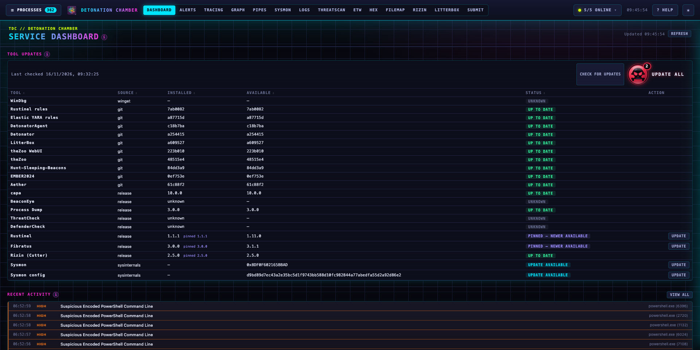

# Tool Updates

How the tools on the VM are checked for a newer version, updated and pinned.

The **Tool Updates** panel on the Dashboard (below the service cards) lists every
tool on the VM with its installed and available version and a status, and
installs updates without re-provisioning the VM. The VM needs internet access
for this; without it the rows say "No internet access from the VM" (`offline`).

> The panel in the Telemetry theme, scrolled to the top of the window:
> the time of the last check, **CHECK FOR UPDATES** and the skull button
> **UPDATE ALL** with the number of tools it would install (2: Sysmon and its
> config, the only rows with *update available*). Rustinel and Fibratus are
> pinned (1.1.1 and 3.0.0), so a newer version (1.11.0, 3.1.1) is shown but
> only their own **UPDATE** button installs it; most git and release tools
> are *up to date*, and a few have no version to compare (*unknown*).

- **Check for updates** runs in the background. The server also checks once a
  day on its own (first check 5 minutes after start; `TDC_UPDATE_CHECK_HOURS`),
  but it never installs anything by itself.
- **Update** on a row installs that tool; **Update all (N)** installs every tool
  with an update except the pinned ones. A tool whose update failed can be
  retried. Click a row to see the last lines of its log.
- The check and the update use the same API as the MCP tools
  `tdc_updates_status`, `tdc_updates_check` and `tdc_updates_apply`.

## What is checked

| Source | Tools | Check | Update |
|--------|-------|-------|--------|
| Chocolatey | every package `choco outdated` reports (git, python312, dotnet-8.0-sdk, 7zip, php, ...); a `<x>.install` row is dropped when `<x>` is listed too | `choco outdated` | `choco upgrade <package>` |
| winget | WinDbg | `winget list --upgrade-available` | `winget upgrade` |
| git | Rustinel rules, Elastic YARA rules, DetonatorAgent, Detonator, LitterBox, theZoo WebUI, theZoo, Hunt-Sleeping-Beacons, EMBER2024, Aether | `git fetch`, commits behind upstream | `git pull --ff-only --autostash`, then the install script rebuilds |
| GitHub release | capa, BeaconEye, Process Dump, ThreatCheck, DefenderCheck, Rustinel, Fibratus, Rizin (Cutter), NTSleuth | latest release against the installed version | the `install-*.ps1` script with `-Force` |
| Sysinternals | Sysmon, Sysmon config | `ETag` of the download against the one recorded at install | `install-sysmon.ps1` |

Not covered: the web UI itself and its pip packages (update them with
`make deploy`), system pip, uv, OpenSSH, and DIE or Ghidra when they came from
the fallback zip instead of Chocolatey. A tool that is not on the VM shows
`not_installed` without a button.

The release tools write the installed tag to `tdc-release.txt` in their folder.
Without it the installed version shows as `unknown` and the tool as
`update_available` until its first update. Repos that publish no GitHub release
(BeaconEye, ThreatCheck, DefenderCheck) show `unknown` with "Upstream publishes
no GitHub releases."; there is nothing to compare, so they have no Update
button. Sysmon and Sysmon config without a recorded ETag in `tdc-source.json`
show `update_available` ("Installed version unknown; an update records it").

## Pinned tools

Rustinel (1.1.1), Fibratus (3.0.0) and Rizin (Cutter 2.5.0) are pinned by their
install scripts, and `python312` is held back by TDC itself (the web UI runs on
that Python: updating it restarts services and may need a reboot). A newer
version shows as `pinned_update`; **Update all** skips it. The row's own button
asks first ("Pinned to X for compatibility. Install Y anyway?"; for `python312`
the question carries the warning above), and the API needs `include_pinned: true`.
A package that is pinned in Chocolatey (`choco_pinned: true` in the entry) cannot
be upgraded by `choco upgrade`: the API refuses it with 409 even with
`include_pinned` ("php is pinned in Chocolatey. Unpin it with choco pin remove -n
php first."). Rizin is installed only with the SHA-256
GitHub publishes for the package; without one the update is refused. After
re-provisioning, the VM has the pinned versions from the install scripts again.

## Maintenance mode

While an update runs (`mode: updating`) the web UI is in maintenance mode. A
banner on every page shows the progress, and the server answers every POST,
PUT, PATCH and DELETE outside `/api/updates/` with `503` and
`"maintenance": true`. Reading stays possible, so the dashboard keeps working.
An update does not start (409 with the reason) while a detonation is running
(DetonatorAgent `in_use`), a memory sweep, a Process Dump job or any scan is
running (also the memory scans a detonation starts in the background), or
another check or update is in progress.

For each tool the run closes Rizin sessions if needed, stops the services that
use the tool (for example LitterBox and the Detonator tasks for `python312`),
updates it, starts the services that were running before, and checks the tool
again. A failure of one tool does not stop the run. A script gets at most 45
minutes. `python312` is always updated last. If the web UI restarts during an
update, the tool being updated is marked `failed` ("Interrupted") and the mode
returns to `idle`. The services the run had stopped are listed in the state file
before they are stopped; on the next start the web UI starts them again and adds
"Restarted: <names>." to the tool's detail.

An exit code of 3010 or 1641 means the VM must restart to finish the update;
the tool shows `reboot_required`. There is no rollback to an older version.

## Scripts and logs

The web UI runs the install scripts from `TDC_SCRIPTS_DIR` (default
`C:\tdc\scripts`). `make deploy`, `make.ps1 deploy` and `deploy-utm.py` upload
them, and the Vagrant boxes get them from a file provisioner. If a script is
missing the update fails with "Install script missing: ... (run make deploy)".
Each update appends to `TDC_UPDATE_LOG`; the last 200 lines per tool are also
shown in the panel. Status values: `up_to_date`, `update_available`,
`pinned_update`, `unknown`, `not_installed`, `offline`, `error`, `queued`,
`updating`, `updated`, `failed`, `reboot_required`.

**Next:** [Web UI](web-ui.md)
