# Web UI

What the two themes look like, what the charts of every tab count, and what the
tabs draw - with the screenshots.

The tab-by-tab table is in the repository's [README](../README.md#web-ui-tabs);
this page is the detail behind it.

## Themes

The Web UI has two themes: **Cyberpunk** (the default: neon on deep violet)
and **Telemetry** (cyan, magenta and acid green on near-black blue, with a
fine grid and scanlines; it replaces the former blue Classic look, and a
browser that stored "classic" simply gets Telemetry). The screenshots below
were taken in Telemetry, except the one that says Cyberpunk. **✶** switches between
the themes at once, without reloading the page; the open tab, an open detail
view, filters and drilldown steps, sort orders, the graph and running pipe
interception sessions stay as they are. The choice is stored in the browser
(`localStorage`), so a browser without a stored choice starts in Cyberpunk. ✶
sits at the right end of the top bar, and again in the drawer, below
"? Help".

Both themes have the same window layout, with a top bar instead of a sidebar
and the content in the full width:

- **☰ PROCESSES** (with the number of tracked processes) opens the process
  list and the timeline in a drawer over the content. Esc, a click beside it or
  picking a process closes it.
- The tabs sit in the top bar. Tabs that do not fit into a narrow window move
  into a **"…"** menu; the active tab always stays in the bar.
- **n/m ONLINE** counts the five services of the status row (Rustinel,
  Sysmon, Fibratus, Agent, LitterBox) and opens a drop-down with the status of
  each. The SERVICES ONLINE tile on the dashboard counts six: it adds the
  Detonator.
- Tab heads get a large title in a head area of their own, and cards and
  tiles get neon borders (Cyberpunk) or a glowing accent bar at the top left
  (Telemetry).

The themes differ in colours and effects: Telemetry paints the page with a
40 px grid, glows at the top and left and fine scanlines (they never take a
click, and nothing moves), the cards with a gradient, the tab titles in a
cyan–violet–magenta gradient, the kicker line in acid green, and the active
tab and the primary buttons in cyan. Severities are red (critical), orange
(high), amber (medium), acid green (low) and cyan (info).

Both themes share the card controls:

- **(i)** beside a card or section title explains it in a sentence or two;
  Esc or a click elsewhere closes the explanation.
- **CHART / TABLE** shows the numbers of a chart as a table: the timeline
  in the drawer, the Tracing timeline and severity bar, the file structure of the
  PE/ELF binary analysis, the file map strip of the PE analysis and every
  chart card under [Charts](#charts) (not the sparklines in the tiles). The
  choice holds per card until the page is reloaded.
- **Sortable tables:** a click on a column head sorts ascending, a second
  click descending (↕ / ▲ / ▼). Numbers sort numerically, times
  chronologically, empty cells last. The order survives the table being
  rendered again: the Alerts tab when the alerts refresh (every 5 s) brings
  new ones, Sysmon and the pipe events after Refresh or a filter change. The
  Tracing event list sorts the same way.
- **Dashboard tiles** open what they count: TOTAL ALERTS the Alerts tab, its
  high / med / low counts the Alerts tab filtered by that severity (high
  includes critical, low includes info), PROCESSES TRACKED the process list,
  SERVICES ONLINE the service cards, DETECTION RULES the help on the detection
  rules and SCANNER TOOLS the ThreatScan tab.

Tiles and column heads also take Enter and Space. The **Alerts** tab (see the tab
table in the repository's [README](../README.md#web-ui-tabs)) exists in both themes.

## Charts

The Web UI draws its charts itself, as SVG (no chart library). They take
their colours from the theme, so ✶ recolours them at once, and every chart
card has an **(i)** and **CHART / TABLE** (the sparklines in the tiles are
not cards and have neither): the table lists the same numbers and sorts like
the other tables. Screenshots:
[Dashboard & Alerts Charts](#dashboard--alerts-charts).

| Where | Chart | Shows | Click / drag |
|-------|-------|-------|--------------|
| Dashboard | Sparklines in TOTAL ALERTS and PROCESSES TRACKED | Alerts and newly seen processes per day over the last 45 days | — |
| Dashboard | **ALERT ACTIVITY** | Alerts per hour, day or week, stacked by severity, for **24H / 7D / 30D / ALL** (default ALL) | A drag across the bars narrows the donuts to that range (a chip; its × goes back to the preset); a bar opens the Alerts tab filtered to its period |
| Dashboard | **SEVERITY**, **CATEGORY** | Donuts of the range with name, count and share; the six most frequent categories, the rest as *other categories* | A segment or a legend row opens the Alerts tab with that severity or category, within the range |
| Alerts | **SEVERITY**, **ENGINE** | Pies of the alerts the filters let through | A slice or a legend row shows only its severity (the chips in the filter bar switch severities on or off) or chooses its engine |
| Alerts | **OVER TIME** | The same alerts per hour, day or week, stacked by severity; a span of up to about 20 hours in steps of 1 s to 30 min (at most 40 bars) | A drag across the bars narrows the tab to the bars it covers, a click on a bar to its period |
| Alerts | **FLOW: ENGINE → RULE → PROCESS** | Sankey of the same alerts: the six most frequent rules and processes, the rest as *other rules* / *other processes* | A node sets its engine, rule or process, a band both of its ends |
| Sysmon | **EVENTS OVER TIME** | The loaded events per period (seconds, minutes or longer, by their span), stacked by event type | A bar sets a time window (Shift+click widens it to another bar), a legend row the event type |
| Sysmon | **PROCESS → EVENT TYPE** | Sankey image → event type: the six most frequent images, the rest as *other images* | A node sets its image or event type, a band both of its ends |
| ThreatScan | **SCORE HISTORY** | A point per scan, oldest left: Aether and Exit Capture at their evidence score, with dashed lines at SUSPICIOUS 2 and MALICIOUS 6; every other tool in the lane *no score* (EMBER2024's probability in the tooltip); coloured by verdict | A point opens its scan in the history list, scrolls to it and marks it |
| Submit | **VERDICT HISTORY** | A bar per submission, oldest left, as high as its verdict's score on the verdict's own scale (SUSPICIOUS from 1, MALICIOUS from 3) and in its colour; grey: *not evaluated* | A bar opens its results, as its Results button does |
| Submit, detail panel | **VERDICT FLOW** | Sankey of a detonation's findings: process → kind (LitterBox score, EDR alerts, live memory, exit capture, network beaconing, named pipes) → *counted* / *not counted* | — |
| Graph | **ACTIVITY MIX** | Donut in a process node's detail: the Sysmon activity of that process instance (network, DNS, file, registry, named pipes, the injections it made); its alerts as a number beside it, not part of the ring | — |

- **Click filters:** a time range, category, rule or process (Alerts) and a
  time window, image or event type (Sysmon) set by a click (in the Alerts
  tab also by a range drawn across OVER TIME) show as chips in the filter
  bar; the × of a chip takes that filter off, and in the Alerts tab BACK
  takes the last step back (see *Drilldown*). A severity or an engine sets
  the filter bar's own controls. The count of the table ("n of
  m" in the Alerts tab, "Showing n of m events" in Sysmon) is then exactly
  what the part counted. Some parts set no filter: a bucket (*other rules*,
  *other processes*, *other images*, *other categories*) and every band into
  or out of one (*other rules* → a process, *other images* → an event type),
  which stand for several names and would list more than they show; the
  alerts without an engine and a severity no chip names, which no control
  of the filter bar selects; and a bar without alerts or events, or a range
  drawn across such bars only, which would list nothing.
- **Drawing a range across OVER TIME:** press on the bars and drag by at
  least 5 px: a dashed box over their whole height snaps to whole bars, as
  on ALERT ACTIVITY. Letting go narrows the tab from the start of the first
  to the end of the last bar it covers, so the table lists exactly what
  those bars counted. The bars then divide the range anew: a day in 24 bars
  of an hour, 10:00–12:00 in 24 bars of 5 minutes. A range that does not
  begin and end on a full minute is named with seconds. New alerts (every
  5 s) do not redraw the bars while a range is being drawn; they are drawn
  once the button is up.
- **Drilldown (Alerts tab):** a click on SEVERITY, ENGINE, FLOW or a bar of
  OVER TIME, or a range drawn across OVER TIME, is a step when it changes a
  filter (the same slice clicked again is none); so is every jump from the
  dashboard with a filter. While there is a step, a bar between the head of
  the tab and the charts shows **‹ BACK** (its tooltip names where it
  goes), DRILLDOWN, the path and the count ("n of m alerts"). The path
  reads like
  `ALL ALERTS › 27 Jul › 27 Jul 10:00–12:00`, the current step last; of
  more than three steps the oldest fold into "…", whose tooltip names them,
  and a long name is cut (its tooltip has it in full). BACK takes the last
  step back: the filters it changed get the values they had before it. A
  step in the path jumps back to the state after it, ALL ALERTS takes every
  step back, and the bar disappears. What you set in the filter bar
  yourself (the severity chips, the engine choice, the search, the × of a
  chip) is no step, and BACK never undoes it: the steps forget a filter you
  change that way, and a step leaves the path only once it sets no filter,
  so the path names only what is still in effect (the step of a band,
  `Sigma · rule: Run Key`, stays as `rule: Run Key` when you choose the
  engine yourself). A jump from the dashboard (a high / med / low count of
  TOTAL ALERTS, a bar, a donut segment or legend row) starts a new path
  with one step, named `Dashboard: …` (for example
  `Dashboard: CRITICAL + HIGH`); BACK then shows all alerts and stays in
  the tab. TOTAL ALERTS itself sets no filter and makes no step. The steps
  last until the page is reloaded, as the filters do.
- **Charts and filters:** the charts of the Alerts and Sysmon tabs count
  everything the current filters let through (the Alerts table lists the
  newest 2000 of it, the charts all; Sysmon: all but its time window, which
  the bars mark; the window narrows the table). Both tabs scroll as a whole
  while the filter bar stays at the top (in the Alerts tab right under the
  drilldown bar); a click on the dashboard opens the Alerts tab at its top.
- **Times:** bars follow local hours and days. An alert or event without a
  readable time, or with one before 2000 or more than a day ahead (a sample
  can set the clock), is in no bar: a note under the bars counts those, and
  the pies, donuts and Sankeys of the same filter include them. Sigma's
  level `informational` counts as info.
- **Sankeys** are drawn by square roots, so small flows stay visible;
  **LINEAR** shows true proportions.
- **VERDICT FLOW** counts each finding once, as the results list it: every
  EDR alert (those beyond the 50 the server lists flow from *(not listed)*),
  the LitterBox score when it added points to the verdict (4 of 10 or more;
  it flows from *(sample file)*) and every memory finding by its source;
  *named pipes* counts the pipe findings, not the pipes the Named Pipes tab
  counts. A memory finding is *counted* while the memory evidence reaches
  SUSPICIOUS and it keeps a weight, also one marked "uncorroborated — weight
  reduced"; findings the host baseline suppressed, repeats capped at weight
  0 and all findings of an evidence below SUSPICIOUS are *not counted*.
- **Stored verdicts:** the server keeps a detonation's verdict (label and
  score) on its submission each time it computes the results: every poll
  of the Submit tab, every opening of the results, the MCP tools that read
  them. It goes to the submission of the run it was computed for: the
  sample run as that PID, without a PID the one of the sample that ran
  without (LitterBox only). Results for a PID none of the sample's
  submissions ran as, or without a PID for a sample that always ran with
  one (`tdc_detonation_results` with a hash only), are stored nowhere.
  VERDICT HISTORY shows the last verdict stored, so it can be provisional: if
  polling stopped early or services were offline then, it is the verdict of
  that moment. Opening the results again computes and stores it anew;
  submissions from before verdicts were stored stay grey until then.
- **Polling:** the charts of the dashboard and the Alerts tab count again
  only when the alerts or the range change, not on every refresh (the
  alerts every 5 s, the dashboard every 10 s), and not while their tab is
  hidden.

## ETW Browser

The ETW tab provides a multi-channel Windows Event Log viewer with automatic threat classification:

| Feature | Details |
|---------|---------|
| **12 Channels** | Sysmon, Security, PowerShell, Defender, WMI, Task Scheduler, BITS, DNS, Firewall, AppLocker, WinRM, Application |
| **Availability Probe** | Channels show ● ACTIVE / ○ NO DATA status on load |
| **Auto-Refresh** | Polls every 5s (toggleable), keyword filter across all fields |
| **Threat Highlighting** | Malicious events highlighted red with threat classification badge |
| **Expandable Details** | Click any event to inspect all data fields; suspicious values marked red |

Threat detection rules cover:

- **Encoded/obfuscated PowerShell** (base64, IEX, downloadstring, bypass, hidden)
- **LOLBin abuse** (certutil, mshta, regsvr32, rundll32, bitsadmin, wmic)
- **Credential access** (LSASS access, mimikatz, sekurlsa, procdump)
- **Persistence** (registry Run keys, scheduled tasks, services, WMI subscriptions)
- **Defense evasion** (AMSI bypass, ETW patching, process tampering)
- **Lateral movement** (explicit credential logon, WinRM, net use)
- **C2 indicators** (suspicious ports, .onion/.tk domains, DNS tunneling)
- **Sysmon IOCs** (CreateRemoteThread, DLL sideloading, ADS creation, process tampering)

## Binary Analysis (PE / ELF)

| Capability | Details |
|-----------|---------|
| **PE Header Analysis** | DOS/COFF/Optional headers, ASLR/DEP/SEH/CFG detection |
| **DiE-Style Detection** | Compiler, packer, protector, linker identification with assessment |
| **Entropy Heatmap** | 64-block Shannon entropy visualization (red >= 7.0 = packed) |
| **Section Layout** | Visual section diagram with RWX permission flagging |
| **ELF Security Audit** | PIE, NX stack, RELRO, stack canary, Fortify, stripped detection |
| **Suspicious Imports** | Categorized: injection, evasion, credential access, networking, crypto |
| **IOC Flags (clickable)** | Expandable detail panels showing matched APIs, detection rules, and explanations |
| **Packer Detection** | UPX, Themida, VMProtect, ASPack, MPRESS via section + heuristic matching |
| **TLS Callbacks** | Anti-debug indicator detection |
| **File Map** | Per-byte class plot, local entropy and structure regions (headers, sections, data directories, overlay, entry point) mapped onto file offsets |
| **Import / Export Trees** | DLL → function trees with suspicious APIs tagged; ELF `DT_NEEDED` + dynamic symbols |

## Reverse Engineering Tools

| Tool | Purpose |
|------|---------|
| **Detect It Easy (DiE)** | PE/ELF/Mach-O identification — packers, compilers, protectors |
| **WinDbg (Preview)** | Kernel/user-mode debugger — crash dumps, live debugging, TTD |
| **Ghidra** | NSA RE framework — disassembly, decompilation, scripting |
| **rizin + rz-ghidra** | Reverse engineering in the browser ([Rizin](rizin.md) tab): analysis, disassembly, control flow graph, decompiler, console |

---

## Demo

Screenshots from the ARM64 UTM VM with the test samples used during development
(`shortlived.exe`, `injectsim.exe`, `beaconsim.exe`, `pipesim.exe` — harmless
programs that mimic implant behaviour).

### Service Dashboard (Telemetry theme)

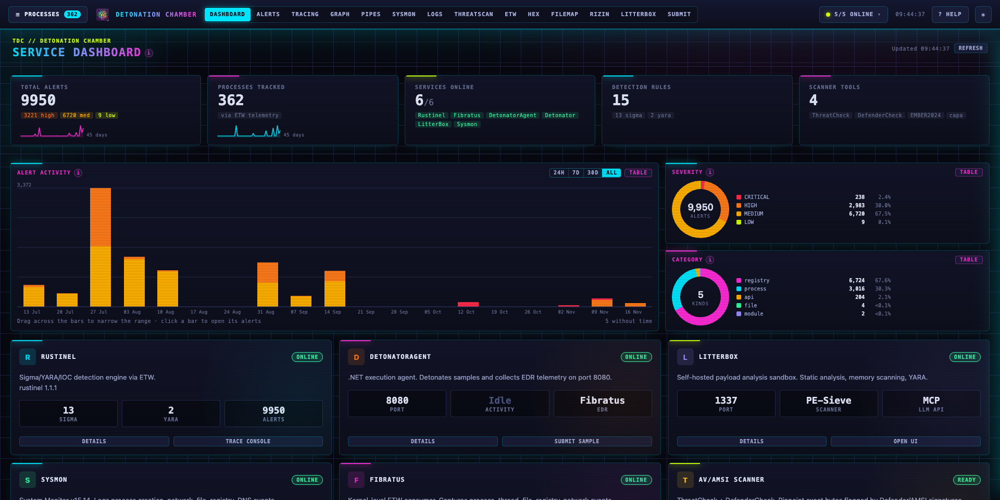

> Stats strip (alerts by severity, tracked processes, services online, loaded
> Sigma/YARA rules, scanner tools), where each tile opens what it counts;
> TOTAL ALERTS and PROCESSES TRACKED carry 45-day sparklines. Below it
> **ALERT ACTIVITY** on ALL: the 9,950 alerts per week from 13 Jul to 16 Nov
> (5 without a time), stacked by severity, beside the **SEVERITY** and
> **CATEGORY** donuts of that range (238 critical, 2,983 high, 6,720 medium,
> 9 low; registry, process, api, file, module). Then one card per service:
> Rustinel, DetonatorAgent and LitterBox, below them Sysmon, Fibratus and the
> AV/AMSI scanner (EMBER2024 and capa follow further down). An offline service
> is struck through and can be launched from its card; all of them are online
> here. The top bar holds ☰ PROCESSES (362 tracked processes; the process list
> and the alert timeline, the 60 newest alerts coloured by severity, which
> TABLE lists as a table, sit in the drawer behind it), the tabs, the service
> summary, Help and ✶, which switches to Cyberpunk.

---

### Cyberpunk Theme (default)

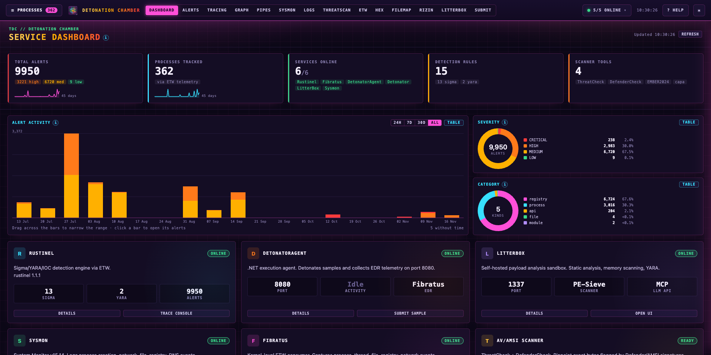

> The same dashboard in the **Cyberpunk** theme, which a browser without a
> stored choice starts in. The top bar holds ☰ PROCESSES
> (362 tracked processes, opens the process list and the timeline in a
> drawer), the logo, the tabs (Dashboard to Submit, LOGS among them) with the
> active one in magenta, the service summary, the time of the last update,
> Help and ✶, which switches to Telemetry. The summary *5/5 ONLINE* counts the
> five services of the status row (a click lists them); the SERVICES ONLINE
> tile shows *6/6* because it also counts the Detonator. Below
> the head area the stats tiles carry a coloured edge; a click on a tile opens
> what it counts, a click on *3221 high* the critical and high alerts. The
> charts follow in the theme's colours: ALERT ACTIVITY on ALL (its switch
> 24H / 7D / 30D / ALL at the top right), the SEVERITY and CATEGORY donuts,
> then the service cards.

---

### Alerts

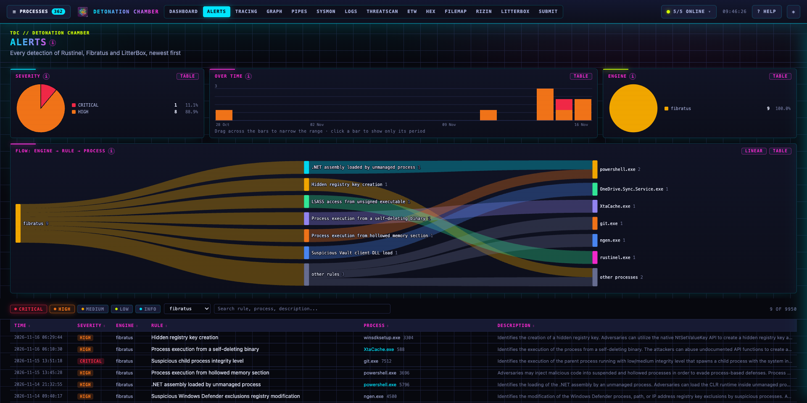

> The **Alerts** tab (Telemetry) filtered to the critical and high alerts of
> the fibratus engine: *9 of 9950*. The charts above the filter bar count
> the same nine: SEVERITY 1 critical and 8 high, OVER TIME bars between
> 28 Oct and 16 Nov (under the bars the hint how to use them), ENGINE
> fibratus alone, and FLOW from fibratus through seven rules (six named, the
> rest as *other rules*) to the processes they ran in (a click on a part would
> narrow the list further). The severity chips and the engine are set in the
> filter bar itself, which is no drilldown step, so no drilldown bar shows.
> Below the bar the rows, newest first, each with its time, severity, engine,
> rule, process and PID, and the rule's description. A click on a row opens
> the alert detail; process names that are in the process list (here
> `XtaCache.exe` and `powershell.exe`) are links to the process. Column heads
> sort the table.

---

### Dashboard & Alerts Charts

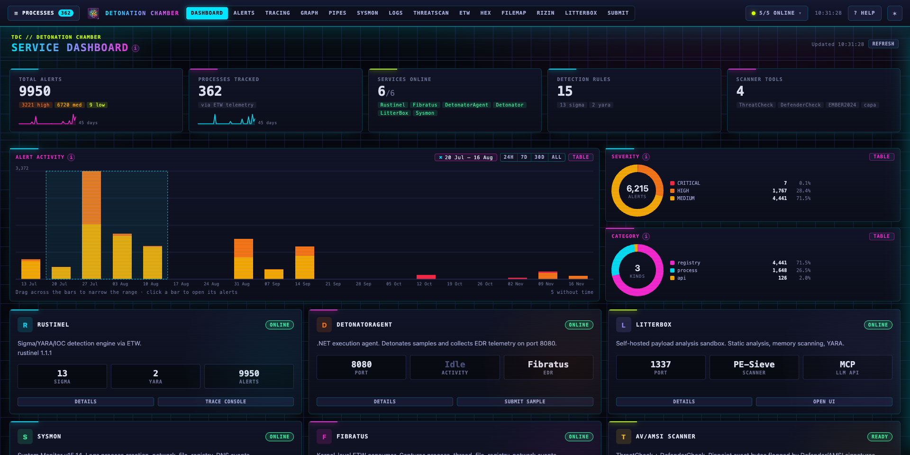

> The dashboard (Telemetry) with a range drawn across **ALERT ACTIVITY**:
> the bars of ALL show the 9,950 alerts per week from 13 Jul to 16 Nov,
> stacked by severity; the range 20 Jul – 16 Aug is marked on them and
> stands as a chip before 24H / 7D / 30D / ALL, whose × goes back to ALL.
> **SEVERITY** and **CATEGORY** count that range only: 6,215 alerts (7
> critical, 1,767 high, 4,441 medium), in three categories (registry 4,441,
> process 1,648, api 126). The TOTAL ALERTS and PROCESSES TRACKED tiles carry their
> 45-day sparklines. A click on a bar or a segment opens the Alerts tab
> filtered to it.

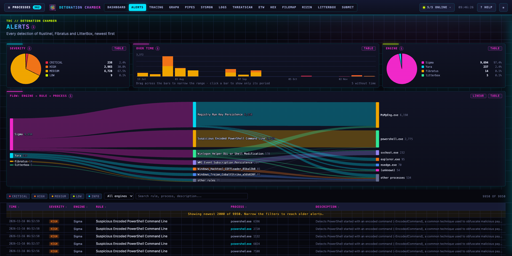

> The **Alerts** tab with all 9,950 alerts: **SEVERITY** and **ENGINE** as
> pies beside their legends (Sigma 9,694, Yara 237, fibratus 14, litterbox 5),
> **OVER TIME** per week stacked by severity (the week of 27 Jul has 3,372 alerts)
> with the hint how to draw a range below it, and **FLOW: ENGINE → RULE →
> PROCESS** drawn by square roots. It shows the noise at a glance: the
> Run-key rule alone has 6,150 of the alerts, and `MsMpEng.exe` alone has
> 6,190. The six most frequent rules and processes stand on
> their own, the rest as *other rules* (95) and *other processes* (534). A
> click on a slice, a bar, a node or a band, or a range drawn across the
> bars, narrows the tab by a step; no filter is set here (*9950 of 9950* in
> the filter bar), so no drilldown bar shows.

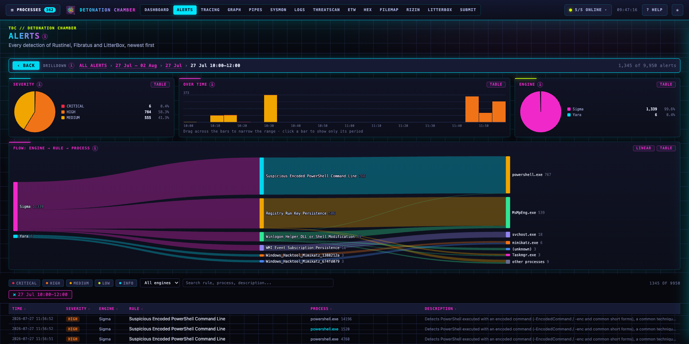

> The **Alerts** tab (Telemetry) after three steps: a click on the week
> 27 Jul – 02 Aug in OVER TIME, a click on its day 27 Jul, then a range
> drawn across the hours 10:00 and 11:00. The drilldown bar above the charts
> shows **‹ BACK**, the path
> `ALL ALERTS › 27 Jul – 02 Aug › 27 Jul › 27 Jul 10:00–12:00` (a click on a
> step goes back to it) and *1,345 of 9,950 alerts*. OVER TIME divides the
> two hours into 24 bars of 5 minutes; the busiest, 10:30–10:35, has 373
> alerts. SEVERITY counts 6 critical, 784 high and 555 medium, ENGINE Sigma
> 1,339 and Yara 6, and FLOW leads Suspicious Encoded PowerShell Command
> Line (766) to `powershell.exe` (767 in all) and Registry Run Key
> Persistence (506) mostly to `MsMpEng.exe` (539 in all). The range stands
> as a chip under the filter bar (*1345 of 9950*), and the table lists those
> alerts, newest first.

---

### Own Dashboard Tiles

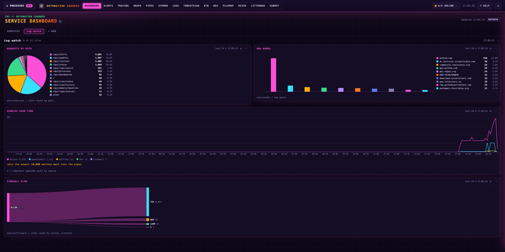

> The dashboard page **Log watch** (Cyberpunk), *4 of 12 tiles*, each one a
> search of the LOGS tab saved with SAVE. The page row above it holds
> SERVICES, this page and + NEW. **REQUESTS BY PATH** draws
> `source=access | stats count by path` as a pie of the twelve largest paths
> plus *other*, **DNS NAMES** `source=dns | top query` as bars beside their
> legend, **SOURCES OVER TIME** `* | timechart span=5m count by source` as a
> line per source — with the warning line that only the newest 10,000
> matches went into the pipes — and **FIREWALL FLOW**
> `source=firewall | stats count by action, protocol` as a Sankey from the
> verdict to the protocol. Table, line and Sankey tiles take a whole row,
> pies and bars half of one. Each head carries the range (`last 24 h`), the
> time its numbers are from, **↻** for that tile alone and **⋯** for its
> menu; the foot shows the query it runs.

---

### Detonation Results

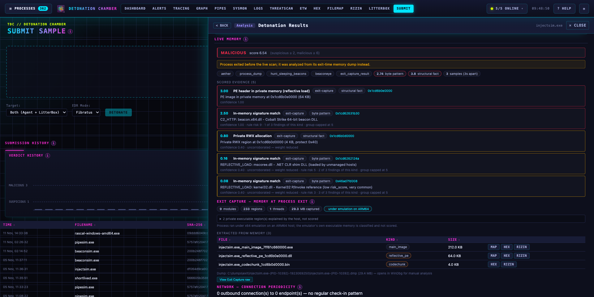

> `injectsim.exe` is **MALICIOUS (6.54)**. It exited before the
> live scan, so the verdict comes from its exit-time memory dump: a PE image in
> private memory (reflective load), a `beacon.x64.dll` string and a private RWX
> region. Every finding shows its evidence class, confidence and why its weight
> was reduced (uncorroborated, group cap). Below: the exit dump summary
> (modules, regions, emulation on ARM64) and the images extracted from memory,
> each with Map/Hex shortcuts.

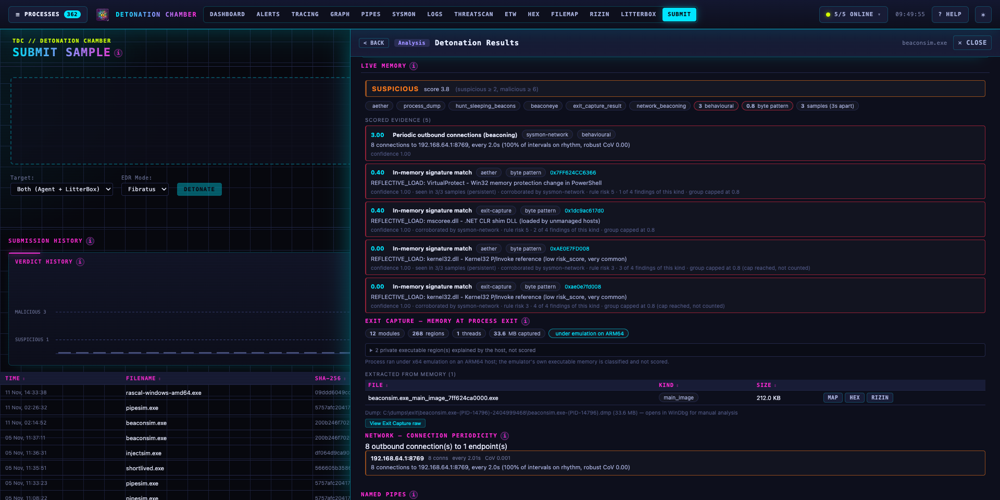

> `beaconsim.exe` is **SUSPICIOUS (3.8)**: Sysmon network events show
> 8 connections to the same endpoint every 2.0 s (robust CoV 0.00), and that
> rhythm corroborates the in-memory signature hits from Aether (3 of 3 samples)
> and the exit dump.

---

### Tracing Console & Alert Detail

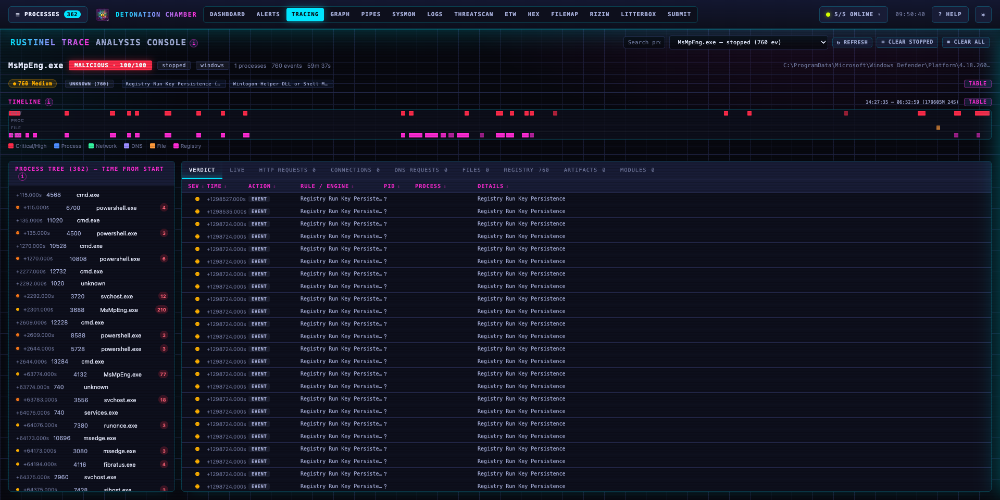

> The Tracing console for a process with 760 events: verdict badge,
> a timeline split by event type, the process tree with alert counts ("time
> from start"), and the verdict table. Tabs filter HTTP, connections, DNS,
> files, registry, artifacts and modules.

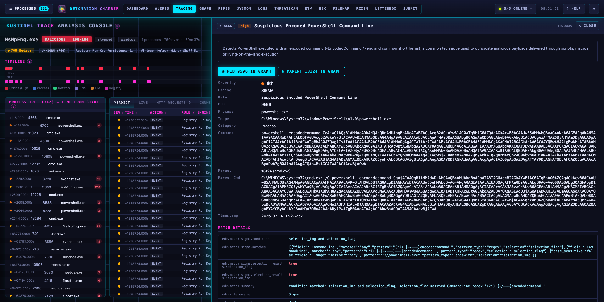

> A Sigma alert ("Suspicious Encoded PowerShell Command Line") with
> the decoded rule description, pivots to the process and its parent in the
> graph (opened at the alert's time, so a reused PID does not lead to the wrong
> process), the full command lines and the Sigma match details (condition,
> matched fields and patterns), loaded on demand.

---

### Process Graph

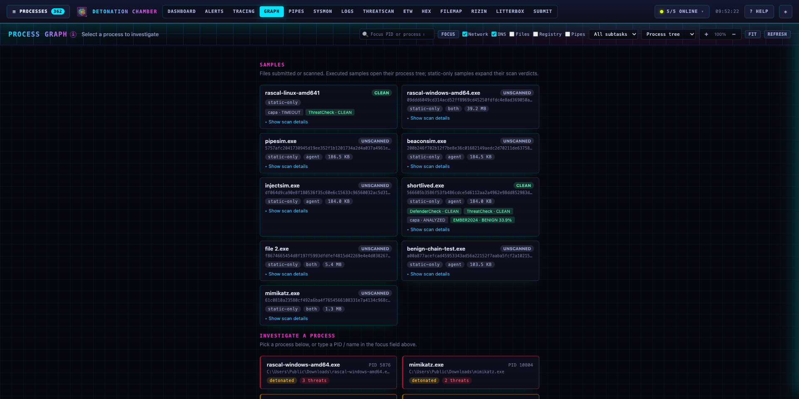

> The landing page lists submitted and scanned samples with their
> scan verdicts (executed samples open their process tree) and the processes
> worth investigating — only processes attributed to a submission are marked
> *detonated*.

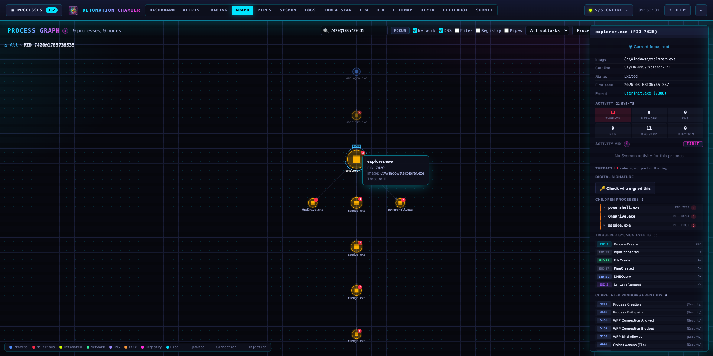

> Process tree around an `explorer.exe` instance
> (`7420@1785739535` — an earlier holder of PID 7420): ancestors above, children
> below. The detail panel shows image, status, activity counters, signature
> check and the children.

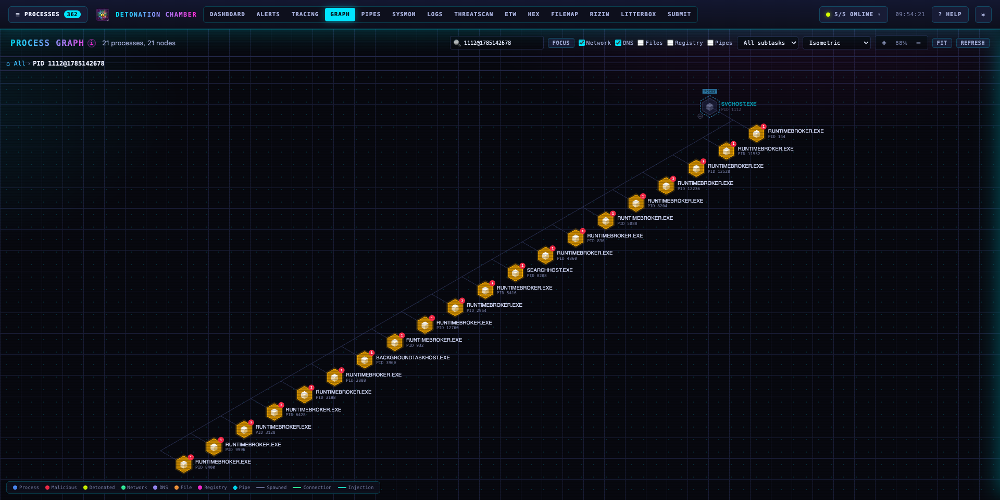

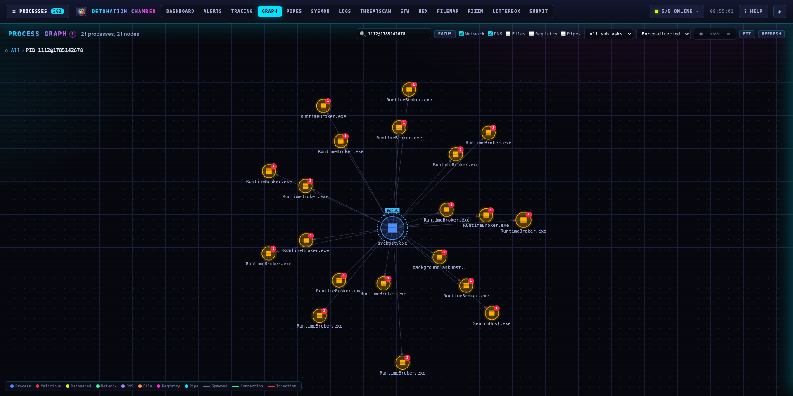

> The same kind of tree in the isometric view (sibling spines,
> hexagon nodes coloured by detonation/severity, foldable subtrees, activity
> icons per process; remote threads are drawn as raised bridges) and as a
> force-directed layout.

---

### PE Analysis, Hex Editor & File Map

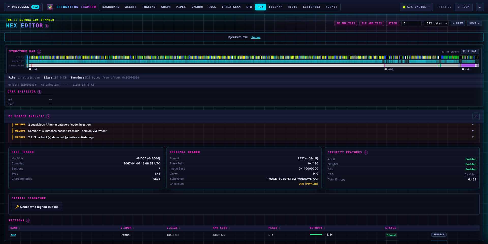

> **PE header analysis** of `injectsim.exe`, scrolled to the lower part of the
> panel: the last three IOC flags (code-injection APIs, a `.tls` section
> matching a packer name, two TLS callbacks), file/optional headers with an
> invalid checksum, security features, and the start of the section table
> with its entropy bars.

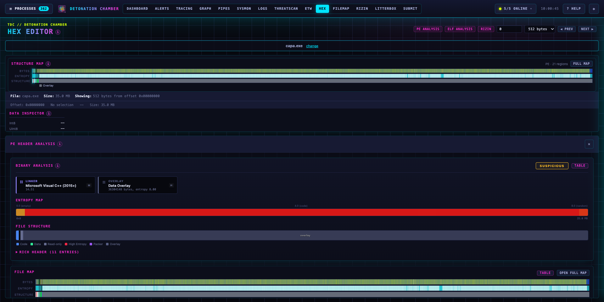

> **Packing analysis** of `capa.exe` (a PyInstaller bundle, 35 MB): Detect-It-Easy
> style cards (linker, 36 MB data overlay at entropy 8.00), entropy map and
> file layout — almost the whole file is overlay.

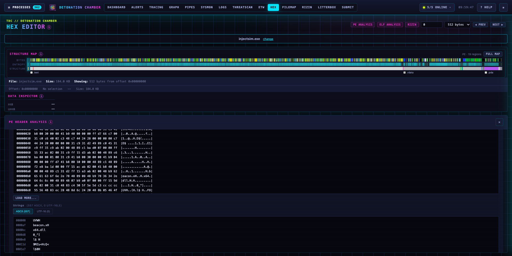

> **Section inspection:** `.text` of `injectsim.exe` with hex dump and
> extracted strings (`beacon.x64.dll`).

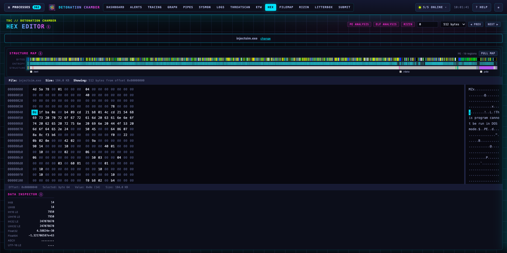

> **Hex editor:** structure minimap above the dump (sections and data
> directories), selected byte at offset 0x40 decoded by the data inspector.

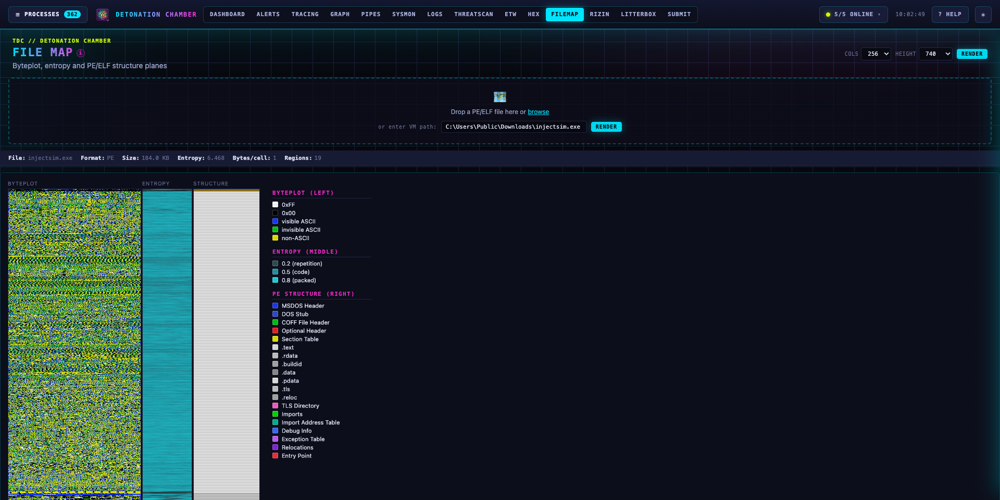

> **File map:** byteplot, local entropy and PE structure planes of
> `injectsim.exe` side by side with the legend; clicking a plane jumps to the
> offset in the hex editor.

---

### Rizin (Reverse Engineering)

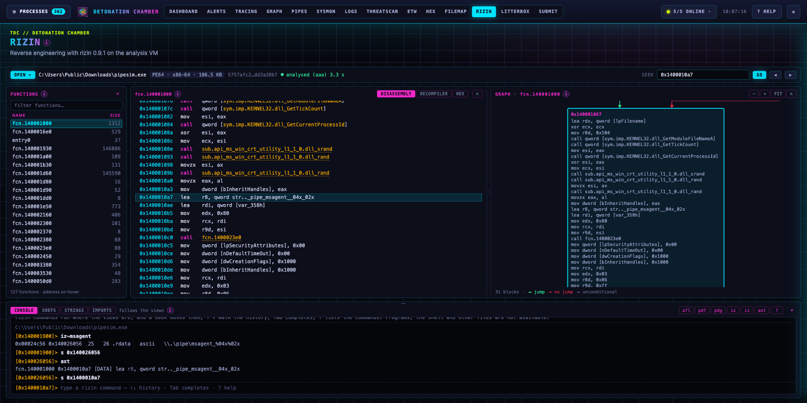

> The **Rizin** tab (Telemetry) with `pipesim.exe`, the harmless named-pipe
> test program, opened from its path in `C:\Users\Public\Downloads` on the VM
> (the OPEN ▾ menu also takes a submitted sample, a dump or an upload). The
> toolbar shows the path, *PE64 · x86-64 · 186.5 KB*, the shortened SHA256 and
> *analysed (aaa) 3.3 s*; FUNCTIONS lists the 127 functions Rizin found, with
> `fcn.140001000` marked. DISASSEMBLY shows that function around 0x1400010a7
> (marked, SEEK says the same): the `lea r8` that loads the pipe-name string
> `\\.\pipe\msagent_%04x%02x`, among calls (pink), the imports of
> `KERNEL32.dll` and the C runtime (amber). GRAPH beside it draws the
> function's 31 blocks, here the block that starts at 0x140001067 (marked).
> Below, the CONSOLE shows how the view got there: `iz~msagent` finds the
> string at 0x140026056, `s 0x140026056` seeks to it, `axt` lists its only
> reference (`fcn.140001000` at 0x1400010a7) and `s 0x1400010a7` follows it;
> the prompt `[0x1400010a7]>` stands at the place the views show.

---

### Live Process Memory

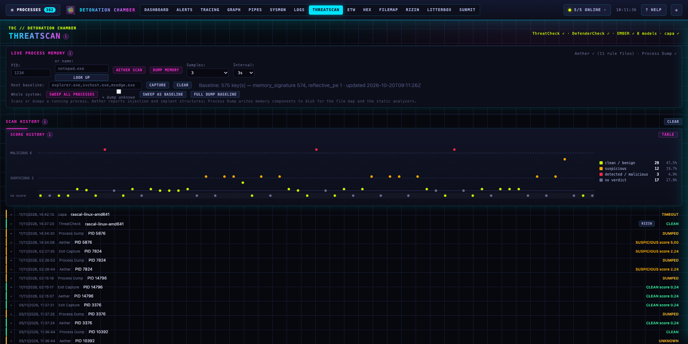

> The **LIVE PROCESS MEMORY** panel of the ThreatScan tab with the **SCAN
> HISTORY** under it. The panel takes a PID, or a name to look up, and offers
> Aether scan (set to 3 samples, 3 s apart), Dump memory, the host
> baseline (explorer.exe, svchost.exe, msedge.exe, with CAPTURE and CLEAR; the
> baseline holds 575 keys, updated 2026-10-20) and the whole-system sweep
> buttons; no scan is running. Below, the score history plots every scan of
> the history as a point (clean 29, suspicious 12, detected 3, no verdict 17
> of the 61 entries; the dashed lines mark SUSPICIOUS at 2 and MALICIOUS at
> 6), and the list gives each entry's time, scanner, target and verdict with
> its score. A click on an entry or a point opens its details. An Aether
> result as the scan shows it (hits by category, the baseline, MITRE
> techniques) is drawn in the detonation results (LIVE MEMORY above) and
> after a scan started here.

---

### Named Pipes

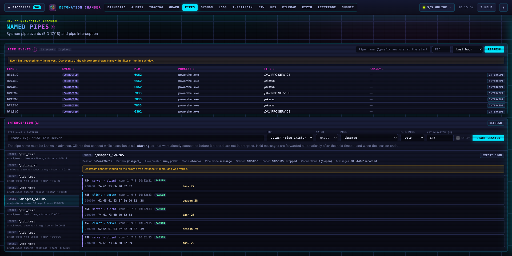

> **Pipes tab:** PIPE EVENTS lists the Sysmon pipe events of the last hour on
> the VM (12 events on 2 pipes when the screenshot was taken: `powershell.exe`
> connecting to `\wkssvc` and `\DAV RPC SERVICE`; the pipe events of the
> `pipesim.exe` detonation are no longer in the Sysmon log, so a filter on
> its pipe finds none). Below, the interception session list and
> the session `\msagent_5e62b5` (pattern `\msagent_`, armed with a prefix
> match before the detonation, mode observe, 10:51:35 to 10:53:05): it took
> the new pipe and relayed the whole run (1 connection, 58 messages, 446 B
> recorded; `beacon n` client → server and `task n` server → client, hex and
> ASCII, every one PASSED), and the sample exited normally. The notice
> above the messages says the upstream connect landed on the proxy's own
> instance once and was retried.

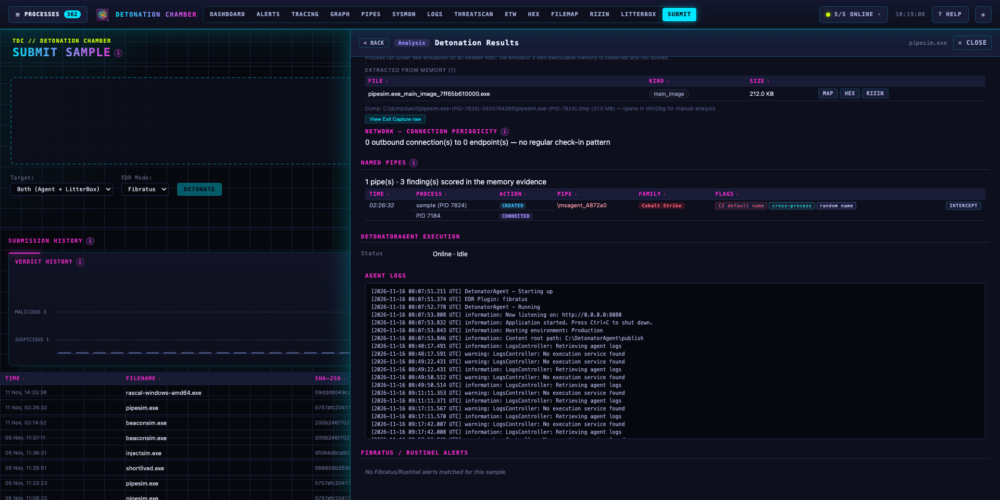

> **NAMED PIPES** in the detonation results of `pipesim.exe` (the run of
> 11 Nov): one pipe, `\msagent_4872a0`, created by the sample (PID 7824) and
> connected by PID 7184, flags *C2 default name*, *cross-process* and
> *random name*, family Cobalt Strike. The 3 findings enter the memory
> evidence (source `sysmon-pipes`, verdict **MALICIOUS** together with the
> memory findings), and **Intercept** opens the Pipes tab with an attach form
> for this pipe.

---

### Sysmon & ETW

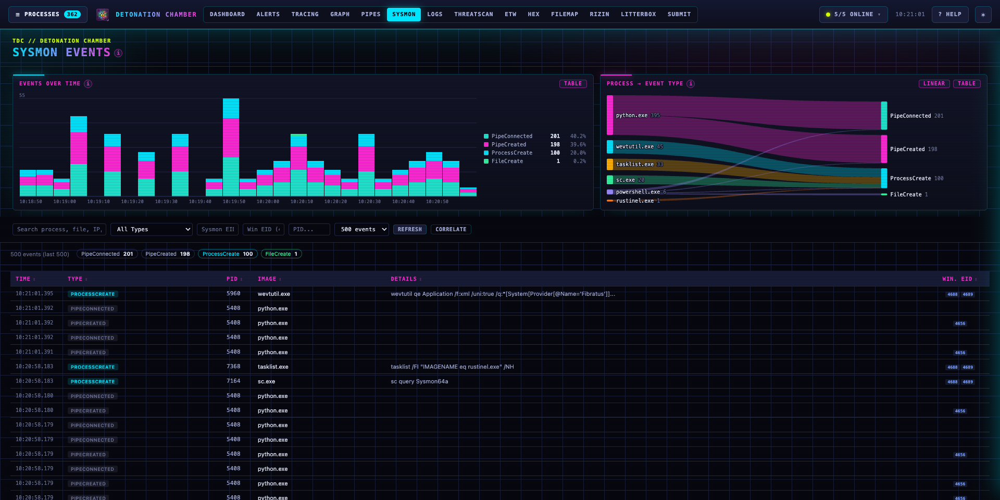

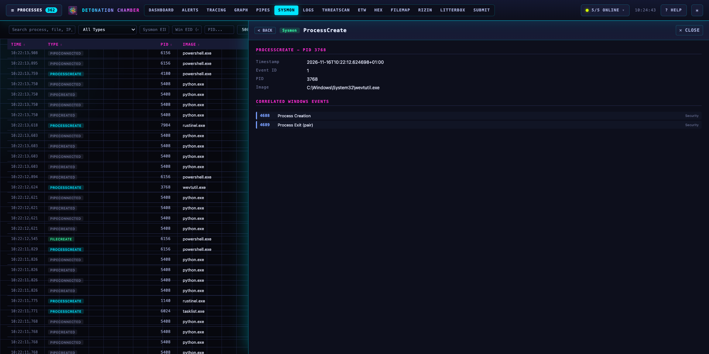

> **Sysmon:** the 500 newest events. **EVENTS OVER TIME** stacks
> them by event type in bars of a few seconds, **PROCESS → EVENT TYPE** shows
> who raised them (`python.exe`, the web UI itself, 395, nearly all of them
> pipe events; then `wevtutil.exe` 45, `tasklist.exe` 33, `sc.exe` 20,
> `powershell.exe` 6 and `rustinel.exe` 1). Under the filter
> bar the type counters (PipeConnected 201, PipeCreated 198, ProcessCreate
> 100, FileCreate 1) and the table with command lines and the Windows
> Event IDs each Sysmon event corresponds to; the detail view (the second image,
> for a `wevtutil.exe` ProcessCreate) lists the correlated Security events 4688
> and 4689.

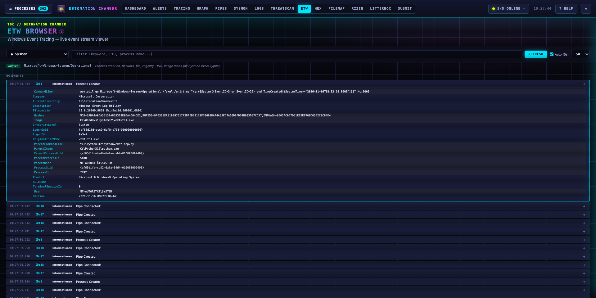

> **ETW browser:** the Sysmon channel with one event expanded (a Process
> Create of `wevtutil.exe`); all fields of the event are shown, suspicious
> values are highlighted.

---

### Firewall

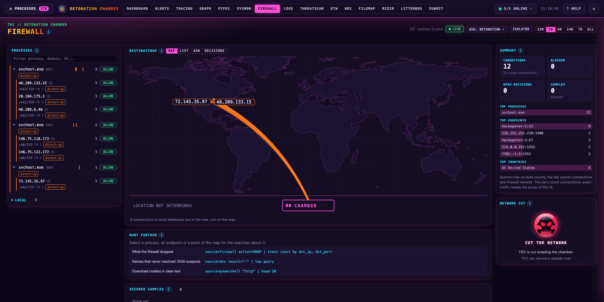

> **FIREWALL tab:** 12 connections over the last hour, nothing isolated. The
> tree on the left holds three `svchost.exe` instances (PIDs 4052, 3964 and
> 3008) with their ALLOW switches, `direct-ip` tags and endpoints; the map shows
> two arcs from the framed CHAMBER device to `72.145.35.97` and
> `48.209.133.15`; the summary counts 12 connections (22 single ones), BLOCKED
> 0, and the CUT THE NETWORK card sits under it, with HUNT FURTHER and SECURED
> SAMPLES at the bottom.

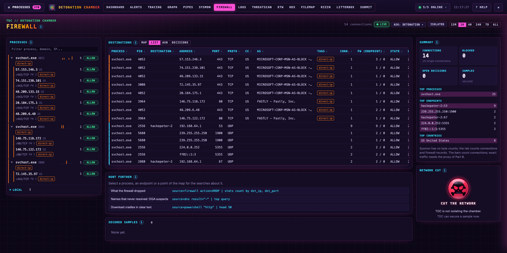

> **LIST view:** the same flows as a table, 14 connections: `svchost.exe` TCP
> rows to Microsoft and Fastly address blocks on 443 and 80, tagged
> `direct-ip` and in state ALLOW, and UDP rows to multicast addresses and to
> `hackepeter-2` on 53 and 67.

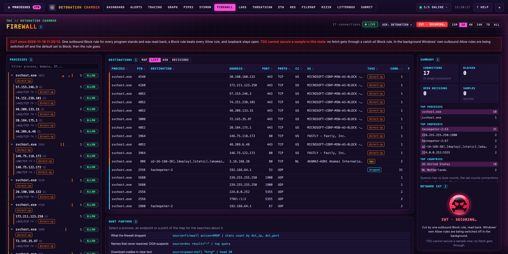

> **The panic cut in force:** the red band says one outbound Block rule for
> every program stands and TDC cannot secure a sample in this state; the header
> switch and the skull card both read `CUT · SECURING…`. The summary shows
> BLOCKED 0 all the same, because that counter holds TDC's per-endpoint and
> per-process rules and the cut is one catch-all rule instead. What each switch
> writes, what the cut stages mean and how to leave are in
> [Firewall](firewall.md).

**Next:** [API](api.md)
