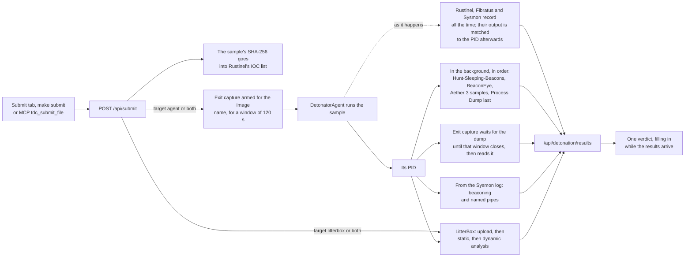

# Workflow

How a sample gets detonated, scanned and taken apart, from the Web UI and from the
command line.

## Detonation Workflow

1. Open the Web UI at `http://<vm-ip>:9000` (`make open`)
2. Go to the **Submit** tab and drop (or browse) a sample
3. Select the target: **Agent** (execution), **LitterBox** (analysis) or **Both**
4. Click **Detonate** and watch the stages: agent execution, LitterBox, EDR
   alerts, exit capture, live memory. Live-memory results arrive 1-2 minutes
   after the start; the verdict updates while they come in
5. **Tracing** shows the sample's events and alerts; **Graph** its process tree
   (the landing page links each executed sample to its tree)
6. Earlier detonations: **Submit → Submissions → View results**, or MCP
   `tdc_detonation_results`

What runs against the process while it lives, and how the stages add up to one
verdict, is in [memory.md](memory.md).

## Data Flow



A submission takes the same path from all three places it can start: the hash
goes into Rustinel's IOC list, and with the agent as a target Windows is armed to
dump the sample's image name on exit before DetonatorAgent runs the file and
answers its PID. The engines record all the time and their output is matched to
that PID afterwards; from the PID itself LitterBox's dynamic analysis, the
live-memory tools, the exit-capture watcher and the Sysmon log go on at once -
the memory tools one after another in one background thread, so their view of the
process stays undisturbed. The Submit tab polls `/api/detonation/results` for the
combined verdict, which rises as the stages report; the results are kept in
`webui/memory_results/` and survive a restart.

## CLI Submission

```bash
# macOS / Linux
make submit FILE=./samples/mimikatz.exe TARGET=both
```

```powershell
.\make.ps1 submit -File .\samples\mimikatz.exe -Target2 both
```

## Scanner Workflow

1. Go to the **ThreatScan** tab
2. Drop a file or enter a path inside the VM
3. Tick the tools: ThreatCheck (Defender/AMSI engine), DefenderCheck,
   EMBER2024 (model + threshold), capa
4. Click **Scan** — each tool reports in its own card; ThreatCheck shows the
   offset of the flagged bytes with a link into the hex editor
5. Every scan is kept in the **Scan History** below and on the graph landing page

## PE Analysis

1. Go to the **Hex** tab
2. Upload a PE file or enter a VM path (samples are in `C:\Users\Public\Downloads\`)
3. Click **PE Analysis**; **Inspect** on a section shows its hex dump and strings
4. Review: headers, security features (ASLR/DEP/SEH/CFG), section entropy, suspicious imports, packer indicators, DiE-style detection overview

## ELF Analysis

1. Go to the **Hex** tab
2. Upload an ELF binary (Linux/BSD executables, shared objects)
3. Click **ELF Analysis** button
4. Review: ELF header, security audit (PIE/NX/RELRO/canary/Fortify), sections, segments, dynamic libraries, suspicious symbol imports

What each field of those reports means, and the File Map beside them, is in
[web-ui.md](web-ui.md#binary-analysis-pe--elf); to go further than the reports, open the file in
[rizin.md](rizin.md).

## Hunt-Sleeping-Beacons

Scan running processes for sleeping C2 beacons (RDP or SSH into VM):

```powershell
# Scan all processes
Hunt-Sleeping-Beacons.exe

# Scan a specific PID (e.g., after detonation)
Hunt-Sleeping-Beacons.exe -p 1234

# Include .NET processes (more false positives)
Hunt-Sleeping-Beacons.exe --dotnet

# Show command lines for suspicious processes
Hunt-Sleeping-Beacons.exe --commandline

# Shortcut alias
hsb --commandline
```

Detections include: unbacked memory in callstacks, non-executable memory pages, module stomping (SharedOriginal check), suspicious APC dispatchers, timer-based sleepmask callbacks, abnormal intermodular calls (module proxying), and return address spoofing (jmp gadget patterns).

Hunt-Sleeping-Beacons and BeaconEye are x64 builds on every VM, ARM64
included: Hunt-Sleeping-Beacons reads thread contexts through the AMD64
`CONTEXT` layout and does not compile for ARM64. Under emulation they see x64
processes - which is what samples and implants on an ARM64 VM are. Results for
a native ARM64 target carry a `limitation` note and count only as
uncorroborated, half-weight evidence. BeaconEye has no PID option; the web UI
scans all processes (under a second) and keeps the requested PID's results.

**Next:** [Live memory analysis](memory.md)
